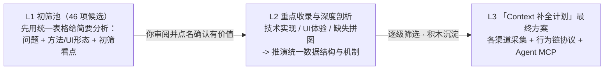

<p align="center">
  
</p>

[🏠 首页索引（当前页）](#context-补全计划--the-context-instrumentality-project) ｜ [📡 采集渠道调研](docs/research/channels.md) ｜ [🧩 整合方法与架构](docs/research/integration-methods.md) ｜ [📦 开源项目精读 (24)](docs/research/projects-digest.md) ｜ [📄 论文与博客精读 (22)](docs/research/papers-blogs-digest.md) ｜ [💡 启发与格式设计](docs/research/design-reflections.md) ｜ [🎙️ 音频通道](docs/research/channel-audio.md) ｜ [📋 剪切板通道](docs/research/channel-clipboard.md)

# Context 补全计划 · The Context Instrumentality Project

> **探索与任务定义阶段 · 逐级筛选与方案演进工作台**  
> 本项目仍处于**探索与任务定义阶段**。我们不提前下僵化的结论，而是以首页作为**“初筛总表 → 重点深挖 → 方案收敛”**的工作台：先用统一表格简要展示候选先驱与研究脉络；当你认为某个项目确实有价值并拍板关注后，再进入重点收录区做技术/UI 深度剖析与格式推演，逐级筛选并拼合出最终方案。

---

## 目录导航

- [🔄 我们的研究与设计方法：三级逐级筛选漏斗](#-我们的研究与设计方法三级逐级筛选漏斗)
- [📋 第一级（L1）：候选项目初筛简要分析总表（24 项）](#-第一级l1候选项目初筛简要分析总表24-项)
  - [1.1 开源项目初筛简要分析总表（24 项）](#11-开源项目初筛简要分析总表24-项)
  - [1.2 学术论文与工程报告初筛速查表（22 篇）](#12-学术论文与工程报告初筛速查表22-篇)
- [⭐ 第二级（L2）：重点收录与深度分析（你确认有价值后深挖）](#-第二级l2重点收录与深度分析你确认有价值后深挖)
  - [No.01 · Promnesia — 算法自动收藏整理与整体行为流 Web Context 格式](#no01--promnesia--算法自动收藏整理与整体行为流-web-context-格式)
- [🧩 第三级（L3）：正在收敛的「Context 补全计划」方案拼图](#-第三级l3正在收敛的context-补全计划方案拼图)
- [📚 附录：专题研究归档与仓库结构](#-附录专题研究归档与仓库结构)

---

## 🔄 我们的研究与设计方法：三级逐级筛选漏斗



| 筛选层级 | 在解决什么问题 | 准入条件与产出 | 查看位置 |
| :---: | :--- | :--- | :--- |
| **L1 · 初筛总表** | 快速扫完先驱项目“在解决什么、用了什么技术/UI、有没有可用应用”，降低信息过载 | 全量列出 **24 项开源项目 + 22 篇论文/报告** 简要分析；详细背景保留在独立档案中 | [下方 L1 表格](#-第一级l1候选项目初筛简要分析总表24-项) |
| **L2 · 重点收录** | 只对真正打动我们的项目做耗时深挖，追问它离“整体用户行为 Context”还差哪一步 | 经你确认有价值后收录：拆解技术/UI 亮点 → 剖析缺失 → 推演并兼容扩展 Schema | [下方 L2 专区](#-第二级l2重点收录与深度分析你确认有价值后深挖) · [design-reflections.md](docs/research/design-reflections.md) |
| **L3 · 方案收敛** | 防止调研停留在零散点子，把通过筛选的设计积木逐步拼成完整可执行方案 | 持续追踪哪些模块已有定稿草案、哪些环节正等待从 L1 池继续挑人补位 | [下方 L3 拼图](#-第三级l3正在收敛的context-补全计划方案拼图) · [context-event.schema.json](schema/context-event.schema.json) |

---

## 📋 第一级（L1）：候选项目初筛简要分析总表（24 项）

> [!NOTE]
> **怎么用这两张表？**  
> 本节只给客观、紧凑的**初筛简要分析**（完整“问题 / 方法 / Before vs. After”四维详卡已完整归档在 [projects-digest.md](docs/research/projects-digest.md) 与 [papers-blogs-digest.md](docs/research/papers-blogs-digest.md)）。看到你觉得有意思的项目，直接在对话里点名编号（如“展开看看 #7、#15”），我们再将值得保留的设计推进 L2 深度推演。

### 1.1 开源项目初筛简要分析总表（24 项）

| # | 方向 | 项目（仓库 · 详卡） | 1. 解决什么问题（简要） | 2. 核心方法与 UI / 应用形态 | 3. 初筛看点（供你判断是否深挖） | 筛选状态 |
| :---: | :---: | :--- | :--- | :--- | :--- | :---: |
| 1 | 归档 | **[Promnesia](https://github.com/karlicoss/promnesia)** · [详卡](docs/research/projects-digest.md) | 重访网页时找回以前在聊天、笔记里讨论/保存过它的上下文 | 多源索引器 + URL 归一化 + 本地 SQLite；**有完整 Chrome/Firefox 侧边栏扩展 + 后端** | 原位侧边栏交互、自动挖掘链接历史与 `locator` 溯源机制 | ⭐ 已入选 L2 ([No.01](#no01--promnesia--算法自动收藏整理与整体行为流-web-context-格式)) |
| 2 | 归档 | **[HPI](https://github.com/karlicoss/HPI)** · [详卡](docs/research/projects-digest.md) | 统一微信/浏览器/GitHub 等混乱导出格式 | 原档不动落盘 + Python `my.*` 迭代器适配层；**纯 Python 库 / CLI（无 GUI）** | `L0` 原件不可变落盘与下游重算解耦原则 | ⏳ 待你审阅筛选 |
| 3 | 归档 | **[Timelinize](https://github.com/timelinize/timelinize)** · [详卡](docs/research/projects-digest.md) | 将多平台消息/照片/位置汇成离线人生时间轴 | Go 解析引擎 + 本地 SQLite/文件库；**完整本地桌面 / Web 时间轴应用** | UTC 跨渠道公共主键，兼容批导入与实时事件 | ⏳ 待你审阅筛选 |
| 4 | 归档 | **[Dogsheep](https://dogsheep.github.io/)** · [详卡](docs/research/projects-digest.md) | 让吃灰的多平台导出数据可直接联合 SQL/全文查询 | `*-to-sqlite` 微型 CLI 集群；**CLI + Datasette 网页查询界面** | **单文件 SQLite + FTS5** 零运维轻量存储底座 | ⏳ 待你审阅筛选 |
| 5 | 采集 | **[ActivityWatch](https://github.com/ActivityWatch/activitywatch)** · [详卡](docs/research/projects-digest.md) | 客观记录桌面软件焦点时长与离开电脑区间（AFK） | 模块化 Watcher + Heartbeat 状态合并 + REST API；**完整桌面托盘 + Web 看板** | AFK 间隙切分任务段（Episode）与心跳去重合并 | ⏳ 待你审阅筛选 |
| 6 | 采集 | **[Maccy](https://github.com/p0deje/Maccy)** (+ ClipContext) · [详卡](docs/research/projects-digest.md) | 保留系统每次复制片段并防密码泄露 | 监听 `NSPasteboard.changeCount` + `nspasteboard.org` 过滤；**macOS 状态栏应用 / MCP 原型** | 高意图低噪文本通道，可作本仓已有剪贴板端演进参考 | ⏳ 待你审阅筛选 |
| 7 | 采集 | **[Defuddle](https://github.com/kepano/defuddle) & [Clipper](https://github.com/obsidianmd/obsidian-clipper)** · [详卡](docs/research/projects-digest.md) | 剥除网页导航/广告脚本，只提炼纯净文章 Markdown | 现代 DOM 结构识别 + 去噪转 Markdown；**开源 JS 库 + 成熟浏览器剪藏扩展** | 浏览器正文高纯度抽取候选首选，保代码与公式 | ⏳ 待你审阅筛选 |
| 8 | 采集 | **[Mozilla Readability](https://github.com/mozilla/readability)** · [详卡](docs/research/projects-digest.md) | 无需手写选择器即可抽取各类老旧异构网页正文 | DOM 文本与超链接密度启发式打分；**纯 JS 库（Firefox 阅读模式内核）** | 与 `Defuddle` 搭配做双引擎 Fallback 兜底 | ⏳ 待你审阅筛选 |
| 9 | 采集 | **[WorldBrain Memex](https://github.com/WorldBrain/Memex)** · [详卡](docs/research/projects-digest.md) | 记住读过的网页正文关键词与页内手工重点 | 浏览器本地全文库 + 网页原位划词高亮/批注；**完整浏览器扩展 + 本地同步应用** | **“静默建索 + 划词/高亮提权”** 注意力评分模型 | ⏳ 待你审阅筛选 |
| 10 | 采集 | **[Omi](https://github.com/BasedHardware/omi)** · [详卡](docs/research/projects-digest.md) | 捕捉离开电脑桌的线下对话并转成摘要与待办 | VAD 切段 + ASR 转写 + 对话抽取 `action_items`；**可穿戴硬件 / App + 开源后端** | 录音到待办的三层解耦，与本仓 `record-for-agent` 互补 | ⏳ 待你审阅筛选 |
| 11 | 采集 | **[screenpipe](https://github.com/screenpipe/screenpipe) & [OpenRecall](https://github.com/openrecall/openrecall)** · [详卡](docs/research/projects-digest.md) | 解决无 API 封闭窗口内文字“看不见”的问题 | 定期截屏帧 + 本地 OCR 写入 SQLite；**桌面后台守护 + Web 回溯 UI** | **对照组参考**：全时截屏耗电/占盘且有商用许可限制 | ⏳ 待你审阅筛选 |
| 12 | 采集 | **[Atuin](https://github.com/atuinsh/atuin)** · [详卡](docs/research/projects-digest.md) | 让终端 Shell 历史带目录、耗时与退出码 | Shell Hook 写入结构化 SQLite；**完整 CLI + 交互式 `Ctrl+R` TUI** | 极轻 5 字段精准刻画开发者调试与排错轨迹 | ⏳ 待你审阅筛选 |
| 13 | 采集 | **[Dawarich](https://github.com/Freika/dawarich)** · [详卡](docs/research/projects-digest.md) | 私有掌控多年物理出行轨迹与常访地点标签 | 自托管定位上报汇总 + 地点聚类；**完整 Docker 自托管 Web 地图台** | 为核心 Schema 预留可选 `location / place` 线索 | ⏳ 待你审阅筛选 |
| 14 | 采集 | **[FunASR](https://github.com/modelscope/FunASR) · [SenseVoice](https://github.com/FunAudioLLM/SenseVoice) · [sherpa-onnx](https://github.com/k2-fsa/sherpa-onnx)** · [详卡](docs/research/projects-digest.md) | 离线高精度中英混读语音转写、加标点与说话人分离 | VAD + 流式/离线 ASR + ONNX C++ 端侧推理；**模型套件 / C++ / Python 推理引擎** | 本地语音隐私零上传，补齐音频通道关键一环 | ⏳ 待你审阅筛选 |
| 15 | 记忆 | **[OpenViking](https://github.com/volcengine/OpenViking)** · [详卡](docs/research/projects-digest.md) | 解决扁平向量 RAG 切片碎裂且狂烧 Token 问题 | `viking://` 虚拟文件系统 + L0/L1/L2 分层按需展开；**Context 数据库引擎 + SDK** | **分层渐进加载**作为 Agent MCP 出口契约候选 | ⏳ 待你审阅筛选 |
| 16 | 记忆 | **[Graphiti](https://github.com/getzep/graphiti)** · [详卡](docs/research/projects-digest.md) | 解决现实决策变更后新旧记忆打架的动态演进问题 | 双时序图谱（`valid_at / invalid_at`）+ 混合召回；**Python 服务 / MCP / 图谱引擎** | **不删旧史、关闭旧边**的双时间轴冲突消解规范 | ⏳ 待你审阅筛选 |
| 17 | 记忆 | **[Mem0](https://github.com/mem0ai/mem0)** (+ Chrome Ext) · [详卡](docs/research/projects-digest.md) | 跨多 AI 平台共享精简的个人核心记忆卡 | 两阶段抽取 `ADD/UPDATE/DELETE`；**SDK / 托管服务 + Chrome 跨平台注入扩展** | 跨 AI 网站侧边注入思路，同时需警惕有损删除原文风险 | ⏳ 待你审阅筛选 |
| 18 | 记忆 | **[Letta](https://github.com/letta-ai/letta)** · [详卡](docs/research/projects-digest.md) | 让 Agent 像 OS 管理内存一样自主翻查深历史 | Core / Recall / Archival 分层 + 夜间异步整理；**Agent Runtime + 管理面板 UI** | 夜间空闲异步整理（Sleep-time）与 MCP 工具定位边界 | ⏳ 待你审阅筛选 |
| 19 | 记忆 | **[cognee](https://github.com/topoteretes/cognee)** · [详卡](docs/research/projects-digest.md) | 打通语义向量模糊搜与知识图谱关系多跳检索 | 强类型 `DataPoint` + 异步 `ECL` 管线；**Python 框架 + 轻量可视化 UI** | 毫秒轻采集与后台慢认知（Cognify）异步解耦 | ⏳ 待你审阅筛选 |
| 20 | 应用 | **[MineContext](https://github.com/volcengine/MineContext)** · [详卡](docs/research/projects-digest.md) | 人不主动搜索时容易遗忘全天事项与隐含待办 | 后台活动聚合 + 主动工作日报 / Todo 提取；**完整桌面端应用** | `L4` 主动日报/漏项提醒展示形态（但避开重截屏采集） | ⏳ 待你审阅筛选 |
| 21 | 应用 | **[Khoj](https://github.com/khoj-ai/khoj)** · [详卡](docs/research/projects-digest.md) | 私有文档本地 AI 问答与定时研究摘要汇总 | 本地 LLM 接入 + 多端插件 + 定时 Automations；**完整 Web/桌面端 + Obsidian/Emacs 插件** | **Nightly Synthesis** 夜间把日流水折叠成干净 Markdown | ⏳ 待你审阅筛选 |
| 22 | 应用 | **[Second-Me](https://github.com/mindverse/Second-Me)** · [详卡](docs/research/projects-digest.md) | 让助手真正懂长期偏好与个人风格而非千篇一律 AI 腔 | 分层记忆对齐 + 本地小模型微调（Me-Alignment）；**完整桌面端 + 本地训练应用** | 明确“近期动态靠检索，长期风格才考虑微调”的阶段边界 | ⏳ 待你审阅筛选 |
| 23 | 应用 | **[personal-ai-memory](https://github.com/marswangyang/personal-ai-memory)** · [详卡](docs/research/projects-digest.md) | 用低依赖极简方式让浏览器记忆服务私有对话 | Chrome 插件采集 + 轻量本地后端；**开源轻量扩展 + 小型本地服务** | 提醒遵守开源个人工具“5 分钟零重依赖跑通”底线 | ⏳ 待你审阅筛选 |
| 24 | 应用 | **[web-recap](https://github.com/robzolkos/web-recap) & [Reading-Watch-List](https://github.com/swetas7/Reading-Watch-List-Extension-Local-LLM)** · [详卡](docs/research/projects-digest.md) | 待读清单/多标签页积压且不愿将网页正文上传云端 | 收集浏览正文 + 调用本地 Ollama 总结分类；**轻量化 Chrome 扩展原型** | 浏览器侧“本地小模型低成本初筛与两句摘要”可行范例 | ⏳ 待你审阅筛选 |

---

### 1.2 学术论文与工程报告初筛速查表（22 篇）

> [!TIP]
> **检索核实说明**：完整四维拆解见 [papers-blogs-digest.md](docs/research/papers-blogs-digest.md)。按严谨原则保留待复核标记：`PM-Bench` 的 `arXiv:2607.12385` 仅见于单一检索结果、`Nemori` 标题与 ID 对应关系部分核验、`From Memory to Action` 收录于 OpenReview 暂未对应 arXiv 编号。

| # | 类型 | 标题 / 机构 · 出处 | 1. 研究什么问题 / 痛点 | 2. 核心发现与方法（简要） | 3. 初筛看点 | 筛选状态 |
| :---: | :---: | :--- | :--- | :--- | :--- | :---: |
| 1 | 评测 | **LifeDialBench** · [arXiv:2604.11182](https://arxiv.org/abs/2604.11182) | 多模态连续生活流 + 对话交织在线记忆评估 | 对比有损摘要与原文检索，发现重度压缩常输给原文 RAG | 决定必须保留 `L0/L1` 原始证据链不可销毁 | ⏳ 待你审阅筛选 |
| 2 | 评测 | **STALE** · [arXiv:2605.06527](https://arxiv.org/abs/2605.06527) | 新计划悄悄推翻旧方案时的“隐式记忆冲突” | 构建 400 场景基准，前沿模型隐式冲突准确率最高仅 ~55.2% | 验证必须区分 `L1` 原档与带失效期的 `L3` 真相视图 | ⏳ 待你审阅筛选 |
| 3 | 评测 | **PM-Bench** · [arXiv:2607.12385](https://arxiv.org/abs/2607.12385) *(单一检索源)* | 跨 7 天长噪声流的前瞻性提醒（“到时候记得提醒我”） | 构造连续 7 天模拟基准（最佳 F1 ~65.1%），写时粗糙即退化 | 为未来主动触发（Proactive Trigger）提供设计标尺 | ⏳ 待你审阅筛选 |
| 4 | 评测 | **MemoryCD** · [arXiv:2603.25973](https://arxiv.org/abs/2603.25973) | 多年跨域持续写入后记忆库为何越用越笨 | 分析长期写入演化，低价值废话淹没高意图且矛盾积压 | 论证入口必须做“注意力权重 + 指纹去重”门控 | ⏳ 待你审阅筛选 |
| 5 | 评测 | **From Memory to Action** · OpenReview *(无确认 arXiv 号)* | 记住偏好后为何在实际调用工具做决策时仍出错 | 多步工具行动实证发现最大掉点落在“记住之后、行动之前” | 确立“以工具执行成功率而非聊天像不像”评估 Context | ⏳ 待你审阅筛选 |
| 6 | 评测 | **LongMemEval** · [arXiv:2410.10813](https://arxiv.org/abs/2410.10813) | 长周期跨会话提取、时序推算、更新与防胡编 | 确立 5 维标尺含时间推理与记不清时坦诚拒答（Abstention） | 约束 MCP 在低置信时返回空列表而非强行脑补 | ⏳ 待你审阅筛选 |
| 7 | 评测 | **LoCoMo** · [arXiv:2402.17753](https://arxiv.org/abs/2402.17753) | 横跨数周的多会话超长图文连续对话推理 | 构造超长多会话沙盒，硬塞长窗口在跨会话多跳仍落后人类 | 佐证需要主题聚簇与实体跳转链而非纯塞长窗口 | ⏳ 待你审阅筛选 |
| 8 | 架构 | **EM-LLM** · [arXiv:2407.09450](https://arxiv.org/abs/2407.09450) | 机械按字数切块腰斩完整叙事因果链 | 按大模型预测“惊喜度峰值”切情景块 + 召回相邻时间邻居 | 启发用空闲/切窗/话题拐点切分自然 Episode 并捞邻居 | ⏳ 待你审阅筛选 |
| 9 | 架构 | **Episodic Memory** · [arXiv:2502.06975](https://arxiv.org/abs/2502.06975) | 只存干瘪百科事实（Semantic）丢失踩坑过程记忆 | 从认知科学界定情景记忆五大特征，须与语义事实并行 | 启发 `L2 Episode 现场档案` 与 `L3 事实视图` 分工共存 | ⏳ 待你审阅筛选 |
| 10 | 架构 | **Zep** · [arXiv:2501.13956](https://arxiv.org/abs/2501.13956) | 多实体多跳且随日期修改状态的低延迟图记忆 | Episode → 双时序 Entity → Community 三层子图混合检索 | 图谱所有推论须顺指针追溯回原始 Episode 存证 | ⏳ 待你审阅筛选 |
| 11 | 架构 | **Mem0 Paper** · [arXiv:2504.19413](https://arxiv.org/abs/2504.19413) | 高成本长对话如何在写入端压缩并维护一致事实池 | 实证对比纯向量与图增强版 `ADD/UPDATE/DELETE` 压紧效果 | 借鉴其整理高层 `L3` 工作状态卡，严禁用于删 `L0/L1` | ⏳ 待你审阅筛选 |
| 12 | 架构 | **Nemori** · [arXiv:2508.03341](https://arxiv.org/abs/2508.03341) *(部分核验)* | 定时周期摘要反复录入同质背景导致废话膨胀 | 探索边界对齐与“预测-校准”偏差驱动的增量整理 | 引入信息增益闸门：遇到新词/新报错才高权重提炼 | ⏳ 待你审阅筛选 |
| 13 | 综述 | **Memory for Autonomous LLM Agents** · [arXiv:2603.07670](https://arxiv.org/abs/2603.07670) | 杂乱的 Agent 记忆技术路线缺少统一分析坐标系 | 基于 POMDP 提出 **Write – Manage – Read** 三轴生命周期 | 作为检查各阶段方案短板的架构体检三轴清单 | ⏳ 待你审阅筛选 |
| 14 | 奠基 | **Personal Knowledge Graphs** · *ICTIR 2019* (`DOI:10.1145/3341981.3344241`) | 定义以“用户个人（Me）”为原点的跨私密/公开图谱 | 系统确立 PKG 自我中心视角、动态演化与跨源实体连接准则 | 跨语音/剪贴板/Git 的最终粘合锚点是统一实体主键 | ⏳ 待你审阅筛选 |
| 15 | 奠基 | **Event Segmentation Theory (EST)** · *Psych. Bull.* 2007 | 物理感知流从不断开，人脑如何划分出一件件事 | 实证当场景/人物/意图突变导致“预测误差骤增”时形成事件边界 | 用 AFK / 切窗 / 说话人变更零成本切分事件边界 | ⏳ 待你审阅筛选 |
| 16 | 奠基 | **MyLifeBits & LSC** · *CACM* 2006 · [lifelogsearch.org](http://lifelogsearch.org/) | 20 年终身全数字记录到底卡在硬盘容量还是检索可读性 | 实证存下来很容易，沦为“只写不读的数据坟墓”才是致命伤 | 每个渠道接入前先定清结构、Agent 检索出口与过期清理 | ⏳ 待你审阅筛选 |
| 17 | 报告 | **Anthropic Engineering**：Effective context engineering for AI agents · [原文](https://www.anthropic.com/engineering/effective-context-engineering-for-ai-agents) | 长程多步 Agent 提示词爆表导致注意力稀释 | 主张压缩（Compaction）+ 结构化笔记 + **Just-in-Time 工具按需取回** | 本项目对外输出的核心规范：**轻量卡片 + 按需 MCP 工具** | ⏳ 待你审阅筛选 |
| 18 | 报告 | **Chroma Report**：Context Rot · [原文](https://research.trychroma.com/context-rot) | 百 K/百万大窗口是否真能无脑塞入全年个人历史 | 受控实验证明远未塞满窗口时准确率就骤降，相似废话最伤模型 | 从实证角度论证去重、降噪、分层召回是刚需 | ⏳ 待你审阅筛选 |
| 19 | 博客 | **Karlicoss**：Exobrain 系列工程文集 · [原文](https://beepb00p.xyz/) | 为何 95% 个人知识基建半年就因为太复杂弃坑 | 主张 Local-first、原档不动与极度克制引入重型服务 | 防过度设计的十年稳定压舱准则 | ⏳ 待你审阅筛选 |
| 20 | 博客 | **Simon Willison**：Personal Data Warehouses · [原文](https://simonwillison.net/2020/Nov/14/personal-data-warehouses/) | 个人开发者没法运维大数据集群怎么建跨源数仓 | 微型 CLI + 单文件 SQLite + Datasette 一周末零门槛跑通 | 坚定了单机极简存储选型信心 | ⏳ 待你审阅筛选 |
| 21 | 规范 | **`nspasteboard.org` & macOS 15.4+ 剪贴板规范** · [原文](http://nspasteboard.org/) | 剪贴板监听如何避免落盘密码且适配原生权限提示 | 内存门控跳过 `ConcealedType` 等标记 + 兼容 `accessBehavior` | 桌面剪贴板监听不可逾越的隐私与系统权限红线 | ⏳ 待你审阅筛选 |
| 22 | 规范 | **浏览器有效停留三层信号规范** · [Chrome idle](https://developer.chrome.com/docs/extensions/reference/api/idle) · [Page Visibility](https://developer.mozilla.org/en-US/docs/Web/API/Page_Visibility_API) | 后台开着几十个标签页挂机一晚怎么从采集端剔除 | `Visibility` ∩ `windows.onFocusChanged` ∩ `idle` 求交集计数 | 确定浏览器侧零算力高纯采集的前置门控逻辑 | ⏳ 待你审阅筛选 |

---

## ⭐ 第二级（L2）：重点收录与深度分析（你确认有价值后深挖）

> **板块规则**：只有经过你在 L1 表中审阅并确认“这个项目确实有价值 / 思路对味”后，我们才会为其立项 **L2 重点收录**：深挖其技术实现与 UI 体验 → 明确我们要吸收的部分 → 指出它在**整体用户行为 Context**上的空白 → 推演进我们的统一协议（目前入选：**1 / 24**）。

| 编号 | 启发源项目 | 你拍板保留的核心价值 | 离整体用户行为 Context 还缺什么 | 推演出的设计 / 协议落点 |
| :---: | :--- | :--- | :--- | :--- |
| **No.01** | **[Promnesia](https://github.com/karlicoss/promnesia)** | ① 算法自动收藏与内容整理 browsed 网页；② 浏览器侧边栏原位展示 | 仅存孤立 `Visit(norm_url, dt, context, locator)`，缺前因动机、注意力收藏分级与跨渠道后续行为链 | `WebBehaviorContextEvent` · [完整推演](docs/research/design-reflections.md) · [Schema](schema/context-event.schema.json) |

### No.01 · Promnesia — 算法自动收藏整理与整体行为流 Web Context 格式

- **🔍 技术实现与 UI 形态核实亮点**：
  - **技术底层**：用可插拔 Python 索引器 + `cannon.py` URL 归一化（去追踪参数、统一斜杠）+ 文本/AST 上下文提取，写入本地 SQLite（关键结构包含规范化 `url`、时间戳 `dt`、上下文片段 `context` 与源定位符 `locator`），并由本地轻量 HTTP 服务响应反查。
  - **UI 与可用性**：提供完整可用的 **Chrome / Firefox WebExtension + 服务端**（`pip install promnesia` 即跑），包含标签页角标命中数提示、网页链接历史标记及**原位侧边栏（Sidebar Overlay）**展示与一键跳回源文件。
- **💎 你看中并决定保留的核心价值**：
  1. **算法自动收藏与内容整理**：不依赖人手工点收藏夹，根据真实网页浏览信号，自动筛掉过眼噪音，沉淀高质量摘要与摘录片段。
  2. **浏览器侧边栏“原位展示”体验**：留在用户正在阅读的浏览器页面右侧原地浮现上下文，低打扰且无需额外切换 App 搜索。
- **🧩 离“整体用户行为 Context”还缺什么**：
  - Promnesia 的记录单元只是围绕单一 URL 聚合的孤立索引点 `Visit(norm_url, dt, context, locator)`，无法还原**网页浏览作为用户整体连续行为流的一环**：
    - 不知“为什么打开这一页”（来自某段语音讨论、AI 对话还是剪贴板报错？）；
    - 不区分 2 秒扫一眼的误点与 15 分钟精读并多次划词的文章；
    - 看完网页后复制代码、切回 IDE 的后续行动与之断裂。
- **📐 我们推演并采纳的格式（`WebBehaviorContextEvent`）**：
  1. **行为与自动收藏分级**：在 `context` 下引入 `curation_tier`（`transient` / `auto_curated` / `pinned`）与 `interactions`（`selection_count`、`copy_count`、`highlight_count`），结合停留 `dwell_ms`、滚动 `scroll_depth` 与 `attention` 得分自动决定收藏与整理深度。
  2. **分层自动整理产物**：在 `content` 下引入 `summary`（给侧边栏和 Agent 首轮召回省 Token）与 `excerpts[]`（带精确 DOM/行级 `locator` 与 `note` 的精选片段），长正文通过 `provenance.locator` 按需回溯。
  3. **整体行为因果链**：在事件根级新增 `episode_id`（同一工作流编号）与 `links[]`（`triggered_by` / `copied_to` / `discussed_in` / `same_anchor` + `confidence`），让同一份结构既驱动**浏览器双向侧边栏**（前因 + 本页整理 + 同 Episode 历史），又直通 **Agent MCP 分层拉取**。
  - 📄 完整对比表、Mermaid 流向与合法 JSON 示例：[design-reflections.md](docs/research/design-reflections.md) ｜ 🧩 协议定义：[schema/context-event.schema.json](schema/context-event.schema.json)

---

## 🧩 第三级（L3）：正在收敛的「Context 补全计划」方案拼图

> **收敛方式**：随着一个个项目从 **L1 初筛表** 被你挑进 **L2 深度推演**，我们把通过验证的设计积木陆续装配到下表中，最终汇聚形成完整的「Context 补全计划」工程方案。

| 方案拼图模块 | 收敛状态 | 依据来源（L2 已入选 / L1 待选） | 当前已敲定设计 / 下一步待你筛选的问题 |
| :--- | :---: | :--- | :--- |
| **1. 网页行为与自动收藏数据格式** | ✅ 已出兼容草案 | 源自 `No.01 Promnesia` | 采用 `WebBehaviorContextEvent`（兼容扩展 `context-event.schema.json`：增加 `summary`、`excerpts`、`curation_tier`、`interactions`、`episode_id`、`links`） |
| **2. 浏览器端交互形态（UI）** | ✅ 已出原型方向 | 源自 `No.01 Promnesia` | 采用**原位双向上下文侧边栏**：展示上游触发原因 + 算法自动整理的本页摘要/摘录 + 同 `episode_id` 跨渠道动作 |
| **3. 全局溯源与 URL 对齐底线** | ✅ 已出工程约束 | 源自 `No.01 Promnesia` | 所有 `L0/L1` 事件必须带可回跳 `provenance.locator`；跨渠道 URL 在写库早期统一归一化为 `url_norm` |
| **4. 网页正文纯净抽取与页内高亮信号** | ⏳ 待从 L1 筛选 | L1 候选：`#7 Defuddle & Clipper`、`#8 Readability`、`#9 WorldBrain Memex`、`#24 web-recap` | 你审阅 L1 表后确认：网页抽取组合是否选用 `Defuddle + Readability`、是否吸收 Memex 划词提权规则与 Ollama 初筛？ |
| **5. 桌面时间骨架、剪贴板与 Shell 开发态** | ⏳ 待从 L1 筛选 | L1 候选：`#5 ActivityWatch`、`#6 Maccy/ClipContext`、`#11 screenpipe (对照)`、`#12 Atuin` | 待确认桌面窗口与终端轨迹如何与已合入的 `ClipContext` 汇合成 `episode_id` 分段依据 |
| **6. 离线语音采集、转写与本地底座** | ⏳ 待从 L1 筛选 | L1 候选：`#2 HPI`、`#3 Timelinize`、`#4 Dogsheep`、`#10 Omi`、`#14 FunASR/SenseVoice/sherpa-onnx` | 待确认单机存储 `SQLite + FTS5` 与 `record-for-agent` 本地离线 ASR 的整合细节 |
| **7. 跨渠道记忆演进、检索协议与防退化** | ⏳ 待从 L1 筛选 | L1 候选：`#15 OpenViking`、`#16 Graphiti`、`#17 Mem0`、`#18 Letta`、`#19 cognee` 及论文池 #1–#18 | 待筛选 L2/L3 状态更新策略、渐进加载 MCP 工具面及抗 Context Rot / 隐式冲突约束 |

---

## 📚 附录：专题研究归档与仓库结构

### 专题研究文档归档

| 专题文档 | 里面有什么 | 最适合什么时候读 |
| :--- | :--- | :--- |
| [重点项目启发与格式设计 · design-reflections.md](docs/research/design-reflections.md) | **L2 深度推演专库**：记录每个入选重点项目的吸收点、缺失剖析、对比表与统一格式 JSON 样例 | 看完首页 L2 摘要后，深入看协议细节与 JSON 示例 |
| [开源项目四维精读 · projects-digest.md](docs/research/projects-digest.md) | **24 项** 开源项目的完整“问题 / 方法 / Before vs. After / 启示”独立长文归档 | 在 L1 初筛表中看中某个编号，想读它完整拆解时 |
| [论文与博客四维精读 · papers-blogs-digest.md](docs/research/papers-blogs-digest.md) | **16 篇论文 + 6 篇工程报告/规范** 的完整通俗四维拆解档案 | 想核对某篇基准/论文的数据实验细节与来源时 |
| [12 条采集渠道优先级对比 · channels.md](docs/research/channels.md) | 语音 / 浏览 / 剪贴板 / AI 对话 / 窗口 / Shell / 手机 / IM 的评估、工作量与红线 | 评估新传感器接入优先级与注意力评分公式细节 |
| [整合方法与架构选型 · integration-methods.md](docs/research/integration-methods.md) | 11 个先驱字段 Schema 对照、6 种融合策略横评、`L0 → L4` 架构及 MCP 工具草案 | 准备进入整体 Hub 融合与架构选型设计时 |
| [音频通道实盘盘点 · channel-audio.md](docs/research/channel-audio.md) | 已合入原型 `record-for-agent` 的 SQLite 布局、事件流、已有 MCP 与 5 大待补缺口 | 对接/改造本仓语音采集端代码时 |
| [剪贴板通道实盘盘点 · channel-clipboard.md](docs/research/channel-clipboard.md) | 已合入原型 `ClipContext` 的 `clipboard.json`、增量/撤销指纹与缺口 | 扩展桌面剪贴板监听代码时 |
| [早期全景调研初稿 · landscape.md](docs/research/landscape.md) | 立项初期对 Dark Context、生态空档与端侧硬件路线的草拟笔记 *(结论以后续篇为准)* | 回顾立项早期思考起点 |
| [架构设计草案 · RFC-0001](docs/rfc/0001-context-integration.md) · [事件协议 Schema](schema/context-event.schema.json) | `L0 → L4` 分层架构规范草案 + `ContextEvent` JSON Schema 校验文件 | 实际落地事件数据结构与接入校验时 |

### 仓库目录结构

```text
context-instrumentality-project/
├── README.md                              # 首页：L1 初筛总表 → L2 重点收录 → L3 方案拼图工作台
├── ROADMAP.md                             # 分阶段演进路线图
├── CONTRIBUTING.md                        # 开源协作指南
├── assets/
│   └── eva-context-banner.png             # EVA 档案风项目顶图（極秘 · CONTEXT 补全计划）
├── docs/
│   ├── github-projects-setup.md           # GitHub Issues / Project 看板初始化指南
│   ├── rfc/
│   │   └── 0001-context-integration.md    # RFC-0001：个人多源 Context 整合架构与分层规范
│   └── research/
│       ├── design-reflections.md          # L2 重点项目启发、缺失剖析与统一格式演进设计
│       ├── projects-digest.md             # 24 项开源项目四维精读完整归档
│       ├── papers-blogs-digest.md         # 16 篇论文 + 6 篇博客与规范四维精读完整归档
│       ├── channels.md                    # 12 条 Context 采集渠道优先级、信噪比与可行性分析
│       ├── integration-methods.md         # 11 个先驱系统横向对比与 L0–L4 整合方法研究
│       ├── channel-audio.md               # 音频采集端 record-for-agent 架构与缺口调研
│       ├── channel-clipboard.md           # 剪切板采集端 ClipContext 设计与 MCP 梳理
│       └── landscape.md                   # Dark Context 概念与生态版图初稿
├── schema/
│   ├── README.md                          # 事件规范说明
│   └── context-event.schema.json          # L1 统一 ContextEvent JSON Schema（已兼容扩展）
├── channels/
│   ├── README.md                          # 多渠道采集总览与接入约束
│   ├── audio/record-for-agent/            # 已合入：macOS 低功耗多源录音与状态采集原型
│   ├── clipboard/clipcontext/             # 已合入：macOS 剪切板历史与 MCP 检索原型（含 README）
│   ├── browser/README.md                  # 规划中：三层有效停留 + Defuddle/Readability 正文采集
│   ├── window/README.md                   # 规划中：桌面应用焦点与 AFK 状态区间采集
│   └── ai-chat/README.md                  # 规划中：跨 AI 工具对话轨迹归档与回流
├── hub/
│   └── README.md                          # 规划中：L1 SQLite/FTS5 底座 + L2 Episode 聚合 + MCP 出口
├── project/
│   └── issues.json                        # Roadmap 种子 Issue 列表
├── scripts/
│   └── bootstrap_github.py                # 批量同步 GitHub Project / Issues 辅助脚本
└── tests/
    └── test_bootstrap_github.py           # 自动化脚本单元测试
```

### 项目协作与许可证

- 研发任务拆解、里程碑与开源协作方式见 [ROADMAP.md](ROADMAP.md)、[CONTRIBUTING.md](CONTRIBUTING.md) 与 [docs/github-projects-setup.md](docs/github-projects-setup.md)（配合 [project/issues.json](project/issues.json) 与 [scripts/bootstrap_github.py](scripts/bootstrap_github.py)）。
- 开源许可证（License）将在进入稳定代码协同与外部插件生态阶段前补充确定。
