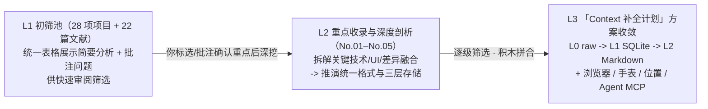

<p align="center">
  
</p>

# Context 补全计划 · The Context Instrumentality Project

<a name="app-checklist"></a>

## 应用验收清单

最近核对于 **2026-11-22**。表中「已验」只覆盖写明的版本、环境和操作。「待验」表示已有实现或样例，仍缺这一环的证据。「待接」表示这条路径尚未实现。完整度按可用功能和剩余缺口记录。

| 应用 | 功能完整度 | UI 情况 | Context 接入 | Agent 使用 |
| --- | --- | --- | --- | --- |
| <a name="check-audio"></a>**[录音 · Record for Agent](channels/audio/record-for-agent/AgentBridge/README.md)** | 两场真机长录的序号连续。复查同一批 173 段，手机持久收到 76 段，其中一场完整收到 61/61 段。手机的 76 段逐一匹配表端确认，余下 97 段音频均在手表。[REC-47](https://linear.app/zhiming-app/issue/REC-47) | Watch 模拟器已验录制和归档两页，iPhone 已验手机实收、手表待确认和状态未知的显示。改版待审，真机操作待验。[REC-60](https://linear.app/zhiming-app/issue/REC-60) | 日常 Mac 收件库、投递回执和 Hub 均命中 0/173 段。用户选段经定向导入隔离 Hub 已验。 | 日常录音 MCP 和 Hub MCP 均可调用，本批可见 0/173。独立 Codex 已从隔离 Hub 找回获准的一句及出处。[整批核对](docs/verification/2026-11-22-source-to-agent.md#日常链路逐段复查) · [单句回查](docs/verification/2026-11-22-source-to-agent.md#真机单句回查) |
| <a name="check-clipboard"></a>**[剪贴板 · ClipContext](channels/clipboard/clipcontext/README.md)** | 0.1.4/build 5 预发行应用已验受控复制、排除隐藏项及重启后续写。 | 卡片和列表有局部验收；0.1.4 普通图形会话的跨 App 自动粘贴待验。 | 发布端实产归档显式导入得到 4 Raw / 3 Memory，重导新增 0 条。 | 默认隐藏。单条授权后，真实 Codex 从 Hub 逐字找回重启后的测试口令，Raw ID 和出处均匹配。[验收记录](docs/verification/2026-11-22-source-to-agent.md#剪贴板) |
| <a name="check-wechat"></a>**微信 · Mac 采集工具** | 已实现历史文件导入、前台 OCR、周期导出；真实会话漏收率待测。[PR #8](https://github.com/BENZEMA216/context-instrumentality-project/pull/8) | 启动器引导选择标题和消息区域，记录在 Hub 管理页查看；真窗口校准待验。 | 已用合成历史和真实 Vision 识别的合成画面验证入库、去重。屏外消息不在 OCR 覆盖范围。 | 合成验收中 Agent 看不到仅本机记录；明确授权后的会话原文回查待验。 |
| <a name="check-browser"></a>**浏览器 · 摘录扩展** | 主动保存选区、原网址、标题和时间已验；URL 隐私处理待补。 | Chrome 158 在合成网页实测弹窗保存、撤销，本地条目数 0 → 1 → 0。 | 原型写入扩展本地存储。扩展 → Hub 待接。 | 等待接入后验证 Agent 能找回选区原句和网页出处。 |
| <a name="check-chat-history"></a>**[Agent 对话历史](https://github.com/BENZEMA216/context-instrumentality-project/pull/13)** | 已将多个客户端的本机历史和账户导出按来源、会话、用户及助手消息整理。各云账户的全量覆盖仍待核对。 | 本地索引和项目记忆支持按主题回到证据，另可用 CLI 按会话查看。 | 实际私有库已生成逐消息 Raw、摘录 Memory 和跨轮项目记忆，可从 Memory 定位原消息。[REC-67](https://linear.app/zhiming-app/issue/REC-67) | 默认仅所有者可查。隔离样本通过真实 MCP 验过单条授权、回查和删除。[实现与测试](https://github.com/BENZEMA216/context-instrumentality-project/pull/13) |
| <a name="check-hub"></a>**Context Hub** | Raw 和 Memory 的增删查改、周期提取及权限检查已验。[PR #2](https://github.com/BENZEMA216/context-instrumentality-project/pull/2) | 真实浏览器已验列表、编辑、来源回查、冲突保留草稿及窄屏布局。 | 已验剪贴板发布端归档、录音测试包和通用事件的显式导入。持续到达仍按渠道核对。 | 仅授权一条剪贴板样本后，独立 Codex 检索 Memory 并按 ID 回查 Raw，原句和出处匹配。[验收记录](docs/verification/2026-11-22-source-to-agent.md#剪贴板) |
| <a name="check-vault"></a>**Context Vault** | 加密资料管理、单次授权和导入已实现；跨设备 iCloud 投递待验。[PR #4](https://github.com/BENZEMA216/context-instrumentality-project/pull/4) | Mac 管理页操作已验；iPhone 模拟器已验文件投递，真机拍照扫描待验。 | 用户主动分享后，Hub 收到脱敏操作回执；私密原件保留在 Vault。 | 已验 Agent 通过 MCP 申请、所有者在 Mac 批准、Agent 单次执行并收到回执。[授权与回执](https://github.com/BENZEMA216/context-instrumentality-project/blob/ea3409679287d0c174303d46efc4fdb8d0193d1b/vault/README.md#agent-使用授权与-context-hub) |

**下一轮验收**　录音和剪贴板优先，可并行验收。勾选时在对应行补上日期、版本和证据。分工和缺陷见 [Linear 渠道看板](https://linear.app/zhiming-app/project/context-补完计划-渠道接入与验收-b0bb633d4d52)，工单需要工作区访问权限。

- [x] **录音 · 单段回查**　真机片段已核对手表与手机回执。用户选段后，通过 Mac 和隔离 Hub，独立 Codex 逐字找回获准的一句转写及出处。[验收记录](docs/verification/2026-11-22-source-to-agent.md#真机单句回查)
- [ ] **录音 · 日常自动交付**　逐段核对手机补传、Mac 投递回执与日常 Agent 可见性。录音消费 skill / prompt 已标记，待人工验证和撰写。[REC-61](https://linear.app/zhiming-app/issue/REC-61) · [REC-66](https://linear.app/zhiming-app/issue/REC-66)
- [x] **Agent 对话历史 · 本机整理**　已用真实历史生成本地索引、摘录和有原消息依据的项目记忆。已登录网页的可见历史与完整账户导出分别核对。[REC-67](https://linear.app/zhiming-app/issue/REC-67)
- [x] **剪贴板**　0.1.4/build 5 预发行应用已完成受控复制、重启、Hub 重导、排除项与 Agent 原句回查（2026-11-22）。[REC-62](https://linear.app/zhiming-app/issue/REC-62)
- [ ] **微信**　在标题唯一的测试会话中切换、恢复和滚动，核对漏收、误收及获准后的原文回查。[REC-63](https://linear.app/zhiming-app/issue/REC-63)
- [ ] **浏览器**　保存一个选区到 Hub，验证 URL 处理、重复提交、撤销和 Agent 引用原句。[REC-64](https://linear.app/zhiming-app/issue/REC-64)
- [x] **Context Hub**　剪贴板发布应用采集受控文本后，单条授权可查用时 ≤104.484 秒，Codex 找回并核对原句用时 ≤126.693 秒。包含定时归档和显式导入。[本次测量](docs/verification/2026-11-22-source-to-agent.md#剪贴板) · [Hub 工作项](https://github.com/BENZEMA216/context-instrumentality-project/issues/1)
- [ ] **Context Vault**　用 iPhone 真机扫描一份测试材料，经用户自己的 iCloud 在另一设备入库，再核对授权回执。[Vault 工作项](https://github.com/BENZEMA216/context-instrumentality-project/issues/3)

[窗口焦点](channels/window/README.md)已有采集方案。Hub（#2）、Vault（#4）、微信（#8）和对话历史（#13）的实现均待合并。

## 研究工作台

[📊 Google Sheet 在线筛选总表](https://docs.google.com/spreadsheets/d/1ggWJjSIKsgY5Wro-GPciEo9AhJOD4gEi-DQv5uCHRbg/edit) ｜ [🏠 首页索引（当前页）](#context-补全计划--the-context-instrumentality-project) ｜ [📡 采集渠道调研](docs/research/channels.md) ｜ [🧩 整合方法与架构](docs/research/integration-methods.md) ｜ [📦 开源项目精读 (28)](docs/research/projects-digest.md) ｜ [📄 论文与博客精读 (22)](docs/research/papers-blogs-digest.md) ｜ [💡 启发与格式设计](docs/research/design-reflections.md) ｜ [🎙️ 音频通道](docs/research/channel-audio.md) ｜ [📋 剪切板通道](docs/research/channel-clipboard.md)

### 立项说明

> **探索与任务定义阶段 · 逐级筛选与方案演进工作台**  
> 本项目仍处于**探索与任务定义阶段**。我们不提前下僵化的结论，而是以首页及配套的 **[📊 Google Sheet 在线筛选工作台](https://docs.google.com/spreadsheets/d/1ggWJjSIKsgY5Wro-GPciEo9AhJOD4gEi-DQv5uCHRbg/edit)** 作为**“初筛总表 → 重点深挖 → 方案收敛”**的工作台：先用统一表格简要展示候选先驱与研究脉络；当你认为某个项目确实有价值并拍板关注后，再进入重点收录区做技术/UI 深度剖析与格式推演，逐级筛选并拼合出最终方案。

---

## 目录导航

- [🔄 我们的研究与设计方法：三级逐级筛选漏斗](#-我们的研究与设计方法三级逐级筛选漏斗)
- [📋 第一级（L1）：候选项目初筛简要分析总表（28 项）](#-第一级l1候选项目初筛简要分析总表28-项)
  - [1.1 开源项目初筛简要分析总表（28 项）](#11-开源项目初筛简要分析总表28-项)
  - [1.2 学术论文与工程报告初筛速查表（22 篇）](#12-学术论文与工程报告初筛速查表22-篇)
- [⭐ 第二级（L2）：重点收录与深度分析（5 组重点推演）](#-第二级l2重点收录与深度分析5-组重点推演)
  - [No.01 · Promnesia — 算法自动收藏整理与整体行为流 Web Context 格式](#no01--promnesia--算法自动收藏整理与整体行为流-web-context-格式)
  - [No.02 · HPI — L0 原档不可变落盘与增量 SQLite 缓存三层架构](#no02--hpi--l0-原档不可变落盘与增量-sqlite-缓存三层架构)
  - [No.03 · Timelinize — 三维时空主轴与跨平台身份归一](#no03--timelinize--三维时空主轴与跨平台身份归一)
  - [No.04 · 浏览器纯净 Context 联合管线（Defuddle + Readability + 极简 Memex）](#no04--浏览器纯净-context-联合管线defuddle--readability--极简-memex)
  - [No.05 · 录音手表 App 与位置轨迹 App 技术移植方案](#no05--录音手表-app-与位置轨迹-app-技术移植方案)
  - [附：表格批注重点问题快速结论（#5 ActivityWatch · #11 screenpipe · #23 淘汰原因）](#附表格批注重点问题快速结论5-activitywatch--11-screenpipe--23-淘汰原因)
- [🧩 第三级（L3）：正在收敛的「Context 补全计划」方案拼图](#-第三级l3正在收敛的context-补全计划方案拼图)
- [📚 附录：专题研究归档与仓库结构](#-附录专题研究归档与仓库结构)

---

## 🔄 我们的研究与设计方法：三级逐级筛选漏斗



| 筛选层级 | 在解决什么问题 | 当前推进状态 | 查看位置 |
| :---: | :--- | :--- | :--- |
| **L1 · 初筛总表** | 快速扫完先驱项目“在解决什么、技术/UI 形态、初步看点”，记录批注筛选 | **28 项项目**（含针对性补充 4 项）+ **22 篇文献**；已标出入选/待了解/备选/淘汰状态 | [下方 L1 表格](#-第一级l1候选项目初筛简要分析总表28-项) · [📊 Google Sheet 同步表](https://docs.google.com/spreadsheets/d/1ggWJjSIKsgY5Wro-GPciEo9AhJOD4gEi-DQv5uCHRbg/edit) |
| **L2 · 重点收录** | 对你标为高价值和点名追问的项目逐一做技术深挖、对比融合与方案移植 | 已展开 **No.01–No.06 逐项独立深度推演**（含 14 个重点子项架构与迁移细节） | [下方 L2 专区](#-第二级l2重点收录与深度分析5-组重点推演) · [design-reflections.md](docs/research/design-reflections.md) |
| **L3 · 方案收敛** | 把通过筛选的设计积木陆续装配为统一协议与端侧工程蓝图 | 核心格式、Markdown 产物规范、浏览器抽取及手表/位置方案已有草案；记忆整合进入下一轮筛选 | [下方 L3 拼图](#-第三级l3正在收敛的context-补全计划方案拼图) · [context-event.schema.json](schema/context-event.schema.json) |

---

## 📋 第一级（L1）：候选项目初筛简要分析总表（28 项）

> [!NOTE]
> **怎么用这两张表（已双向同步在线 Google Sheet）？**  
> - **在线交互筛选与批注**：已完整同步至 **[📊 Google Sheet 筛选工作台](https://docs.google.com/spreadsheets/d/1ggWJjSIKsgY5Wro-GPciEo9AhJOD4gEi-DQv5uCHRbg/edit)**（内含 **`L1_开源项目初筛_28项`**、**`L1_论文与报告初筛_22篇`**、**`L2_重点收录深度剖析`**（14 项独立深挖行）、**`L3_方案收敛拼图`** 4 张分表，均已设置列宽、表头样式与状态下拉筛选）。  
> - **本轮已完成第一轮筛选对齐**：你在表格中的批注与状态已全部同步到下方总表与 [design-reflections.md](docs/research/design-reflections.md)。

### 1.1 开源项目初筛简要分析总表（28 项）

| # | 方向 | 项目（仓库 · 详卡） | 1. 解决什么问题 & 核心技术 / UI 形态 | 2. 你的批注 / 关键看点回应 | 筛选状态 |
| :---: | :---: | :--- | :--- | :--- | :---: |
| 1 | 归档 | **[Promnesia](https://github.com/karlicoss/promnesia)** · [详卡](docs/research/projects-digest.md) | 重访网页找回历史关联上下文；多源索引 + URL 归一化 + SQLite；**Chrome/Firefox 侧边栏** | 算法自动收藏分级 + 原位双向侧边栏 + `WebBehaviorContextEvent` 起点 | ⭐ 已入选 L2 ([No.01](#no01--promnesia--算法自动收藏整理与整体行为流-web-context-格式)) |
| 2 | 归档 | **[HPI](https://github.com/karlicoss/HPI)** · [详卡](docs/research/projects-digest.md) | 统一各平台导出格式；原档不动落盘 + `dal.py` + `@cachew` SQLite 增量缓存（纯 Python） | **回应「技术细节很关键」**：已深挖 `raw/` 不覆盖原件 + `@cachew` 随时删除重算机制 | ⭐ 已入选 L2 ([No.02](#no02--hpi--l0-原档不可变落盘与增量-sqlite-缓存三层架构)) |
| 3 | 归档 | **[Timelinize](https://github.com/timelinize/timelinize)** · [详卡](docs/research/projects-digest.md) | 多平台消息/照片/位置离线时间轴；Go 引擎 + Blob 去重 + 桌面/Web 界面 | 推动 Schema 根级落地 `location` 字段，确立“时间 × 地点 × 人物”三维主轴 | ⭐ 已入选 L2 ([No.03](#no03--timelinize--三维时空主轴与跨平台身份归一)) |
| 4 | 归档 | **[Dogsheep](https://dogsheep.github.io/)** · [详卡](docs/research/projects-digest.md) | 导出包 SQL/全文检索；微型 CLI + 单文件 SQLite/FTS5 + Datasette 网页后台 | **底座范式参考**：与 `#2 HPI` 上下游绝配，零运维单文件全文底座 | 🔍 待进一步了解 |
| 5 | 采集 | **[ActivityWatch](https://github.com/ActivityWatch/activitywatch)** · [详卡](docs/research/projects-digest.md) | 桌面窗口焦点与空闲 AFK 记录；Heartbeat 合并 + `localhost:5600` API + Web 看板 | **回应「与苹果屏幕时间区别」**：精细到窗口标题/URL、开源可编程、带 AFK 切段（见 [快速结论](#附表格批注重点问题快速结论5-activitywatch--11-screenpipe--23-淘汰原因)） | 🔍 待进一步了解 |
| 6 | 采集 | **[Maccy](https://github.com/p0deje/Maccy)** (+ ClipContext) · [详卡](docs/research/projects-digest.md) | 监听 `NSPasteboard.changeCount` + `nspasteboard.org` 过滤密码 | **确认自研基座**：继续演进本仓 `ClipContext`，补窗口标题与浏览器 `copied_to` 关联 | 🏠 本仓自研基座 |
| 7 | 采集 | **[Defuddle](https://github.com/kepano/defuddle) & [Clipper](https://github.com/obsidianmd/obsidian-clipper)** · [详卡](docs/research/projects-digest.md) | 现代 DOM 去噪抽取纯净正文转 Markdown（保代码块/公式/Frontmatter）；JS 库 + 扩展 | **回应「联合前面网页项目」**：作为浏览管线一级主抽，吐出干净 Markdown 存盘 | ⭐ 已入选 L2 ([No.04](#no04--浏览器纯净-context-联合管线defuddle--readability--极简-memex)) |
| 8 | 采集 | **[Mozilla Readability](https://github.com/mozilla/readability)** · [详卡](docs/research/projects-digest.md) | 老旧异构网页正文 DOM 启发式打分；Firefox 阅读模式纯 JS 内核 | **回应「与 7 的区别和融合」**：`Defuddle` 主抽现代文档 + `Readability` 兜底老旧页 | ⭐ 已入选 L2 ([No.04](#no04--浏览器纯净-context-联合管线defuddle--readability--极简-memex)) |
| 9 | 采集 | **[WorldBrain Memex](https://github.com/WorldBrain/Memex)** · [详卡](docs/research/projects-digest.md) | 已读网页本地全文 + 原位划词高亮；完整浏览器扩展 | **回应「输入侧如何简化」**：砍掉手动弹窗，只靠 `selectionchange` 停顿与 `copy` 自动入摘录并提权 | ⭐ 已入选 L2 ([No.04](#no04--浏览器纯净-context-联合管线defuddle--readability--极简-memex)) |
| 10 | 采集 | **[Omi](https://github.com/BasedHardware/omi)** · [详卡](docs/research/projects-digest.md) | 线下随口对话捕捉转摘要与待办；可穿戴硬件 / App + VAD + ASR | **回应「手表 App 技术移植」**：提炼端侧 VAD 省电门控、离线续传、15s 声纹区分与封口出 Markdown | ⭐ 已入选 L2 ([No.05](#no05--录音手表-app-与位置轨迹-app-技术移植方案)) |
| 11 | 采集 | **[screenpipe](https://github.com/screenpipe/screenpipe) & [OpenRecall](https://github.com/openrecall/openrecall)** · [详卡](docs/research/projects-digest.md) | 定时桌面截屏 + 本地 OCR；后台守护 + Web 回溯台 | **回应「用在哪儿与用户反馈」**：社区反馈持续开导致高功耗/占盘；仅作快捷键单帧捉屏或会议低频抽帧用例（见 [快速结论](#附表格批注重点问题快速结论5-activitywatch--11-screenpipe--23-淘汰原因)） | 🔍 待进一步了解 |
| 12 | 采集 | **[Atuin](https://github.com/atuinsh/atuin)** · [详卡](docs/research/projects-digest.md) | 终端 Shell 结构化历史（目录/耗时/退出码）；Rust CLI + TUI | **赞同批注 (`only for developer`)**：定位为程序员高阶可选插件，不作大众必选项 | ⚙️ 开发者可选模块 |
| 13 | 采集 | **[Dawarich](https://github.com/Freika/dawarich)** · [详卡](docs/research/projects-digest.md) | 自托管长期物理定位与常访地点聚类；Docker Web 地图台 | **回应「先行改造成 App」**：配合 `#27 Overland` 零耗电采集 -> Hub 聚类 `StayPoint` 合并每日足迹 | ⭐ 已入选 L2 ([No.05](#no05--录音手表-app-与位置轨迹-app-技术移植方案)) |
| 14 | 采集 | **[FunASR](https://github.com/modelscope/FunASR) · [SenseVoice](https://github.com/FunAudioLLM/SenseVoice) · [sherpa-onnx](https://github.com/k2-fsa/sherpa-onnx)** · [详卡](docs/research/projects-digest.md) | 全离线中英混读语音转写、标点与声纹分离；C++/Swift/ONNX 引擎 | **ASR 选型锁定**：端侧用 `sherpa-onnx + SenseVoice-Small + FSMN-VAD + CAM++` | ⭐ 已入选 L2 ([No.05](#no05--录音手表-app-与位置轨迹-app-技术移植方案)) |
| 15 | 记忆 | **[OpenViking](https://github.com/volcengine/OpenViking)** · [详卡](docs/research/projects-digest.md) | `viking://` 虚拟目录 L0/L1/L2 分层渐进加载上下文 | **向量化备选**：下一轮重点评审的分层检索 MCP 契约候选 | 🗂️ 架构备选池 |
| 16 | 记忆 | **[Graphiti](https://github.com/getzep/graphiti)** · [详卡](docs/research/projects-digest.md) | 双时序动态知识图谱（`valid_at / invalid_at`）不删旧边消解冲突 | **整合备选**：下一轮重点评审，主要解决计划更新冲突 | 🗂️ 架构备选池 |
| 17 | 记忆 | **[Mem0](https://github.com/mem0ai/mem0)** (+ Chrome Ext) · [详卡](docs/research/projects-digest.md) | `ADD/UPDATE/DELETE` 动态记忆池 + 跨 AI 网页扩展注入 | **整合备选**：借其跨网页 AI 注入形式，严禁直接 DELETE 原始事件 | 🗂️ 架构备选池 |
| 18 | 记忆 | **[Letta](https://github.com/letta-ai/letta)** · [详卡](docs/research/projects-digest.md) | 类 OS 虚拟内存（Core / Recall / Archival）+ 夜间异步整理 | **整合备选**：重点借用夜间 Sleep-time 定时整合生成每日 Markdown | 🗂️ 架构备选池 |
| 19 | 记忆 | **[cognee](https://github.com/topoteretes/cognee)** · [详卡](docs/research/projects-digest.md) | 强类型 `DataPoint` + 异步 `ECL` 管线同时驱动图+向量库 | **整合备选**：参考其“毫秒轻采集与后台慢认知解耦”编排 | 🗂️ 架构备选池 |
| 20 | 应用 | **[MineContext](https://github.com/volcengine/MineContext)** · [详卡](docs/research/projects-digest.md) | 后台桌面活动聚合主动日报/待办；完整桌面端 | **尊重判断淘汰**：其唯一可留的每日 Markdown 复盘已由 `Khoj/HPI` 路线覆盖 | ❌ 暂不采纳 |
| 21 | 应用 | **[Khoj](https://github.com/khoj-ai/khoj)** · [详卡](docs/research/projects-digest.md) | 本地文档问答 + 定时 Nightly Synthesis 摘要；Web/桌面/Obsidian 插件 | **确立核心原则**：**“Markdown 一定是 context 整理的一个产物”**，落地为 L2 输出层 | ⭐ 已入选 L2 ([No.02](#no02--hpi--l0-原档不可变落盘与增量-sqlite-缓存三层架构)) |
| 22 | 应用 | **[Second-Me](https://github.com/mindverse/Second-Me)** · [详卡](docs/research/projects-digest.md) | 个人记忆分层 + 本地小模型微调形成数字分身 | **同意先搁置**：近期专注检索/协议/产物闭环，暂不做模型权重微调 | ❌ 暂不采纳 |
| 23 | 应用 | **[personal-ai-memory](https://github.com/marswangyang/personal-ai-memory)** · [详卡](docs/research/projects-digest.md) | 极简 Chrome 插件抓取网页正文进私有对话的早期小 Demo | **回应「Demo 没看懂」**：确属缺少架构与可用 UI 的简陋早期原型，已被 `#1/#7/#24` 完全覆盖 | ❌ 暂不采纳 |
| 24 | 应用 | **[web-recap](https://github.com/robzolkos/web-recap) & [Reading-Watch-List](https://github.com/swetas7/Reading-Watch-List-Extension-Local-LLM)** · [详卡](docs/research/projects-digest.md) | 汇集待读/标签页正文并调用本地 Ollama 免费摘要分类 | **浏览器方向确认**：纳入 L2 浏览联合管线，零云端上传跑两句摘要与标签 | ⭐ 已入选 L2 ([No.04](#no04--浏览器纯净-context-联合管线defuddle--readability--极简-memex)) |
| 25 | 整理/补充 | **[Karakeep (原 Hoarder)](https://github.com/karakeep-app/karakeep)** | 自托管智能书签 + 全页快照 + AI 自动打标/摘要；完整 Web/移动端/扩展 | **🆕 针对性填充**：为你看重的“自动收藏与卡片展示”提供开源 UI 与自动打标参照 | 🆕 建议补充收录 |
| 26 | 采集/补充 | **[ChatGPT Exporter / Web LLM 轨迹](https://github.com/pionxzh/chatgpt-exporter)** | 浏览器内向 ChatGPT / Claude / Gemini 提问的高密思维流一键导成 Markdown/JSON | **🆕 针对性填充**：补齐 `ai_chat` 渠道，串联“问 AI 起因 -> 查网页 -> 写代码”前因链 | 🆕 建议补充收录 |
| 27 | 采集/补充 | **[Overland (iOS / Watch 低功耗定位)](https://github.com/aaronpk/Overland-iOS)** | 利用 iOS `Significant Location Change` + 离线 SQLite 队列零额外耗电攒批上报 | **🆕 针对性填充**：直接充当 `#13 Dawarich` 位置轨迹 App 先行方案的手机端采集底座 | 🆕 建议补充收录 |
| 28 | 产物/补充 | **[Obsidian Local REST API & Frontmatter 规范](https://github.com/coddingtonbear/obsidian-local-rest-api)** | 将各渠道整理的 Markdown 摘要带标准 YAML 元数据（`id/episode_id/location`）增量写库 | **🆕 针对性填充**：直接落地 `#21` “Markdown 是整理产物”路线，人机共读无缝联动 | 🆕 建议补充收录 |

---

### 1.2 学术论文与工程报告初筛速查表（22 篇）

> [!TIP]
> **检索核实说明**：完整四维拆解见 [papers-blogs-digest.md](docs/research/papers-blogs-digest.md)。按严谨原则保留待复核标记：`PM-Bench` 的 `arXiv:2607.12385` 仅见于单一检索结果、`Nemori` 标题与 ID 对应关系部分核验、`From Memory to Action` 收录于 OpenReview 暂未对应 arXiv 编号。

| # | 类型 | 标题 / 机构 · 出处 | 1. 研究什么问题 / 痛点 | 2. 核心发现与方法（简要） | 3. 初筛看点 | 筛选状态 |
| :---: | :---: | :--- | :--- | :--- | :--- | :---: |
| 1 | 评测 | **LifeDialBench** · [arXiv:2604.11182](https://arxiv.org/abs/2604.11182) | 多模态连续生活流 + 对话交织在线记忆评估 | 对比有损摘要与原文检索，发现重度压缩常输给原文 RAG | 决定必须保留 `L0/L1` 原始证据链不可销毁 | ⏳ 待你审阅筛选 |
| 2 | 评测 | **STALE** · [arXiv:2605.06527](https://arxiv.org/abs/2605.06527) | 新计划悄悄推翻旧方案时的“隐式记忆冲突” | 构建 400 场景基准，前沿模型隐式冲突准确率最高仅 ~55.2% | 验证必须区分 `L1` 原档与带失效期的 `L3` 真相视图 | ⏳ 待你审阅筛选 |
| 3 | 评测 | **PM-Bench** · [arXiv:2607.12385](https://arxiv.org/abs/2607.12385) *(单一检索源)* | 跨 7 天长噪声流的前瞻性提醒（“到时候记得提醒我”） | 构造连续 7 天模拟基准（最佳 F1 ~65.1%），写时粗糙即退化 | 为未来主动触发（Proactive Trigger）提供设计标尺 | ⏳ 待你审阅筛选 |
| 4 | 评测 | **MemoryCD** · [arXiv:2603.25973](https://arxiv.org/abs/2603.25973) | 多年跨域持续写入后记忆库为何越用越笨 | 分析长期写入演化，低价值废话淹没高意图且矛盾积压 | 论证入口必须做“注意力权重 + 指纹去重”门控 | ⏳ 待你审阅筛选 |
| 5 | 评测 | **From Memory to Action** · OpenReview *(无确认 arXiv 号)* | 记住偏好后为何在实际调用工具做决策时仍出错 | 多步工具行动实证发现最大掉点落在“记住之后、行动之前” | 确立“以工具执行成功率而非聊天像不像”评估 Context | ⏳ 待你审阅筛选 |
| 6 | 评测 | **LongMemEval** · [arXiv:2410.10813](https://arxiv.org/abs/2410.10813) | 长周期跨会话提取、时序推算、更新与防胡编 | 确立 5 维标尺含时间推理与记不清时坦诚拒答（Abstention） | 约束 MCP 在低置信时返回空列表而非强行脑补 | ⏳ 待你审阅筛选 |
| 7 | 评测 | **LoCoMo** · [arXiv:2402.17753](https://arxiv.org/abs/2402.17753) | 横跨数周的多会话超长图文连续对话推理 | 构造超长多会话沙盒，硬塞长窗口在跨会话多跳仍落后人类 | 佐证需要主题聚簇与实体跳转链而非纯塞长窗口 | ⏳ 待你审阅筛选 |
| 8 | 架构 | **EM-LLM** · [arXiv:2407.09450](https://arxiv.org/abs/2407.09450) | 机械按字数切块腰斩完整叙事因果链 | 按大模型预测“惊喜度峰值”切情景块 + 召回相邻时间邻居 | 启发用空闲/切窗/话题拐点切分自然 Episode 并捞邻居 | ⏳ 待你审阅筛选 |
| 9 | 架构 | **Episodic Memory** · [arXiv:2502.06975](https://arxiv.org/abs/2502.06975) | 只存干瘪百科事实（Semantic）丢失踩坑过程记忆 | 从认知科学界定情景记忆五大特征，须与语义事实并行 | 启发 `L2 Episode 现场档案` 与 `L3 事实视图` 分工共存 | ⏳ 待你审阅筛选 |
| 10 | 架构 | **Zep** · [arXiv:2501.13956](https://arxiv.org/abs/2501.13956) | 多实体多跳且随日期修改状态的低延迟图记忆 | Episode → 双时序 Entity → Community 三层子图混合检索 | 图谱所有推论须顺指针追溯回原始 Episode 存证 | ⏳ 待你审阅筛选 |
| 11 | 架构 | **Mem0 Paper** · [arXiv:2504.19413](https://arxiv.org/abs/2504.19413) | 高成本长对话如何在写入端压缩并维护一致事实池 | 实证对比纯向量与图增强版 `ADD/UPDATE/DELETE` 压紧效果 | 借鉴其整理高层 `L3` 工作状态卡，严禁用于删 `L0/L1` | ⏳ 待你审阅筛选 |
| 12 | 架构 | **Nemori** · [arXiv:2508.03341](https://arxiv.org/abs/2508.03341) *(部分核验)* | 定时周期摘要反复录入同质背景导致废话膨胀 | 探索边界对齐与“预测-校准”偏差驱动的增量整理 | 引入信息增益闸门：遇到新词/新报错才高权重提炼 | ⏳ 待你审阅筛选 |
| 13 | 综述 | **Memory for Autonomous LLM Agents** · [arXiv:2603.07670](https://arxiv.org/abs/2603.07670) | 杂乱的 Agent 记忆技术路线缺少统一分析坐标系 | 基于 POMDP 提出 **Write – Manage – Read** 三轴生命周期 | 作为检查各阶段方案短板的架构体检三轴清单 | ⏳ 待你审阅筛选 |
| 14 | 奠基 | **Personal Knowledge Graphs** · *ICTIR 2019* (`DOI:10.1145/3341981.3344241`) | 定义以“用户个人（Me）”为原点的跨私密/公开图谱 | 系统确立 PKG 自我中心视角、动态演化与跨源实体连接准则 | 跨语音/剪贴板/Git 的最终粘合锚点是统一实体主键 | ⏳ 待你审阅筛选 |
| 15 | 奠基 | **Event Segmentation Theory (EST)** · *Psych. Bull.* 2007 | 物理感知流从不断开，人脑如何划分出一件件事 | 实证当场景/人物/意图突变导致“预测误差骤增”时形成事件边界 | 用 AFK / 切窗 / 说话人变更零成本切分事件边界 | ⏳ 待你审阅筛选 |
| 16 | 奠基 | **MyLifeBits & LSC** · *CACM* 2006 · [lifelogsearch.org](http://lifelogsearch.org/) | 20 年终身全数字记录到底卡在硬盘容量还是检索可读性 | 实证存下来很容易，沦为“只写不读的数据坟墓”才是致命伤 | 每个渠道接入前先定清结构、Agent 检索出口与过期清理 | ⏳ 待你审阅筛选 |
| 17 | 报告 | **Anthropic Engineering**：Effective context engineering for AI agents · [原文](https://www.anthropic.com/engineering/effective-context-engineering-for-ai-agents) | 长程多步 Agent 提示词爆表导致注意力稀释 | 主张压缩（Compaction）+ 结构化笔记 + **Just-in-Time 工具按需取回** | 本项目对外输出的核心规范：**轻量卡片 + 按需 MCP 工具** | ⏳ 待你审阅筛选 |
| 18 | 报告 | **Chroma Report**：Context Rot · [原文](https://research.trychroma.com/context-rot) | 百 K/百万大窗口是否真能无脑塞入全年个人历史 | 受控实验证明远未塞满窗口时准确率就骤降，相似废话最伤模型 | 从实证角度论证去重、降噪、分层召回是刚需 | ⏳ 待你审阅筛选 |
| 19 | 博客 | **Karlicoss**：Exobrain 系列工程文集 · [原文](https://beepb00p.xyz/) | 为何 95% 个人知识基建半年就因为太复杂弃坑 | 主张 Local-first、原档不动与极度克制引入重型服务 | 防过度设计的十年稳定压舱准则 | ⏳ 待你审阅筛选 |
| 20 | 博客 | **Simon Willison**：Personal Data Warehouses · [原文](https://simonwillison.net/2020/Nov/14/personal-data-warehouses/) | 个人开发者没法运维大数据集群怎么建跨源数仓 | 微型 CLI + 单文件 SQLite + Datasette 一周末零门槛跑通 | 坚定了单机极简存储选型信心 | ⏳ 待你审阅筛选 |
| 21 | 规范 | **`nspasteboard.org` & macOS 15.4+ 剪贴板规范** · [原文](http://nspasteboard.org/) | 剪贴板监听如何避免落盘密码且适配原生权限提示 | 内存门控跳过 `ConcealedType` 等标记 + 兼容 `accessBehavior` | 桌面剪贴板监听不可逾越的隐私与系统权限红线 | ⏳ 待你审阅筛选 |
| 22 | 规范 | **浏览器有效停留三层信号规范** · [Chrome idle](https://developer.chrome.com/docs/extensions/reference/api/idle) · [Page Visibility](https://developer.mozilla.org/en-US/docs/Web/API/Page_Visibility_API) | 后台开着几十个标签页挂机一晚怎么从采集端剔除 | `Visibility` ∩ `windows.onFocusChanged` ∩ `idle` 求交集计数 | 确定浏览器侧零算力高纯采集的前置门控逻辑 | ⏳ 待你审阅筛选 |

---

## ⭐ 第二级（L2）：重点收录与深度分析（5 组重点推演）

> **板块规则**：经你在 Google Sheet 中标为 `⭐ 已入选 L2` 或点名追问技术细节后，在这里拆解核心原理、融合路径与协议落地，详细对比与代码示例全量收录于 [design-reflections.md](docs/research/design-reflections.md)。

| 编号 | 启发源 / 组合 | 核心吸取的价值 | 落地产物与 Schema 演进 |
| :---: | :--- | :--- | :--- |
| **No.01** | **[Promnesia](https://github.com/karlicoss/promnesia)** | 算法自动收藏整理 + 浏览器双向上下文侧边栏 | `WebBehaviorContextEvent` (`curation_tier`, `excerpts`, `episode_id`, `links`) |
| **No.02** | **[HPI](https://github.com/karlicoss/HPI)** (+ `#4 Dogsheep` + `#21 Khoj` 产物原则) | 原档按日期不可变落盘 + `dal.py` + `@cachew` 增量 SQLite 缓存 + **Markdown 整理产物** | 「`L0 raw/` -> `L1 SQLite+@cachew` -> `L2 Markdown`」三层存储与 `content.markdown_locator` |
| **No.03** | **[Timelinize](https://github.com/timelinize/timelinize)** | `Item` 统一节点 + Blob 去重 + 跨平台 Entity 归并 + 三维时空工作台 | Schema 根级新增 `location{lat, lon, place_name, stay_id}`，打通时间×空间×实体 |
| **No.04** | **`#7 Defuddle` + `#8 Readability` + `#9 Memex(极简)` + `#24 web-recap` + `#25 Karakeep`** | 现代 Markdown 抽取 + 老网页兜底 + 无弹窗隐式划词高亮 + 端侧 Ollama 摘要 | 浏览器纯净 Context 五步联合采集流水线（兼顾人类 Markdown 与 Agent 低 Token） |
| **No.05** | **`#10 Omi` + `#14 SenseVoice/sherpa-onnx` + `#13 Dawarich` + `#27 Overland`** | 端侧 VAD 省电 + BLE 续传 + 15s 本人声纹 + 离线高精中英 ASR + 超省电 iOS 轨迹聚类 | 手表录音 App (`record-for-agent`) 4 项移植设计 + 位置轨迹 App 最小先行改造方案 |

### No.01 · Promnesia — 算法自动收藏整理与整体行为流 Web Context 格式

- **🔍 核实实现与 UI**：Python 可插拔索引器 + `cannon.py` URL 归一化 + 本地 SQLite（`url, dt, context, locator`）；完整 Chrome/Firefox WebExtension 侧边栏与 `pip install promnesia` 后端。
- **🧩 补齐整体 Context 缺失**：针对 Promnesia 只有孤立 `Visit` 的局限，扩展了 **`WebBehaviorContextEvent`**：用 `curation_tier`（`transient` / `auto_curated` / `pinned`）与 `interactions` 量化浏览注意力，用 `episode_id` + `links[]`（`triggered_by` / `copied_to`）串联跨渠道前因后果，同屏驱动**双向侧边栏 UI**与**Agent MCP**。
- 📄 详版推演与合法 JSON 示例：[design-reflections.md · 第 01 号](docs/research/design-reflections.md#第-01-号推演--promnesia-karlicosspromnesia--算法自动收藏整理与整体行为流-web-context-格式)

### No.02 · HPI — L0 原档不可变落盘与增量 SQLite 缓存三层架构

- **🔍 关键技术细节深挖**（回应 *“这个技术细节还挺关键”*）：
  1. **`raw/` 只增不改（Immutable L0）**：录音、剪贴板、网页快照等原件按日期落盘永不篡改，确保日后更换 ASR/切分算法可无损重放（Replay）。
  2. **`dal.py` 数据访问隔离层**：底层文件格式再变，向上只暴露统一 Python `Iterator[Event]`。
  3. **`@cachew` 增量 SQLite 缓存**：依据 Python 类型注解自动建 SQLite 表，结合原文件 `mtime/size/hash` 做细粒度缓存失效与流式重建；损坏或升级时随时可删库重建。
  4. **`Result[T, Exception]` 容错流**：单条坏数据只包裹错误，绝不拖垮整条采集管道。
- **📐 融合 `#21 Khoj`（*“Markdown 一定是整理产物”*）的三层规范**：`L0 raw/ 不可变原档` -> `L1 hub.sqlite (@cachew + FTS5)` -> `L2 markdown/`（带 YAML Frontmatter 的 `.md` 档案，路径记录在 `content.markdown_locator`）。
- 📄 详版剖析：[design-reflections.md · 第 02 号](docs/research/design-reflections.md#第-02-号推演hpi-原档不可变架构与增量-sqlite-缓存)

### No.03 · Timelinize — 三维时空主轴与跨平台身份归一

- **🔍 核心亮点**：Go 单二进制应用、`Content-Addressable Blobs` 媒体去重、跨平台人物账号 Entity 归并，以及「时间线 + 地图 + 人物」三位一体离线回溯台。
- **📐 协议落点**：在 [context-event.schema.json](schema/context-event.schema.json) 根级新增可选 **`location`（`lat` / `lon` / `place_name` / `stay_id`）**，即使手表录音没带 GPS，同时间段内只要手机位置通道有驻留点，Hub 也能自动跨源补全地点上下文。
- 📄 详版剖析：[design-reflections.md · 第 03 号](docs/research/design-reflections.md#第-03-号推演timelinize-三维时空主轴与位置轨迹模型)

### No.04 · 浏览器纯净 Context 联合管线（Defuddle + Readability + 极简 Memex）

- **🔍 `#7 Defuddle` vs `#8 Readability` 核心区别与融合**：
  - **`#7 Defuddle`** 专为现代技术网页与 Markdown 工作流打造，完整保留**代码块语言标签、LaTeX 公式与作者元数据**；
  - **`#8 Readability`** 是经过十多年验证的传统文本密度 DOM 启发式基线（但常丢代码缩进与公式、仅吐 HTML）。
  - **融合策略**：采用 **Defuddle 一级主抽 -> 若抽取异常/过空则自动 Fallback 至 Readability + Turndown 转 Markdown**。
- **🔍 `#9 WorldBrain Memex` 输入侧极简方案**：彻底去掉手点弹窗和建 Space 负担，只用**“三层有效停留门控 + 监听 `selectionchange`（划词停顿 >1.2s）& `Cmd+C` 复制自动入 `excerpts[]` 并提权 `auto_curated`”**实现零心理负担的高权重自动收藏。
- **🔍 `#24 web-recap` + `#25 Karakeep` 收口**：抽出后的干净正文用端侧 **Ollama 小模型** 生成 2 句 `summary` 与标签（明文绝不上云），同时写盘到 `markdown_locator` 并刷新侧边栏。
- 📄 详版流水线：[design-reflections.md · 第 04 号](docs/research/design-reflections.md#第-04-号推演浏览器纯净-context-联合管线defuddle--readability--极简-memex)

### No.05 · 录音手表 App 与位置轨迹 App 技术移植方案

- **⌚ 适合移植到手表录音 App (`record-for-agent`) 的 4 项 `#10 Omi` 优化**：
  1. **端侧能量/VAD 静音门控**：只录传有人声帧，相比连续全时录音大幅降低手表电量与蓝牙开销；
  2. **离线 Store-and-Forward 环形队列**：断连手机时按精确时间戳与序号 `seq` 本地暂存 Opus 分片，重连自动续传；
  3. **15 秒本人声纹注册**：提取一次本人声纹 Embedding，自动标出 `actor: "self"` vs `speaker_k`，让 Agent 分清谁在承诺；
  4. **静音封口出双产物**：一段对话结束自动封装 `Episode`，同步生成带待办的 Markdown 会议纪要与结构化事件。
- **🎙️ `#14` 离线 ASR 选型结论**：锁定 **`sherpa-onnx`（纯 C++/Swift 零 PyTorch 依赖，可进端侧） + `Silero/FSMN-VAD` + `SenseVoice-Small`（中英混读/情绪极低延迟） + `CAM++` 声纹分离**；桌面长音频精校备选 `FunASR Paraformer`。
- **📍 `#13 Dawarich` + `#27 Overland` 位置轨迹 App 先行方案**：直接用开源 `Overland` 的 iOS **`Significant Location Change` + 运动状态识别 + 离线批量上报协议**接入本地 Hub，自动跑 **DBSCAN 驻留点聚类（`StayPoint` -> `stay_id`）**，并与同期录音自动合成每日足迹 Markdown。
- 📄 详版架构图与参数表：[design-reflections.md · 第 05 号](docs/research/design-reflections.md#第-05-号推演录音手表-app-与位置轨迹-app-技术移植方案)

### 附：表格批注重点问题快速结论（#5 ActivityWatch · #11 screenpipe · #23 淘汰原因）

- **Q1：`#5 ActivityWatch` 与苹果自带「屏幕使用时间」的区别？** — ① **粒度**：苹果只有 App 总时长，AW 精确到每秒**具体窗口标题与网页 URL**；② **开放性**：苹果库受 SIP 保护封闭，AW 全开源且自带 `localhost:5600` 本地 REST API 供 Hub 读取；③ **挂机剔除**：自带 `aw-watcher-afk` 检测离开电脑间隙，可作 `Episode` 自然边界。
- **Q2：`#11 screenpipe` 能用在哪儿与真实用户反馈？** — 社区正反馈在能读微信/腾讯会议共享 PPT 等无 API 封闭窗；但主要槽点是持续 OCR 导致 **Mac 风扇发热、掉电快与每月 20–30GB 体积**。如果要用，**绝不盲开 24/7**，仅用于“快捷键主动截一帧取字”或“录音会议期间低频抽帧看屏幕共享”。
- **Q3：`#23 personal-ai-memory` Demo 为何没看懂？** — 该仓库只是非常早期的数百行玩具原型，缺结构化 Schema 与真实可用 UI，其合理点已被 `Promnesia + Defuddle + web-recap` 完全吸收，直接淘汰。
- 📄 详细问答对照见 [design-reflections.md · 附：批注问答](docs/research/design-reflections.md#附google-sheet-批注重点问题集中解答)

---

## 🧩 第三级（L3）：正在收敛的「Context 补全计划」方案拼图

> **收敛方式**：随着重点项目进入 L2 深度推演，关键拼图已快速成型；后续待选部分仅剩“桌面焦点边界”和“高层跨渠道记忆整合”。

| 方案拼图模块 | 收敛状态 | 依据来源（L2 已入选 / L1 待选） | 当前已敲定设计 / 下一步待你筛选的问题 |
| :--- | :---: | :--- | :--- |
| **1. 核心事件协议、时空坐标与 Markdown 产物规范** | ✅ 已出兼容草案 | `No.01 Promnesia` + `No.02 HPI` + `No.03 Timelinize` + `#21` + `#28` | 确立 **「`L0 raw/` 不可变原档 -> `L1 SQLite+@cachew` 可重算库 -> `L2` 带 Frontmatter `markdown/`」** 三层模型；Schema 已兼容扩展 `summary` / `excerpts` / `markdown_locator` / `curation_tier` / `interactions` / `episode_id` / `links` / `location` |
| **2. 浏览器纯净采集管线与双向上下文侧边栏 UI** | ✅ 已出联合草案 | `No.01` + `No.04` (`#7/#8/#9/#24/#25/#26`) | 三层停留门控 -> `Defuddle(主) + Readability(备)` -> 极简无弹窗 `selectionchange/copy` 自动入摘录并提权 -> 本地 Ollama 写摘要 -> 双向侧边栏与 Markdown 双出口 |
| **3. 录音手表 App 移植优化与本地离线 ASR 栈** | ✅ 已出移植选型 | `No.05` (`#10 Omi` + `#14 sherpa-onnx/SenseVoice`) | 手表端端侧 VAD 省电门控 + BLE 离线续传 + 15s 本人声纹标 `self` + 封口出 Markdown 纪要；推理引擎锁定 `sherpa-onnx + SenseVoice-Small + FSMN-VAD + CAM++` |
| **4. 位置轨迹 App 先行改造与跨源时空合流** | ✅ 已出先行草案 | `No.03 Timelinize` + `No.05` (`#13 Dawarich` + `#27 Overland`) | 复用 `Overland` iOS `Significant Location Change` 上报 -> Hub 聚类 `StayPoint` 生成 `stay_id` -> 与同期手表录音合成每日足迹 Markdown |
| **5. 桌面剪贴板、窗口焦点骨架与截屏边界** | 🟡 半收敛（已答疑） | 已拍板 `#6 自研 ClipContext`；待确认 `#5 ActivityWatch` / `#11 screenpipe` / `#12(可选)` | 已答疑 AW vs 屏幕时间区别及 screenpipe 触发式按需用例；待确认是否将 AW 空闲间隙直接纳为桌面 `Episode` 分段骨架 |
| **6. 跨渠道记忆整合、冲突消解与 Agent MCP 协议** | ⏳ 待从备选池筛选 | `#15 OpenViking` / `#16 Graphiti` / `#17 Mem0` / `#18 Letta` / `#19 cognee` 及 L1 论文池 | 采集主干已明晰，下一轮重点结合 `#15–#19` 与 `LifeDialBench/STALE` 收敛双时序状态边与 `MCP` 渐进召回协议 |
| **7. 明确暂缓 / 淘汰边界** | 🛑 已收敛排除 | `#20 MineContext` / `#22 Second-Me` / `#23 personal-ai-memory` | 排除大厂重全时截屏整包方案（`#20`）、早期模型微调（`#22`）及简陋玩具 Demo（`#23`） |

---

## 📚 附录：专题研究归档与仓库结构

### 专题研究文档归档

| 专题文档 | 里面有什么 | 最适合什么时候读 |
| :--- | :--- | :--- |
| [重点项目启发与格式设计 · design-reflections.md](docs/research/design-reflections.md) | **L2 深度推演专库**：完整涵盖 **No.01–No.05 深度技术解析**、JSON Schema 样例及 Google Sheet 批注全部问答 | 看完首页 L2 摘要后，深入看代码/工程细节与格式样例 |
| [开源项目四维精读 · projects-digest.md](docs/research/projects-digest.md) | **28 项** 开源项目（24 项原初筛 + 4 项新增补充）完整“问题 / 方法 / Before vs. After / 启示”长文归档 | 在 L1 初筛表中看中某个编号，想读它完整拆解时 |
| [论文与博客四维精读 · papers-blogs-digest.md](docs/research/papers-blogs-digest.md) | **16 篇论文 + 6 篇工程报告/规范** 的完整通俗四维拆解档案 | 想核对某篇基准/论文的数据实验细节与来源时 |
| [12 条采集渠道优先级对比 · channels.md](docs/research/channels.md) | 语音 / 浏览 / 剪贴板 / AI 对话 / 窗口 / Shell / 手机 / IM 的评估、工作量与红线 | 评估新传感器接入优先级与注意力评分公式细节 |
| [整合方法与架构选型 · integration-methods.md](docs/research/integration-methods.md) | 11 个先驱字段 Schema 对照、6 种融合策略横评、`L0 → L4` 架构及 MCP 工具草案 | 准备进入整体 Hub 融合与架构选型设计时 |
| [音频通道实盘盘点 · channel-audio.md](docs/research/channel-audio.md) | 已合入原型 `record-for-agent` 的 SQLite 布局、事件流、已有 MCP 与 5 大待补缺口 | 对接/改造本仓语音采集端代码时 |
| [剪贴板通道实盘盘点 · channel-clipboard.md](docs/research/channel-clipboard.md) | 已合入原型 `ClipContext` 的 `clipboard.json`、增量/撤销指纹与缺口 | 扩展桌面剪贴板监听代码时 |
| [早期全景调研初稿 · landscape.md](docs/research/landscape.md) | 立项初期对 Dark Context、生态空档与端侧硬件路线的草拟笔记 *(结论以后续篇为准)* | 回顾立项早期思考起点 |
| [架构设计草案 · RFC-0001](docs/rfc/0001-context-integration.md) · [事件协议 Schema](schema/context-event.schema.json) | `L0 → L4` 分层架构规范草案 + `ContextEvent` JSON Schema 校验文件（已兼容扩展 `location` 与 `markdown_locator`） | 实际落地事件数据结构与接入校验时 |

### 仓库目录结构

```text
context-instrumentality-project/
├── README.md                              # 首页：L1 初筛总表(28项) -> L2 重点收录(No.01-05) -> L3 方案拼图
├── ROADMAP.md                             # 分阶段演进路线图
├── CONTRIBUTING.md                        # 开源协作指南
├── assets/
│   └── eva-context-banner.png             # EVA 档案风项目顶图（極秘 · CONTEXT 补全计划）
├── docs/
│   ├── github-projects-setup.md           # GitHub Issues / Project 看板初始化指南
│   ├── rfc/
│   │   └── 0001-context-integration.md    # RFC-0001：个人多源 Context 整合架构与分层规范
│   └── research/
│       ├── design-reflections.md          # L2 深度推演专库（No.01–No.05 + 批注问答）
│       ├── projects-digest.md             # 28 项开源项目四维精读完整归档
│       ├── papers-blogs-digest.md         # 16 篇论文 + 6 篇博客与规范四维精读完整归档
│       ├── channels.md                    # 12 条 Context 采集渠道优先级、信噪比与可行性分析
│       ├── integration-methods.md         # 11 个先驱系统横向对比与 L0–L4 整合方法研究
│       ├── channel-audio.md               # 音频采集端 record-for-agent 架构与缺口调研
│       ├── channel-clipboard.md           # 剪切板采集端 ClipContext 设计与 MCP 梳理
│       └── landscape.md                   # Dark Context 概念与生态版图初稿
├── schema/
│   ├── README.md                          # 事件规范说明
│   └── context-event.schema.json          # L1 统一 ContextEvent JSON Schema（已兼容扩展）
├── channels/
│   ├── README.md                          # 多渠道采集总览与接入约束
│   ├── audio/record-for-agent/            # 已合入：macOS 低功耗多源录音与状态采集原型
│   ├── clipboard/clipcontext/             # 已合入：macOS 剪切板历史与 MCP 检索原型（含 README）
│   ├── browser/README.md                  # 规划中：三层有效停留 + Defuddle/Readability 正文采集
│   ├── window/README.md                   # 规划中：桌面应用焦点与 AFK 状态区间采集
│   └── ai-chat/README.md                  # 规划中：跨 AI 工具对话轨迹归档与回流
├── hub/
│   └── README.md                          # 规划中：L1 SQLite/FTS5 底座 + L2 Episode 聚合 + MCP 出口
├── project/
│   └── issues.json                        # Roadmap 种子 Issue 列表
├── scripts/
│   └── bootstrap_github.py                # 批量同步 GitHub Project / Issues 辅助脚本
└── tests/
    └── test_bootstrap_github.py           # 自动化脚本单元测试
```

### 项目协作与许可证

- 研发任务拆解、里程碑与开源协作方式见 [ROADMAP.md](ROADMAP.md)、[CONTRIBUTING.md](CONTRIBUTING.md) 与 [docs/github-projects-setup.md](docs/github-projects-setup.md)（配合 [project/issues.json](project/issues.json) 与 [scripts/bootstrap_github.py](scripts/bootstrap_github.py)）。
- 开源许可证（License）将在进入稳定代码协同与外部插件生态阶段前补充确定。
