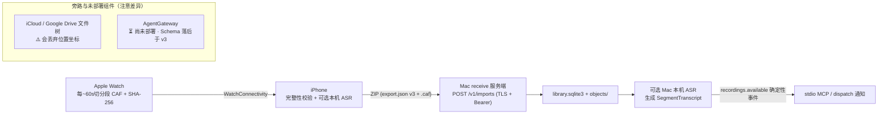

[🏠 首页索引](../../README.md) ｜ [📡 采集渠道调研](channels.md) ｜ [🧩 整合方法与架构](integration-methods.md) ｜ [📦 开源项目精读](projects-digest.md) ｜ [📄 论文与博客精读](papers-blogs-digest.md) ｜ **🎙️ 音频通道（本文）** ｜ [📋 剪切板通道](channel-clipboard.md)

# 音频通道研究：`record-for-agent` 数据模型与接入方案

> 本文基于对已并入本仓库的 `channels/audio/record-for-agent`（源自 `record-for-agent-source` 分支 `ui-iteration`）的**只读源码分析**整理而成，梳理音频端数据流、SQLite 表模型、已有 MCP 与跨渠道接入时的核心缺口。

---

## 一、 核心结论与接入拍板（TL;DR）

> [!TIP]
> **接入结论**：在 Mac 本机直接**只读读取** AgentBridge 写入的 `library.sqlite3`（或直接 `import library.Library`）。这是所有路径里字段最完整（带位置与明确时区）、纯本地零网络与 OAuth 依赖的最佳切入点。
> - **增量同步两条可选路线**：① 监听/消费幂等事件 `recordings.available`（`eventID` 确定性生成）；② 基于 `(started_at, id)` 游标扫描并协同监控转写表增量。
> - **切忌重复造单通道 MCP 轮子**：`record-for-agent` 自带 4 个命名重叠的 MCP 服务。本项目 **`hub` 应专注当跨渠道聚合层**，对上输出联合时空视图，不再重复暴露同名 `list_recordings / get_transcript` 工具（若需透传则严格加 `audio.*` 命名空间）。

---

## 二、 端到端音频数据流

---

## 三、 五大影响集成的核心缺口

> [!WARNING]
> 将音频端合并进 `hub` 的 `L1 ContextEvent` 模型前，必须在适配器里显式弥补以下五个已确认结构缺口：
> 1. **无说话人分离（Diarization）**：尚不能区分音频段中哪句是“我本人（Self）”说的话、哪句是同事或背景音。
> 2. **缺源采集设备 ID**：线上只带接收方 `receiverID`，无法区分同一段音频原始源自手表还是手机。
> 3. **~60 秒机械切段可能腰斩长句**：需依托 `recordingGroup` 逻辑录音会话把相邻物理段拼回完整会话再供语义分析。
> 4. **`spans` 时间戳是“段内相对秒数”**：入库 `L1` 前必须加上该段 `startedAt` 换算为绝对墙钟毫秒时间。
> 5. **地理位置只在 Mac/ZIP 路径保留**：经网盘文件树中转的路径会自动剥除 GPS 属性。

---

## 四、 核心数据结构盘点（Swift & AgentBridge）

| 数据模型对象 | 关键持久化字段 | 源码位置参考 |
| :--- | :--- | :--- |
| **`SegmentManifest`** | `id`, `sessionID`, `sequence`, `startedAt` / `endedAt`, `sampleRate`, `frameCount`, `fileName`, `byteCount`, `sha256`, 可选 `timeZoneIdentifier` / `location` / `recordingGroup` | `Sources/RecordingCore/Models.swift` (L31-70) |
| **`RecordingGroup`** | `id`, `startedAt`, `utcOffsetMinutes`, `firstSequence`（从按录到暂停期间逻辑上属同一次连续录音） | `Models.swift` (L73-111) |
| **`SegmentTranscript`** | `segmentID`, `audioSHA256`, `locale`, `engine`, `createdAt`, `text` (≤256KiB), `spans[{start, end, text}]` (**注意为段内相对秒**) | `SegmentTranscript.swift` (L36-115) |
| **`SegmentLocation`** | `latitude`, `longitude`, `horizontalAccuracy`, `capturedAt`（默认关闭，仅前台主动录音采集，精度 ~100m） | `RecordingMetadata.swift` (L8-29) |
| **`AgentRecordingMetadata`** | 派生时间字段：整数 ms 时间戳、显式偏移 ISO 8601、`timeZoneSource` ∈ {`recorded`, `utc_fallback`} | `RecordingMetadata.swift` (L49-101) |

- **时间与状态约定**：跨边界统一使用**整数 Unix 毫秒**；派生 ISO 8601 字符串携带显式时区偏移，未知时区如实标记而不靠猜测伪造；转写段状态仅区分 `ready` 与 `not_generated`（后者只表示未生成转写，绝不等同于静音或出错）。

### AgentBridge 本地库与事件接口
- **SQLite 库布局**：`<Library>/library.sqlite3`（`user_version=2`），核心表包括 `recordings`、`exports`、`export_members`、`transcripts`；原音文件置于 `objects/<uuid>/<uuid>.caf`。
- **内置 stdio MCP（`bridge.py`，serverInfo `record-for-agent` 0.2.0）**：`list_recordings`、`get_recording`、`get_transcript`、`search_recordings`（casefold 字面子串）、`get_audio_asset`。
- **`recordings.available` 幂等事件规则**（`automatic.py` L264-282）：
  - `eventID` = `uuid5(receiverID, 排序后 id:revision 列表)`
  - `revision` = `sha256(audioSHA256 + ":" + transcript_json)`
  - **关键触发条件：只有完成转写的音频段才会发出可用通知事件**；`deliveries` 表通过指数退避状态机管理投递重试（`retry / sending / accepted / uncertain`），绝不静默重发不确定请求。

### AgentGateway（当前未部署参考）
- 预留支持 OAuth 单条录音粒度授权与即时撤销，并提供 `get_profile / list_recordings / get_transcript / search_recordings / list_changes`（含 tombstone 墓碑删除语义）。
- 已知缺口：当前 `manifestSchema` 尚未同步 Swift 端 v3 中的 `timeZoneIdentifier`、`location` 与 `recordingGroup`，且不传输原始音频流。

---

## 五、 到统一 `ContextEvent` 模型（L1）的映射表

| `ContextEvent` 目标语义 | `record-for-agent` 数据源字段 |
| :--- | :--- |
| **id / 内容溯源** | `recordingID` + `audioSHA256`；转写对应 `revision` |
| **精确时间** | `startedAt`（整数 ms）+ `startedAtISO8601` + `timeZoneSource` |
| **区间时长** | `durationSeconds = frameCount / sampleRate` |
| **来源设备** | **暂缺失**（当前仅存接收方 `receiverID`） |
| **会话逻辑分组** | `sessionID` + `sequence` + `recordingGroup.id` |
| **正文载荷** | `transcript.text`、`locale`、`engine` |
| **句子/词级绝对时间** | 每个 `span` 的墙钟时间 = `segment.startedAt + span.start * 1000` |
| **地理位置（可选）** | `SegmentLocation`（仅直传 Mac/ZIP 路径完整保留） |
| **回跳定位符（Locator）** | 引用对应记录与片段 ID（`record-for-agent` / `get_transcript(recording_id)`） |

---

## 六、 值得推广到全仓库的优秀工程约定 & 开源合规前置项

> [!IMPORTANT]
> **全仓推荐沿用的防御式工程规范**（来自对本模块源码架构的分析提炼）：
> - 用 `ID + SHA256` 做内容寻址、原件只追加不覆盖；同 ID 内容不一致立即抛出 `conflict`。
> - 错误统一结构化为 `{"error": {"code", "message"}}`（MCP 异常置 `isError: true`），对外不泄漏本机绝对路径与机密；持久化坚持 **先 `fsync` 再原子 `rename` 与目录同步后再 `COMMIT`**；自动化测试全部基于合成脱敏数据。
> - **防止间接提示词注入（Indirect Prompt Injection Defense）**：所有采集通道传回正文必须明确视作不可信参考数据（可显式标记 `contentIsAgentInstruction: false`），绝不把他人聊天或录音中的语句直接当成 Agent 系统指令执行。

**开源合规待办阻塞项**（独立分发音频组件前必清）：
1. **补齐许可证文件**：原 `record-for-agent` 子目录尚无明确 `LICENSE` 文件。
2. **清理敏感配置与残留杂项**：脱除 README/配置文件内个人域名引用及版本库中误追踪的 `.DS_Store`；审视 `get_audio_asset` 暴露宿主本地文件路径的风险。
3. **整理重名 MCP & 协议兼容**：收口 `record-for-agent` 内 4 个重叠命名 MCP 服务，并检查更新 MCP 协议版本支持。
