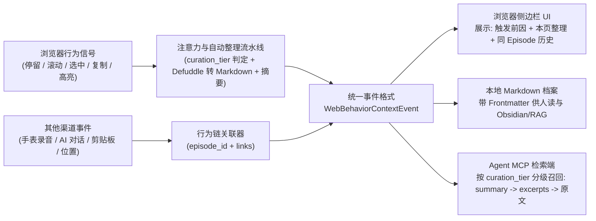

[🏠 首页索引](../../README.md) ｜ [📡 采集渠道调研](channels.md) ｜ [🧩 整合方法与架构](integration-methods.md) ｜ [📦 开源项目精读](projects-digest.md) ｜ [📄 论文与博客精读](papers-blogs-digest.md) ｜ **💡 启发与格式设计（本文）** ｜ [🎙️ 音频通道](channel-audio.md) ｜ [📋 剪切板通道](channel-clipboard.md)

# 💡 重点项目启发、缺失剖析与格式演进设计

> **文档定位（探索与任务定义阶段 · L2 深度推演专库）**：  
> 当我们在 L1 初筛表中遇到真正有价值的项目与组合时，会在此建立独立编号的**「技术细节深挖 → 启发吸收与取舍 → 缺失 Context 剖析 → 统一格式/架构推演」**档案，沉淀为后续落地「Context 补全计划」的工程蓝本。

---

## 目录

- [第 01 号推演 · Promnesia (`karlicoss/promnesia`) — 算法自动收藏整理与整体行为流 Web Context 格式](#第-01-号推演--promnesia-karlicosspromnesia--算法自动收藏整理与整体行为流-web-context-格式)
- [第 02 号推演：HPI 原档不可变架构与增量 SQLite 缓存](#第-02-号推演hpi-原档不可变架构与增量-sqlite-缓存)
- [第 03 号推演：Timelinize 三维时空主轴与位置轨迹模型](#第-03-号推演timelinize-三维时空主轴与位置轨迹模型)
- [第 04 号推演：浏览器纯净 Context 联合管线（Defuddle + Readability + 极简 Memex）](#第-04-号推演浏览器纯净-context-联合管线defuddle--readability--极简-memex)
- [第 05 号推演：录音手表 App 与位置轨迹 App 技术移植方案](#第-05-号推演录音手表-app-与位置轨迹-app-技术移植方案)
- [附：Google Sheet 批注重点问题集中解答](#附google-sheet-批注重点问题集中解答)

---

## 第 01 号推演 · Promnesia (`karlicoss/promnesia`) — 算法自动收藏整理与整体行为流 Web Context 格式

> **关联卡片**：[📦 projects-digest.md · #1 Promnesia](projects-digest.md#1-promnesia-karlicosspromnesia--个人数字历史原位反向叠加层) ｜ **协议对照**：[🧩 schema/context-event.schema.json](../../schema/context-event.schema.json) ｜ [📐 RFC-0001](../rfc/0001-context-integration.md)

### 1. 我们要保留和发扬的两个核心价值

1. **按真实阅读行为算法“自动收藏与内容整理”，解放手动书签**：
   - 沿用 [采集渠道调研 · channels.md](channels.md) 中探讨的三信号注意力评分思路（停留时长、滚动深度、选中/复制/高亮、7 天内回访与搜索来源加权）：
     - $\text{score} \approx \log(1+\text{dwell\_sec}) \times \text{scroll\_coeff} + 3\times\text{select} + 5\times\text{copy} + 8\times\text{highlight} + 2\times\text{revisit\_7d} + \text{search\_bonus}$
   - 自动将一次网页浏览分为三级沉淀策略（`curation_tier`）：
     - `transient`：短暂停留（如 `< 10s`）且零有效交互 → 仅记轻量化路径轨迹，不触发正文整理；
     - `auto_curated`：达到有效阅读/交互阈值 → 自动抓取干净正文，提炼高层摘要、`markdown_locator` 与关键摘录；
     - `pinned`：用户显式触发收藏、高亮批注或固定操作 → 最高权重保存并保留原文定位。

2. **浏览器侧边栏“原位双向上下文叠加层”（Contextual Sidebar Overlay）**：
   - 在当前浏览器标签页右侧打开轻量侧边栏，升级为**「前因 + 本页自动整理 + 跨渠道后续」三位一体的双向面板**：
     - **向上游回溯（Trigger）**：当前页面是刚刚在哪个会议语音、哪次 AI 对话、哪次剪贴板复制后跳转打开的？
     - **看本页沉淀（Auto-Curation）**：这页自动整理出了什么核心摘要、关键摘录与 Markdown 存档路径？
     - **看同工作流同伴（Episode）**：同一工作任务（Episode）里关联的录音、终端命令或位置足迹还有哪些？

---

### 2. Promnesia 缺在哪里：从“单点 URL 反查”到“整体行为流 Context”

Promnesia 的底层记录抽象本质上是一个孤立的索引元组：`Visit(norm_url, dt, context_snippet, locator)`。放进**完整个人数字上下文**视角下，还缺 6 块拼图：

| 对比维度 | Promnesia 当前记录形态 (`Visit`) | 我们的整体行为流模型 (`WebBehaviorContextEvent` 草案) | 补齐的关键能力 |
| :--- | :--- | :--- | :--- |
| **1. 触发动机 (Trigger)** | 仅记录出现时间 `dt`，不知道用户**为什么**打开这页。 | 通过 `links` (`relation: "triggered_by"`) 显式指向前序语音、AI 对话、搜索或剪贴板事件。 | 把“单次点击”还原为带着意图的行为起止点。 |
| **2. 注意力与自动整理分级** | 所有被索引的浏览记录权重几乎一致，缺乏精读与扫一眼的区分。 | 引入 `attention` 连续分、`context.curation_tier` (`transient` / `auto_curated` / `pinned`) 与 `context.interactions` 交互计数。 | 让系统知道**哪页值得自动整理收藏**、哪页只是路过噪音。 |
| **3. 结构化整理与 Markdown 产物** | 仅存短文本碎片 `context` 或外链，无独立可读摘要产物。 | `content` 内提供 `summary`、`excerpts[]`（带精确 `locator` 与 `note`）及 `markdown_locator`。 | 既支撑侧边栏快速回看与 Obsidian 沉淀，又省 AI Token。 |
| **4. 跨渠道统一锚点** | 几乎完全绑定 URL 字符串匹配（`url_norm`）。 | 除 `content.url_norm` 外，引入 `anchors[]` 提取项目名、Issue、文件路径、主题标签等跨渠道实体锚点。 | 让网页阅读能和本地文件、IDE、聊天记录自动合流。 |
| **5. 后续行动因果链** | 阅读结束后用户在本地复制了什么、写进哪段代码，与该 Visit 断裂。 | 通过 `episode_id` 归入统一任务场景，并用 `links` 串联 `copied_to` / `discussed_in` / `same_anchor`。 | 还原“查资料 → 复制方案 → 改动代码”完整工作闭环。 |
| **6. 双端消费出口** | 仅面向人眼在浏览器扩展中点击查看，缺少 AI Agent 的标准化预算检索协议。 | 同一份事件同时服务 **浏览器侧边栏 UI** 与 **Agent MCP 分层拉取（摘要 → 摘录 → 原文）**。 | “给人看的收藏夹”与“给 Agent 用的记忆层”共享同一份事实源。 |

---

### 3. 我们采纳的数据格式草案：`WebBehaviorContextEvent`（兼容扩展根 Schema）

```json
{
  "id": "01JDMQ8X9K7N2P4R6T8V0W2Y4Z",
  "source": "browser",
  "kind": "page_read",
  "t_start": 1763218800000,
  "t_end": 1763219125000,
  "tz": "Asia/Shanghai",
  "tz_source": "recorded",
  "t_observed": 1763219126500,
  "device_id": "macbook-pro-m3",
  "actor": "self",

  "anchors": [
    "url:https://github.com/karlicoss/promnesia",
    "repo:karlicoss/promnesia",
    "topic:context-overlay",
    "topic:url-canonicalization"
  ],

  "attention": 0.86,
  "context": {
    "app_bundle": "com.google.Chrome",
    "window_title": "karlicoss/promnesia: Another bookmarking tool...",
    "dwell_ms": 325000,
    "scroll_depth": 0.84,
    "afk": false,
    "curation_tier": "auto_curated",
    "interactions": {
      "selection_count": 4,
      "copy_count": 2,
      "highlight_count": 1
    }
  },

  "content": {
    "title": "karlicoss/promnesia — README & Architecture",
    "url_norm": "https://github.com/karlicoss/promnesia",
    "lang": "en",
    "content_hash": "sha256:9f84c2b1e0a7d3...",
    "summary": "通过多源索引器 + URL 规范化（cannon）把散落各处的 URL 上下文汇总到本地 SQLite，并在浏览器侧边栏以原位叠加层展示历史提及与源码定位符 locator。",
    "excerpts": [
      {
        "text": "Normalises URLs so http/https, trailing slashes and utm params match the same history graph.",
        "locator": "css:#readme > p:nth-of-type(3)",
        "note": "自动摘录（触发过文本选中+复制）：URL 归一化设计要点"
      },
      {
        "text": "Every indexed visit keeps a dt, context snippet and clickable locator back to the source.",
        "locator": "css:#how-it-works > ul > li:nth-of-type(2)",
        "note": "自动摘录（触发过高亮）：L0 溯源字段约束启发"
      }
    ],
    "markdown_locator": "markdown/web/2026/11/promnesia-readme.md"
  },

  "episode_id": "ep_01JDMQ5000RESEARCH_PROMNESIA",
  "links": [
    {
      "target_id": "01JDMQ5A112233445566778899",
      "relation": "triggered_by",
      "confidence": 0.94
    },
    {
      "target_id": "01JDMQ9Z998877665544332211",
      "relation": "copied_to",
      "confidence": 0.98
    }
  ],

  "location": {
    "place_name": "Studio Desk",
    "stay_id": "stay_20261116_home"
  },

  "provenance": {
    "connector": "browser-sidebar-ext",
    "version": "0.1.0-draft",
    "source_id": "chrome-tab-418-visit-92",
    "source_hash": "sha256:4a1e0d9b...",
    "locator": "https://github.com/karlicoss/promnesia#readme"
  },

  "privacy": {
    "tier": "local_only",
    "pii_tags": []
  }
}
```



---

## 第 02 号推演：HPI 原档不可变架构与增量 SQLite 缓存

> **启发源**：`#2 HPI (karlicoss/HPI)` ｜ **用户批注**：*“⭐ 已入选 L2 · 这个技术细节还挺关键”* ｜ **关联**：`#4 Dogsheep`、`#21 Khoj`

### 1. HPI 最核心的 4 个工程技术细节（为什么值得我们照搬）

1. **原档只增不改（Immutable `L0 raw/` 按日期目录落盘）**：
   - HPI 坚决不做“写一段一次性脚本把原件导入某个封闭数据库然后删原文件”。原始导出包（聊天归档、录音原音、浏览器 JSON、位置点原始包）按日期只读保存在磁盘上。
   - **收益**：哪怕 3 年后换了更强的离线 ASR（比如今天选 SenseVoice，明天换新模型）或重新设计 `Episode` 切分规则，永远可以从 `raw/` **无损重放重算（Replay）**。
2. **`dal.py` 数据访问层与业务逻辑隔离**：
   - HPI 内部为每个数据源约定了一个独立的 `dal.py`（Data Access Layer）：不管原始文件格式是旧版 JSON 还是新版 SQLite、是单文件还是按周拆分的 `.gz` 分片，`dal.py` 对上只暴露统一的 `Iterator[Event]` Python 类型契约。
3. **`@cachew` 装饰器实现的“可随时删除重建的增量 SQLite 缓存”**：
   - 作者专门为此写了开源伴生库 **`cachew`**：只需在 Python 生成器函数上加一行 `@cachew(cache_path=..., depends_on=...)`，它就会**自动读取输入数据类的类型注解（dataclass / NamedTuple）生成 SQLite 表**，按批流式缓存查询结果；当源文件路径列表、`mtime/size` 或哈希发生变化时，`@cachew` 自动局部失效并重算增量；原件没变时，上层读取直接毫秒命中 SQLite。
   - 配合 **`#4 Dogsheep`** 思路，底层就是单文件 **SQLite + FTS5**，个人电脑零 Docker、零运维成本即可秒级检索。
4. **`Result[T, Exception]` 容错迭代哲学**：
   - 解析十年跨度的个人历史数据时，难免有几条编码损坏或字段缺失。HPI 不直接抛异常崩掉整条管线，而是把单条错误封装成 `Exception` 对象继续 `yield`，正常条目照常入库。

### 2. 结合 `#21 Khoj` 批注推演的三层存储产物规范

响应你在 `#21 Khoj` 留下的核心判断——**“Markdown 一定是 context 整理的一个产物”**，我们把 HPI 的思想落地为本仓库的三层存储边界：

| 存储层级 | 物理载体 | 可变性与角色 | 损坏/升级策略 |
| :--- | :--- | :--- | :--- |
| **`L0` 原始资产层** | `raw/<source>/<yyyy-mm-dd>/...`（音频 `.m4a`、剪贴板原件、位置点 JSON、网页 HTML 快照） | **Append-only 不可变事实源**，绝不覆写修改。 | 永久冷备资产，任何算法升级均从这里重新回放。 |
| **`L1` 可重算索引库** | `hub.sqlite`（SQLite + FTS5 + `@cachew` 风格增量状态表） | **派生加速索引与行为链主库**（含 `ContextEvent` 全字段、`episode_id`、`links`）。 | 随时可删库由 `L0` + 本地模型重跑恢复；支持毫秒全文与时间轴查询。 |
| **`L2` 整理产物层** | `markdown/<yyyy-mm-dd>/...`（带 YAML Frontmatter 的 `.md` 档案，路径记录在 `content.markdown_locator`） | **面向人类 + Agent 共读的干净知识产物**（网页正文、每日语音纪要、每日足迹综述），遵循 `#28 Obsidian Frontmatter Markdown 规范`。 | 直接拖进 Obsidian / Typora 浏览，也可直接喂给大模型阅读而不污染主库。 |

---

## 第 03 号推演：Timelinize 三维时空主轴与位置轨迹模型

> **启发源**：`#3 Timelinize (timelinize/timelinize)` ｜ **用户批注**：*“⭐ 已入选 L2”* ｜ **关联**：`#13 Dawarich`、`#27 Overland`

### 1. Timelinize 的核心技术剖析

- **Unified Item + Content-Addressable Blobs**：Go 编写的本地单二进制桌面/Web 应用，为所有异构数据定义一个统一 **`Item`** 节点（绑定时间戳、来源、描述与附件指纹），照片/录音等大附件通过哈希去重存于本地 Blob 目录。
- **跨平台实体归一（Entity / Identity Resolution）**：内置本地人物/账号映射表，能把“通讯录里的联系人、短信号码、Slack/Telegram 用户名、邮件地址”合并到同一个真实人物实体 `Entity` 上。
- **时空双维筛选界面**：UI 不只是一条冰冷的列表，而是把**时间轴（Timeline）**、**地图足迹（Geo / Places）**、**人物卡片（Entities）**并列放在同一个离线工作台上。

### 2. 推演进我们的统一协议

我们在 `schema/context-event.schema.json` 根级新增可选 `location` 对象，与 `t_start / t_end`、`actor / anchors` 构成跨渠道的 **「时间 × 空间 × 人物/主题」三维主轴**：

```json
"location": {
  "lat": 31.2304,
  "lon": 121.4737,
  "place_name": "咖啡馆 A",
  "stay_id": "stay_20261116_1430"
}
```

哪怕手表在室外只录到了音频没有保存 GPS，或者电脑只开着网页但手机知道你此刻在公司工位，**只需同一时段内有任意一个渠道带了 `stay_id` / `location`**，Hub 在整理成 `L2 Episode` 与当日 Markdown 时就能自动互填地点上下文。

---

## 第 04 号推演：浏览器纯净 Context 联合管线（Defuddle + Readability + 极简 Memex）

> **启发源**：`#7 Defuddle` + `#8 Readability` + `#9 Memex` + `#24 web-recap` + 新增 `#25 Karakeep`  
> **回应核心批注**：*“#7 和前面的网页项目联合获取纯净 context；#7 和 #8 的区别与融合；#9 在输入侧如何简化”*

### 1. 解答：`#7 Defuddle` 与 `#8 Mozilla Readability` 有何区别？怎么融合？

| 对比维度 | `#7 Defuddle` (Obsidian 团队现代重构) | `#8 Mozilla Readability` (Firefox 阅读视图经典内核) | 两者融合方式 |
| :--- | :--- | :--- | :--- |
| **定位与年代** | 为现代 Web（React/Next.js、技术博客、文档站）与 LLM/Markdown 工作流专门设计。 | 为传统新闻/博客长文打造，距今十余年的通用 DOM 启发式基线。 | **主备双引擎串联**：`Defuddle` 作为一级主力，`Readability` 作为兜底 Fallback。 |
| **输出格式与干净度** | 直接保留代码块语言标记、LaTeX 公式、嵌套列表、表格与作者/日期 YAML 元数据，输出高纯度 Markdown。 | 输出清洗后的 HTML DOM 节点与纯 `textContent`，现代网站中代码缩进、数学公式与表格常丢失。 | 若 `Defuddle` 成功且正文长度达标，直接拿 Markdown；若遇老旧异构 HTML 漏抽，调用 `Readability` 抽出 DOM 再经 Turndown 转 Markdown。 |
| **常见杂质清理** | 主动识别并剔除社交媒体卡片、分享栏、阅读进度条、“猜你喜欢”等现代站点噪声。 | 主要依据段落长度、标点数量、超链接密度做打分统计。 | 两者组合既能拿到结构完美的现代技术 Markdown，又不会在小众老站点上抽空。 |

### 2. 解答：`#9 WorldBrain Memex` 在输入侧如何极简保留价值？

Memex 功能臃肿在“手动建 Space、打 Tag、弹出批注浮窗、云端账号同步”。放到我们的浏览采集流中，**输入侧彻底砍掉所有强迫用户点击的按钮**，只保留 2 个零摩擦自动化行为 + 1 个轻量规则：

1. **后台静默门控（不打扰）**：通过 `Page Visibility ∩ windows.onFocusChanged ∩ chrome.idle` 累计真实活跃停留时长；若 `< 10s` 且无交互则归为 `transient` 放行丢弃正文。
2. **两个极简隐式高权重信号替代手动点击**：
   - `selectionchange`：用户在文章某段划词选中停顿超过 `1.2s` → 自动把该句收入 `content.excerpts[]`（标记“划词关注”），无需弹出任何按钮；
   - `copy`：用户在页面按 `Cmd+C` → 该段自动收入 `content.excerpts[]` 并将 `links` 与本地 `ClipContext` 事件自动连线，页面直接晋升 `curation_tier: "auto_curated"`。
3. **联合 `#1 Promnesia` + `#24 web-recap` + `#25 Karakeep` 的完整浏览流水线**：

```text
[页面停留达标 或 发生划词/复制]
   ├──> url_norm 归一化（来自 #1 Promnesia）
   ├──> Defuddle 主抽 -> Readability 兜底（来自 #7 + #8）-> 生成干净 Markdown 写盘 (markdown_locator)
   ├──> 收集 selection/copy 生成 excerpts[] 并计算 attention（来自 #9 Memex 极简化）
   ├──> 端侧 Ollama 小模型生成 2 句 summary + tags（来自 #24 web-recap + #25 Karakeep 思路）
   └──> 写入 WebBehaviorContextEvent -> 同屏馈送浏览器双向侧边栏 UI & Agent MCP
```

---

## 第 05 号推演：录音手表 App 与位置轨迹 App 技术移植方案

> **启发源**：`#10 Omi` + `#14 FunASR/SenseVoice/sherpa-onnx` + `#13 Dawarich` + 新增 `#27 Overland / OwnTracks`  
> **回应核心批注**：*“Omi 有什么技术优化适合移植到录音手表 app；ASR 备选选型；Dawarich 细看并先行改造成 App”*

### 1. 适合移植到我们录音手表 App (`record-for-agent`) 的 4 项关键优化

1. **端侧轻量 VAD + 能量门控（省电核心）**：
   - Omi 硬件续航的关键不是压缩录音码率，而是**不录/不传无人说话的静音帧**。手表端跑毫秒级能量门控或极轻量 WebRTC VAD，只有人声触发时才激活音频缓冲与传输，相比 24 小时连录连传可砍掉 **60%–80% 无效写入与电量**。
2. **BLE / 离线环形缓存队列（Store-and-Forward）**：
   - 借鉴 Omi 手环与手机断连重传机制：手表自带本地小容量环形缓存，脱离手机/Mac 时将带精准起始时间戳与单调序号 `seq` 的 Opus 分片落盘，重连后再静默续传至 `L0 raw/audio/`。
3. **本人声纹锚点（Distinguishing `self` vs `speaker_k`）**：
   - 提前在手机/手表录一段 **15 秒本人语音样板** 抽出声纹向量。后续任何会议音频分离说话人时，自动把本人标注为 `actor: "self"`，其余参会者标记为 `speaker_1`、`speaker_2`，否则 Agent 根本分不清“谁答应下周交方案”。
4. **对话静音封口 → 双路结构化产物**：
   - 当连续无有效对话超过 3–5 分钟自动封口切出一个 `Episode`，异步产出两份结构：**① `L2` 本地 Markdown 纪要（含场景标题、摘要、时间点索引、`- [ ] 待办`）** 写入 `content.markdown_locator`；**② 事件写入 SQLite**，与同一时段手机位置 `location` 及电脑端剪贴板/网页关联。

### 2. 本地离线 ASR 与声纹技术选型推荐（回应 `#14`）

| 组件角色 | 首选推荐方案 | 核心理由与适用端 |
| :--- | :--- | :--- |
| **本地推理底座** | **`sherpa-onnx`** | 纯 C++/Swift/Python ONNX Runtime，**无 PyTorch 重依赖**，同一份模型可直接跑在 macOS 笔记本和 iOS App / 手表伴侣端。 |
| **静音切分 (VAD)** | **Silero VAD / FSMN-VAD** | 体积仅 ~2MB，CPU 占用极低，精确切出人声时间戳区间填充 `locator`。 |
| **核心转写 (ASR)** | **`SenseVoice-Small`（主选）** / **`FunASR Paraformer`（桌面精校）** | `SenseVoice-Small` 在中文、中英混读（技术词汇+中文）下延迟极低且自带标点及笑声/情绪标签；长音频批处理精校可切 `FunASR`。 |
| **说话人分离** | **`CAM++ / 3D-Speaker`** | `sherpa-onnx` 原生已集成，配合 15s 本人注册声纹即可完成 `self` / `speaker_k` 标记。 |

### 3. `#13 Dawarich` + `#27 Overland`：先行改造“位置轨迹 App”的最小可行方案

为什么不要在手机上从零写 GPS 轮询？耗电高且会被 iOS 后台杀掉。按**“成熟开源采集端 + Dawarich 概念后端”**两条腿走最快：

1. **手机端（iOS / Watch）**：直接复用或参考开源的 **`Overland`（或 `OwnTracks`）**：
   - 利用 iOS 系统级 **`Significant Location Change`（基站/Wi-Fi 变化唤醒，几乎零额外耗电）+ 运动状态识别（静止 / 步行 / 驾车）**；
   - 网络断开时自动按时间线缓存进本地 SQLite 队列，回到 Wi-Fi 后一次性 JSON Batch 上报。
2. **后台与轨迹汇聚（Dawarich 思路轻量化）**：
   - 不一定要先部署重型 Docker Rails 全套；在我们的本地 Hub 上开一个兼容 Overland JSON 的 `/api/location/ingest` 小接口，写入 `raw/location/` 后自动跑一次 **DBSCAN 时空驻留点聚类（StayPoint Detection）**——把连续停留超过 10 分钟、半径小于 100 米的点自动聚成一条 `Stay`（生成 `stay_id` 并匹配用户预设的“家 / 公司 / 常用咖啡馆”地点标签）。
3. **每日产物自动合流**：每天晚上自动生成一篇《`YYYY-MM-DD` 时空足迹与沟通摘要.md》，把当天的驻留点时间线和同时间段的录音纪要、电脑工作自动串成一页。

---

## 附：Google Sheet 批注重点问题集中解答

### Q1. `#5 ActivityWatch` 和苹果自带「屏幕使用时间 (Screen Time)」有什么本质区别？

| 对比点 | Apple 原生屏幕使用时间 (Screen Time) | `ActivityWatch` |
| :--- | :--- | :--- |
| **粒度差距（最核心）** | 只能看到“今天在 Chrome 用了 3 小时、VS Code 2 小时”的**粗粒度 App 总时长**。 | 精确到每一分钟**具体窗口标题（Window Title）**与**浏览器正在看哪条 URL**（例如具体是哪个 GitHub Repo、哪个文档页）。 |
| **数据开放性与编程性** | 封闭存储在系统加密库 (`knowledgeC.db`)，新版 macOS 受 SIP/TCC 严格隔离，极难安全自动读出给本地 Agent 用。 | **100% 开源开放**，内置标准本地 REST API（`localhost:5600`）与可导出的 SQLite，可直接拿来切 `Episode`。 |
| **AFK 挂机甄别** | 你开着网页离开工位去倒水，只要没锁屏也会算在使用时长内。 | 自带 `aw-watcher-afk`，结合键鼠无操作自动标记 `afk: true`，帮你精准切断工作阶段边界。 |

> **建议定位**：不要把它当“戒网瘾时间统计”，而把它当作整个 Context 系统的**客观时间骨架与 `AFK` 分段器**，供后续确定 desktop episode 边界时直接复用。

---

### Q2. `#11 screenpipe & OpenRecall` 能用在哪儿？真实用户反馈和具体 Case 是什么？

1. **行业真实反馈与核心痛点**（综合 GitHub Issues / 社区讨论反馈）：
   - **正反馈（能解决什么）**：针对完全封闭、没有导出接口或不可复制文字的软件界面（如微信电脑版窗口、腾讯会议共享 PPT 画面、线上只读表格、弹窗报错提示），它确实是目前唯一无需官方 API 就能把画面文字变成历史可搜文本的途径。
   - **主要槽点（为什么不能 24 小时盲开）**：
     - 连续截屏 + 本地 OCR + embedding 导致 **MacBook 风扇起飞、CPU 长期偏高、续航骤减**；
     - 存储膨胀极快（常达 **20–30GB/月**），大量是静态桌面与重复屏幕废话；
     - `screenpipe` 核心团队仓库商业授权转向争议较大，且黑盒库内混入隐私界面（密码/网银窗口/私聊）难以清理。
2. **如果我们要用，最合理的具体用户 Case（克制型事件触发版）**：
   - **绝不做 24/7 全时录屏**；仅在下面 2 个瞬间做**单帧按需捕获**：
     - **Case A · 看封闭聊天的关键同步时刻**：用户主动按下全局快捷键（或手表语音说出“记一下眼前这个界面”）→ 只截当前焦点窗口 1 帧做本地 OCR 提取文本，立刻写完即删截图原图或加密封存；
     - **Case B · “录音期间在电脑上对照看了啥”**：当录音端判定当前处于活跃会议中且用户没有切换任何网页（可能全屏看线下共享屏幕/本地 PDF），以极低频（如每 60 秒或窗口切变瞬间）抽样保存标题与可选 OCR，作为事后回溯辅助线索。

---

### Q3. `#23 personal-ai-memory` Demo 为什么“没看懂”？（决定：暂不采纳）

- 该项目本质上只是一个**非常早期的个人极简 Toy Demo**：核心代码只有寥寥数百行，机制是 Chrome 插件直接抓取网页 DOM 文本丢给一个简化后端提取碎片后注入本地对话框，缺少 URL 归一化、注意力降噪分级、双时序冲突处理与严谨的数据结构设计，因此 Demo 形态看起来既像半成品书签工具又像普通 RAG 玩具，很难形成真正可用的工程体验。
- **核心价值已在更清晰的项目里被完全覆盖**：它唯一提醒我们的是“开源基座部署门槛不要超过 5 分钟”（已记录为工程原则），本项目本身可直接标记为 **`❌ 暂不采纳`**。

---

### Q4. `#4 Dogsheep` 与 `#12 Atuin` 的明确边界

- **`#4 Dogsheep`（建议标记为：底座设计参考）**：它的核心价值不在某一个现成工具，而是展示了 **“每个轻采集器 → 单文件 SQLite + FTS5 + Datasette 只读浏览台”** 的极简架构哲学，刚好与 `#2 HPI` 的 `@cachew` 形成上下游绝配。
- **`#12 Atuin`（确认你的判断：`Only for developer`）**：完全同意，它属于**高阶开发者可选插件渠道（Optional Module）**，绝不作为大众向个人 Context 系统的必需依赖。
