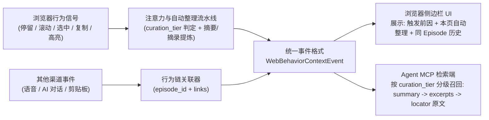

[🏠 首页索引](../../README.md) ｜ [📡 采集渠道调研](channels.md) ｜ [🧩 整合方法与架构](integration-methods.md) ｜ [📦 开源项目精读](projects-digest.md) ｜ [📄 论文与博客精读](papers-blogs-digest.md) ｜ **💡 启发与格式设计（本文）** ｜ [🎙️ 音频通道](channel-audio.md) ｜ [📋 剪切板通道](channel-clipboard.md)

# 💡 重点项目启发、缺失剖析与格式演进设计

> **文档定位（探索与任务定义阶段 · 持续追加）**：  
> 当我们在调研先驱项目过程中，遇到某项设计令人眼前一亮时，会在此建立一条独立编号的**「启发吸收 → 缺失剖析 → 格式/架构推演」**档案：先把真正有价值的体验与机制保留下来，再追问它离**「完整的人机交互上下文系统」**还差哪一步，最后推演出可落地的统一数据格式与 Schema 演进草案，供后续实现验证。

---

## 目录

- [第 01 号推演 · Promnesia (`karlicoss/promnesia`) — 算法自动收藏整理与整体行为流 Web Context 格式](#第-01-号推演--promnesia-karlicosspromnesia--算法自动收藏整理与整体行为流-web-context-格式)
  - [1. 我们要保留和发扬的两个核心价值](#1-我们要保留和发扬的两个核心价值)
  - [2. Promnesia 缺在哪里：从“单点 URL 反查”到“整体行为流 Context”](#2-promnesia-缺在哪里从单点-url-反查到整体行为流-context)
  - [3. 我们采纳的数据格式草案：`WebBehaviorContextEvent`（5 大组成部分）](#3-我们采纳的数据格式草案webbehaviorcontextevent5-大组成部分)
  - [4. 统一格式如何同时喂给“浏览器侧边栏”与“Agent MCP”](#4-统一格式如何同时喂给浏览器侧边栏与agent-mcp)
  - [5. 对仓库 Schema 的兼容演进与待验证问题](#5-对仓库-schema-的兼容演进与待验证问题)

---

## 第 01 号推演 · Promnesia (`karlicoss/promnesia`) — 算法自动收藏整理与整体行为流 Web Context 格式

> **关联卡片**：[📦 projects-digest.md · #1 Promnesia](projects-digest.md#1-promnesia-karlicosspromnesia--个人数字历史原位反向叠加层) ｜ **协议对照**：[🧩 schema/context-event.schema.json](../../schema/context-event.schema.json) ｜ [📐 RFC-0001](../rfc/0001-context-integration.md)

### 1. 我们要保留和发扬的两个核心价值

Promnesia 最打动我们的不是“做了一个庞大的个人搜索网站”，而是下面两个极度贴近真实使用场景的设计方向（也是我们计划吸收并升级的核心能力）：

1. **按真实阅读行为算法“自动收藏与内容整理”，解放手动书签**：
   - 用户平时浏览网页时，大量高价值资料（技术文档、Issue 讨论、教程文章）根本来不及手动点收藏、打标签、写摘要；而把所有历史记录无差别塞进上下文又会充斥大量噪音。
   - **我们的演进方向**：沿用 [采集渠道调研 · channels.md](channels.md) 中探讨的三信号注意力评分思路（停留时长、滚动深度、选中/复制/高亮、7 天内回访与搜索来源加权）：
     - $\text{score} \approx \log(1+\text{dwell\_sec}) \times \text{scroll\_coeff} + 3\times\text{select} + 5\times\text{copy} + 8\times\text{highlight} + 2\times\text{revisit\_7d} + \text{search\_bonus}$
   - 根据注意力与交互信号，系统自动将一次网页浏览分为三级沉淀策略（`curation_tier`）：
     - `transient`：短暂停留（如 `< 10s`）且零有效交互 → 仅记轻量化路径轨迹，不触发正文整理，避免噪音污染。
     - `auto_curated`：达到有效阅读/交互阈值 → 自动抓取干净正文，提炼高层摘要、大纲与关键摘录，形成免手动管理的自动知识卡片。
     - `pinned`：用户显式触发收藏、高亮批注或固定操作 → 最高权重保存并保留原文定位。

2. **浏览器侧边栏“原位双向上下文叠加层”（Contextual Sidebar Overlay）**：
   - Promnesia 证明了一件关键的事：**不要等用户切到另一个 App 里手动搜索**，直接在当前浏览器标签页右侧打开轻量侧边栏，把历史上下文“原位浮现”出来，体验极其自然。
   - **我们的演进方向**：在 Promnesia “按当前 URL 反查历史提及”的基础上，把侧边栏升级为**「前因 + 本页自动整理 + 跨渠道后续」三位一体的双向面板**：
     - **向上游回溯（Trigger）**：当前页面是刚刚在哪个会议语音、哪次 AI 对话、哪次剪贴板复制后跳转打开的？
     - **看本页沉淀（Auto-Curation）**：这页被系统自动整理出了什么核心摘要、关键段落和历史高亮批注？
     - **看同工作流同伴（Episode）**：同一工作任务（Episode）里关联的终端命令、代码库锚点或跨标签阅读还有哪些？

---

### 2. Promnesia 缺在哪里：从“单点 URL 反查”到“整体行为流 Context”

Promnesia 的底层记录抽象本质上是一个孤立的索引元组：

```text
Visit(norm_url, dt, context_snippet, locator)
```

这让它非常擅长回答**“这条 URL 以前在哪里被提到过”**，但放到我们追求的**“完整个人数字上下文（Overall User Behavior Context）”**视角下，还缺关键的拼图：

| 对比维度 | Promnesia 当前记录形态 (`Visit`) | 我们的整体行为流模型 (`WebBehaviorContextEvent` 草案) | 补齐的关键能力 |
| :--- | :--- | :--- | :--- |
| **1. 触发动机 (Trigger)** | 仅记录出现时间 `dt`，不知道用户**为什么**打开这页。 | 通过 `links` (`relation: "triggered_by"`) 显式指向前序语音、AI 对话、搜索或剪贴板事件。 | 把“单次点击”还原为带着意图的行为起止点。 |
| **2. 注意力与自动整理分级** | 所有被索引的浏览记录权重几乎一致，缺乏精读与扫一眼的区分。 | 引入 `attention` 连续分、`context.curation_tier` (`transient` / `auto_curated` / `pinned`) 与 `context.interactions` 交互计数。 | 让系统知道**哪页值得自动整理收藏**、哪页只是路过噪音。 |
| **3. 结构化整理产物** | 仅存短文本碎片 `context` 或完整页面外链，无分层摘要。 | `content` 内提供 `summary`（低成本概览）、`excerpts[]`（带精确 `locator` 与 `note` 的摘录列表）及 `content_hash`。 | 既支撑侧边栏快速回看，又控制后续喂给 AI 的 Token 消耗。 |
| **4. 跨渠道统一锚点** | 几乎完全绑定 URL 字符串匹配（`url_norm`）。 | 除 `content.url_norm` 外，引入 `anchors[]` 提取项目名、Issue、文件路径、主题标签等跨渠道实体锚点。 | 让网页阅读能和本地文件、IDE、聊天记录自动合流。 |
| **5. 后续行动因果链** | 阅读结束后用户在本地复制了什么、写进哪段代码，与该 Visit 断裂。 | 通过 `episode_id` 归入统一任务场景，并用 `links` 串联 `copied_to` / `discussed_in` / `same_anchor`。 | 还原“查资料 → 复制方案 → 改动代码”完整工作闭环。 |
| **6. 双端消费出口** | 仅面向人眼在浏览器扩展中点击查看，缺少 AI Agent 的标准化预算检索协议。 | 同一份事件同时服务 **浏览器侧边栏 UI** 与 **Agent MCP 分层拉取（摘要 → 摘录 → 原文）**。 | “给人看的收藏夹”与“给 Agent 用的记忆层”共享同一份事实源。 |

---

### 3. 我们采纳的数据格式草案：`WebBehaviorContextEvent`（5 大组成部分）

为了让网页浏览不再是一座孤岛，而是能直接并入我们整体 Context 管道（`voice`、`clipboard`、`browser`、`ai_chat`、`window`），我们把一条网页自动整理事件收束为 **5 个逻辑组成部分**，并保持与根协议 [context-event.schema.json](../../schema/context-event.schema.json) 完全兼容：

1. **① 身份、时间与规范化锚点（Identity, Time & Anchors）**：`id` (ULID)、`source: "browser"`、`kind: "page_read"`、`t_start` / `t_end` / `t_observed`、`tz`、`device_id`、`actor` 与跨渠道实体 `anchors[]`。
2. **② 行为信号与自动收藏分级（Behavior, Attention & Auto-Curation）**：`attention` 综合分、`context` 内的停留 `dwell_ms`、滚动深度 `scroll_depth`、`afk` 状态、交互计数 `interactions`（选中/复制/高亮次数），以及算法判定出的 `curation_tier`。
3. **③ 分层自动整理内容（Curated Content）**：`content` 内的 `title`、`url_norm`、`content_hash`、算法生成的 `summary`（供侧边栏与 Agent 速览）、精选 `excerpts[]`（每条保留自身 `text`、`locator` 与自动/手动 `note`）；完整长正文通过 `provenance.locator` 按需延迟回查，不盲目塞入热索引。
4. **④ 整体行为链与跨渠道归因（Behavior Chain: Episode & Links）**：`episode_id` 标记当前连续工作流；`links[]` 显式链接上游触发事件（如 `triggered_by`）和下游衍生行为（如 `copied_to`），并附带关联置信度 `confidence`。
5. **⑤ 溯源与隐私分级（Provenance & Privacy）**：保留 Promnesia 启发的必填 `provenance.locator`（精确到规范化 URL、DOM 锚点或本地存档偏移），以及 `privacy.tier` / `pii_tags` 控制端侧共享边界。

下面是一份符合扩展后 [context-event.schema.json](../../schema/context-event.schema.json) 的完整 JSON 示例草案：

```json
{
  "id": "01JDMQ8X9K7N2P4R6T8V0W2Y4Z",
  "source": "browser",
  "kind": "page_read",
  "t_start": 1763218800000,
  "t_end": 1763219125000,
  "tz": "Asia/Shanghai",
  "tz_source": "recorded",
  "t_observed": 1763219126500,
  "device_id": "macbook-pro-m3",
  "actor": "self",

  "anchors": [
    "url:https://github.com/karlicoss/promnesia",
    "repo:karlicoss/promnesia",
    "topic:context-overlay",
    "topic:url-canonicalization"
  ],

  "attention": 0.86,
  "context": {
    "app_bundle": "com.google.Chrome",
    "window_title": "karlicoss/promnesia: Another bookmarking tool...",
    "dwell_ms": 325000,
    "scroll_depth": 0.84,
    "afk": false,
    "curation_tier": "auto_curated",
    "interactions": {
      "selection_count": 4,
      "copy_count": 2,
      "highlight_count": 1
    }
  },

  "content": {
    "title": "karlicoss/promnesia — README & Architecture",
    "url_norm": "https://github.com/karlicoss/promnesia",
    "lang": "en",
    "content_hash": "sha256:9f84c2b1e0a7d3...",
    "summary": "通过多源索引器 + URL 规范化（cannon）把散落各处的 URL 上下文汇总到本地 SQLite，并在浏览器侧边栏以原位叠加层展示历史提及与源码定位符 locator。",
    "excerpts": [
      {
        "text": "Normalises URLs so http/https, trailing slashes and utm params match the same history graph.",
        "locator": "css:#readme > p:nth-of-type(3)",
        "note": "自动摘录（触发过文本选中+复制）：URL 归一化设计要点"
      },
      {
        "text": "Every indexed visit keeps a dt, context snippet and clickable locator back to the source.",
        "locator": "css:#how-it-works > ul > li:nth-of-type(2)",
        "note": "自动摘录（触发过高亮）：L0 溯源字段约束启发"
      }
    ]
  },

  "episode_id": "ep_01JDMQ5000RESEARCH_PROMNESIA",
  "links": [
    {
      "target_id": "01JDMQ5A112233445566778899",
      "relation": "triggered_by",
      "confidence": 0.94
    },
    {
      "target_id": "01JDMQ9Z998877665544332211",
      "relation": "copied_to",
      "confidence": 0.98
    }
  ],

  "provenance": {
    "connector": "browser-sidebar-ext",
    "version": "0.1.0-draft",
    "source_id": "chrome-tab-418-visit-92",
    "source_hash": "sha256:4a1e0d9b...",
    "locator": "https://github.com/karlicoss/promnesia#readme"
  },

  "privacy": {
    "tier": "local_only",
    "pii_tags": []
  }
}
```

---

### 4. 统一格式如何同时喂给“浏览器侧边栏”与“Agent MCP”

同一条 `WebBehaviorContextEvent` 写入本地事件库与语义索引后，可以无冗余地驱动两条消费路径：



- **给浏览器侧边栏（UI 消费）**：
  - 打开任意网页后，按 `content.url_norm` 秒级反查：若以前访问过，侧边栏自动展示历史 `summary` 与带 `note` 的 `excerpts[]`（Promnesia 的“原位浮现”升级版）；
  - 同时沿着 `links[]` 与 `episode_id` 渲染“关联时间线卡片”——让用户一眼看清“上次看这页是因为哪次语音讨论、后来把哪段代码复制进剪贴板了”。
- **给 AI Agent（MCP 消费）**：
  - 检索时优先召回 `curation_tier` 为 `auto_curated` 和 `pinned` 的事件（过滤掉大量 `transient` 划水记录）；
  - 首轮只向模型注入 `content.summary` 与 `anchors`（低 Token 成本）；模型判断相关后，再按需展开 `excerpts[]` 或沿 `provenance.locator` 回溯原文核对。

---

### 5. 对仓库 Schema 的兼容演进与待验证问题

为了验证上述格式设想，我们在保持向后兼容（不修改根 `required` 必填集合、不破坏已有 `voice` / `clipboard` 采集端）的前提下，对 [schema/context-event.schema.json](../../schema/context-event.schema.json) 做了如下渐进式可选字段扩展：

- `content.summary` & `content.excerpts[]`：承载算法自动整理的摘要与带定位符/备注的精选片段；
- `context.curation_tier` (`transient` | `auto_curated` | `pinned`) & `context.interactions`：显式记录网页阅读的自动收藏分级与页内微交互次数；
- 根级 `episode_id` & `links[]`：把 L1 行为链关系显式附着到单条事件，让“前因动机 → 网页阅读 → 后续行动”可以在事件协议层面表达。

> [!NOTE]
> **当前仍属探索与验证中的开放问题（Open Questions）**：
> 1. **自动摘要生成时机与算力位置**：在浏览器关闭/切换标签页时由端侧小模型异步生成 `summary`，还是仅对 `auto_curated` 级页面延迟整理？
> 2. **`episode_id` 边界切分规则**：当用户同时开着 15 个无关标签页切换时，如何结合窗口焦点窗口期与主题锚点避免把两个不相关任务误合并进同一个 `episode_id`？
> 3. **侧边栏隐私兜底**：登录态网银、内部系统等域名的自动采集默认排除列表，以及浏览器扩展与本地 Hub 的权限隔离边界如何定义？
