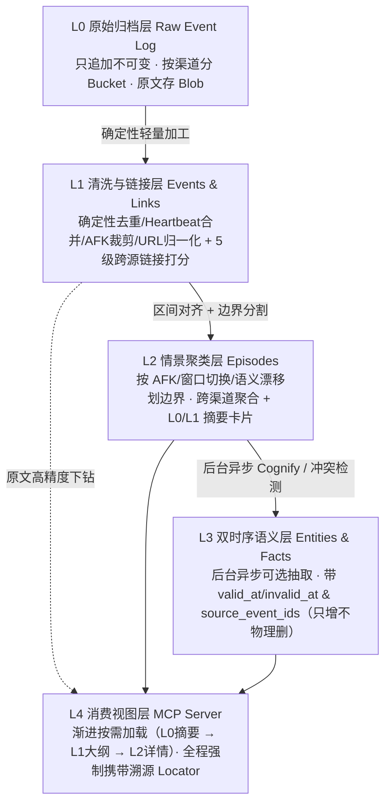

[🏠 首页索引](../../README.md) ｜ [📡 采集渠道调研](channels.md) ｜ **🧩 整合方法与架构（本文）** ｜ [📦 开源项目精读](projects-digest.md) ｜ [📄 论文与博客精读](papers-blogs-digest.md) ｜ [🎙️ 音频通道](channel-audio.md) ｜ [📋 剪切板通道](channel-clipboard.md)

# 上下文整合方法与分层架构研究

> 回答项目核心设计命题：**“从音频、剪贴板、网页、窗口等通道采回来的异构碎片，到底靠什么方法缝合在一起，又怎么喂给 Agent 才不会越喂越笨？”**

> [!NOTE]
> **核实说明**：学术文献通过检索交叉比对标题、ID、作者与摘要完成核验；`Timelinize`、`Omi`、`screenpipe` 的字段级 schema 整理自公开文档与调研期资料，编写对应持久化适配代码前请先对照目标仓库最新源码核实一次。

---

## 一、 核心研究结论（TL;DR）

> [!IMPORTANT]
> **四条拍板原则（直接指导 RFC-0001 与代码设计）**：
> 1. **没有一种单策略能通吃全场景**：必须把 **锚点 Join（Promnesia）+ 统一事件流（ActivityWatch）+ 情景分割（EM-LLM/EST）+ 双时序图谱（Graphiti）+ 分层懒加载（OpenViking）** 组合在正确层级。
> 2. **只有 `L0` 原始日志是唯一真相来源（Single Source of Truth）**：下游所有链接、Episode、实体与摘要视图全都是可销毁、可重算的派生物。
> 3. **摘要只做目录导航，关键答复必须回溯原文**：*LifeDialBench* 证明过度有损压缩常打不过简单 RAG，Chroma *Context Rot* 证明硬塞长文同样拉垮表现——最佳均衡解就是 **`L0/L1` 目录概览先行 + 按需精准调取原貌**。
> 4. **跨渠道缝合的主力引擎是 `Episode`（情景单元）**：辅以从零成本到高成本的五级跨渠道链接打分管道。

---

## 二、 11 个先驱开源系统数据模型横评

| 代表系统 | 核心数据 Schema 抽象 | 本项目可直接复用的设计灵感 |
| :--- | :--- | :--- |
| **[Promnesia](https://github.com/karlicoss/promnesia)** | `Visit(url, dt, context, locator)`，以归一化 URL 汇聚入 SQLite | **确定性锚点 Join**；强制要求用 `locator` 承担可信溯源 |
| **[HPI](https://github.com/karlicoss/HPI)** | 模块化 `my.*` 输出强类型 iterator，`all.py` 合流 | **采集适配解耦层**：保留原始文件不动，各自源内归一化 |
| **[Timelinize](https://github.com/timelinize/timelinize)** | `items`（带时间戳点）+ `entities` + `attributes` + `relationships` 投影 | **统一时间线 + 实体关系网** 双层投影结构 |
| **[ActivityWatch](https://github.com/ActivityWatch/activitywatch)** | `bucket` + `event{timestamp, duration, data}`；**Heartbeat 合并** | 窗口与浏览时长直接复用；**时间区间求交**是零算力对齐原语 |
| **[screenpipe](https://github.com/mediar-ai/screenpipe)** | SQLite（`frames / ocr_text / audio_transcriptions`）+ FTS5 + REST MCP | “原始流 + 全文检索 + MCP” 最小可行参照（但其缺乏跨源语义缝合） |
| **[OpenViking](https://github.com/volcengine/OpenViking)** | `viking://` 虚拟文件系统：`L0 .abstract` → `L1 .overview` → `L2 原文` | **分层按需加载范式**，精准控制 Agent 上下文 Token 预算 |
| **[Graphiti](https://github.com/getzep/graphiti)** (`arXiv:2501.13956`) | Episode / Entity / Community 子图 + **双时间轴**（`valid_at/invalid_at` & `created_at/expired_at`） | **冲突演进与时间失效处理的工业标准**：旧边关区间、不删除 |
| **[Mem0](https://github.com/mem0ai/mem0)** (`arXiv:2504.19413`) | 抽取候选事实后由 LLM 决定 `ADD / UPDATE / DELETE / NOOP` | 写时整理维护高密状态卡很高效；**但 `DELETE` 会丢历史溯源，不能用于底层日志** |
| **[Letta](https://github.com/letta-ai/letta)** | `Core / Recall / Archival` 分页记忆 + `sleep-time agent` 后台整理 | 借鉴其**后台空闲异步整理**，零打扰生成夜间 `Episode` |
| **[cognee](https://github.com/topoteretes/cognee)** | `add → cognify → memify` 异步流 + `DataPoint` 类型原语 | 把 `WebPage`、`ClipboardItem` 定义为标准强类型节点走异步加工 |
| **[Omi](https://github.com/BasedHardware/omi)** | `Conversation{segments, structured}` + 独立提炼 `Memories` | 完美演示语音信道三段跳：**会话切段 → 结构化摘要 → 记忆事实** |

---

## 三、 学术脉络与前期引用核实记录

### 核心学术脉络速览
- **Lifelog 检索传统**：从早年 Memex、*MyLifeBits* 到年度竞赛 LSC（Lifelog Search Challenge），共识明确指向：**以“事件”作为一等检索单元，并原生支持“在此之前 / 之后”时间邻接延伸查询**。
- **事件分割与情景记忆**：心理学 *Event Segmentation Theory (EST)* 指出**预测误差突增处即为事件边界**；[EM-LLM](https://arxiv.org/abs/2407.09450)（ICLR 2025）用 `Bayesian surprise` 在线划定事件并拓展时序邻居；[Episodic Memory](https://arxiv.org/abs/2502.06975) 论证情景记忆绝不能被静态事实压扁替代；*Nemori* ([arXiv:2508.03341](https://arxiv.org/abs/2508.03341)，标题与 ID 对应关系部分核验) 同样延续自组织边界校准路线。
- **个人知识图谱**：Balog & Kenter (*ICTIR 2019*) 确立以“我”为中心、私有+公共实体链接共生的 PKG 架构。
- **Context Engineering**：Anthropic 主张 **Just-in-Time 按需取用** 与动态精简；Chroma *Context Rot* 实证输入变长且混入干扰项后模型性能提前滑坡。

### 引用论文与基准核实状态表

| 论文 / 基准 | 核实状态 | 链接 / 编号 | 对本项目最关键的实证要点 |
| :--- | :---: | :--- | :--- |
| **LifeDialBench** | ✅ 已核实 | [arXiv:2604.11182](https://arxiv.org/abs/2604.11182) | 严格在线流式评测；**复杂有损记忆系统常打不过保留原粒度的简单 RAG** |
| **STALE** | ✅ 已核实 | [arXiv:2605.06527](https://arxiv.org/abs/2605.06527) | 隐式冲突专项（`400` 场景 / `1200` query）：最好成绩 **`55.2%`**，提出 `CUPMem` |
| **PM-Bench** | ✅ 已核实 *(ID 仅见于一组检索结果，建议人工复核)* | [arXiv:2607.12385](https://arxiv.org/abs/2607.12385) | 专注 `7` 天连续模拟与前瞻记忆提醒，最好 F1 约 **`65.1%`** |
| **MemoryCD** | ✅ 已核实 | [arXiv:2603.25973](https://arxiv.org/abs/2603.25973) | 基于多年真实用户行为验证跨域个性化与长程抗退化 |
| **Memory for Autonomous LLM Agents** | ✅ 已核实 | [arXiv:2603.07670](https://arxiv.org/abs/2603.07670) | 基于 POMDP 抽象出 **`Write – Manage – Read`** 三轴设计语言 |
| **From Memory to Action** | ⚠️ OpenReview 收录 *(未见 arXiv 编号)* | OpenReview | **最大性能掉点发生在“记忆已经可用之后、转化为具体行动之前”** |
| **LongMemEval** | ✅ 已核实 | [arXiv:2410.10813](https://arxiv.org/abs/2410.10813) | 评测提取/多跳/时间推理/更新/拒答五大能力，时间感知 query 扩展收益大 |
| **LoCoMo** | ✅ 已核实 | [arXiv:2402.17753](https://arxiv.org/abs/2402.17753) | 超长多会话连续对话记忆与多模态串联基准 |

---

## 四、 六类整合策略横向对比

| 整合策略 | 代表系统 | 显著优点 | 突出短板 | 计算成本 | 可溯源性 | 过时失效控制 | 跨模态关联力 |
| :--- | :--- | :--- | :--- | :---: | :---: | :---: | :--- |
| **(a) 锚点 Join** | Promnesia | 确定可控、零 LLM 开销 | 只能关联共享 URL/ID；录音通常缺锚点 | 极低 | 极好 | 不处理 | 网页↔剪贴板强；语音↔网页弱 |
| **(b) 统一事件日志** | ActivityWatch / Timelinize | 是绝对真相源，支持重放重算 | 自身缺少高层语义串联 | 低 | 天然具备 | 只增不改无冲突 | 仅限时间相近推测 |
| **(c) Episode 分割** | EM-LLM / Omi / LSC | 最贴近人类情景回忆，粒度适中 | 跨天长线任务容易被时间切成多段 | 中 | 好 | 有起止范围但难判事实有效 | **多模态关联主力机制** |
| **(d) 双时序知识图谱** | Graphiti / cognee | 擅长多跳关系推理与新旧更替 | 依赖大模型抽取、维护开销较高 | 高 | 好 | **最强（双时间轴）** | 借共享实体高效打通 |
| **(e) LLM 事实压榨** | Mem0 / Letta | 体积极省，可直塞工作 Prompt | 有损浓缩；`DELETE` 易销毁来龙去脉 | 中 | 弱 | 较粗糙 | 弱 |
| **(f) 分层摘要文件系统** | OpenViking | 对 Token 极其友好，人机皆可读写 | 摘要随新事件会老化需定时重建 | 中 | 中 | 需定期重构 | 依赖目录分类结构 |

---

## 五、 推荐五层架构（`L0 → L4` 蓝图）

### 跨渠道关联怎么算？（遵循“从零成本确定规则到重语义”五步阶梯）

1. **确定性锚点匹配（零算力）**：URL 规范化后精确对碰；代码文件路径、Git Commit Hash、邮箱、单号精确重合即强绑定。
2. **内容指纹重合**：用 MinHash / 文本子串检测“剪贴板复制文字是否出自刚才打开网页的正文”，确立明确的 `copy_of` 因果边。
3. **时间结构求交**：先靠 **区间求交（Interval Intersection）** 把每次 `Cmd+C` 精准挂靠到那一毫秒的前台软件和网页标签上；随后对“不超过 `15 分钟`、中间无明显 `AFK` 离开”的临近事件施加随时间衰减的共现分。
4. **语义与实体叠加**：计算 Embedding 余弦相似度与命名实体（项目名 / 人名 / 专有名词）重叠度。
5. **融合判分与 Episode 边界收口**：前期以加权规则建边并存下命中证据，未来有标注后再拟合最优权重；**应用切换 + 空闲超过阈值 + 语义主题偏移**三合一划定基础 `Episode` 边界，再交由后台空闲窗口精修边界和生成可读摘要。

### MCP 暴露协议设计草案（`L4` 对外接口）

- **Resources（分层目录 URI）**：`oc://now`、`oc://episodes/{date}`、`oc://episode/{id}`、`oc://event/{id}`、`oc://entity/{id}`
- **核心只读 Tools**：
  - `search_context` · `get_timeline` · `related`（沿 Promnesia 式关联链接与实体网扩散）
  - `what_was_i_doing(at)` · `get_facts(subject, as_of)`（带时间点参数查彼时有效的状态！）
  - `expand(id, level)`（先查概览、觉得有必要再取全文细节）
- **铁律约束**：一切返回结果必须附带原件溯源（`locator`）及结构化时间信息；支持 `max_tokens` 预算裁剪参数；最高敏感级别标记数据坚决锁在本机不出网。

---

## 六、 端到端评测设计指南（自我验收闭环）

- **评测数据集构造**：收集个人连续 `1～2 周` 真实多渠道记录彻底脱敏后作为主干，再以脚本合成分镜剧本（如“手表口头提到概念 → 浏览器精读文档 → 剪贴板复制报错 → 收到任务提醒”），合成剧本的跨渠道关联真值 100% 已知。
- **必考六类能力题型**：① 跨渠道联合召回 ② 时间顺序与区间推理 ③ 隐式状态失效（STALE 题型） ④ 未知/不存在记录拒答（Abstention） ⑤ 前瞻提醒触发 ⑥ 真实接入 Agent 后的下游任务成败率。
- **在线流式防泄漏与消融实验**：严格遵守时间因果顺序逐秒回放，杜绝偷看未来记录；依次对比：`纯原始块 RAG → +跨渠道 Link → +Episode 聚类 → +双时序 Facts → 完整 L0–L4 分层懒加载`。
- **核心观测指标**：回答准确率、证据链召回与精确率、跨源 Link 的 P/R、Episode 边界 F1、每次注入耗费的 Token 与端到端延迟、敏感 PII 零泄露校验。

---

## 七、 仍待探索的开放研究问题

1. 跨模态链接置信度怎么高效校准——能否利用“剪贴板 ↔ 当前前台浏览器网页”这种极高确信度的天然锚点当作弱监督标签，反向自举训练“语音 ↔ 网页”之间的软关联评分？
2. 多线程多任务高频交织工作时（一边改 Bug 一边回同事咨询），同一物理时间内的事件能否同时隶属多个并行重叠的 `Episode`？层次化嵌套 Episode 该怎么优雅表达？
3. 在何种 Token 预算甜点区下，引入高层摘要相比直查原片断开始产出显著正收益？
4. 仅凭外显用户行为变化（例如连续两天突然不再打开项目 A 的文件与仓库），能否自动推断某条项目状态事实已经悄然失效过期？
5. 完全被动安静运行的采集体系，应该通过何种不令人烦躁的节制交互暴露前瞻意图（提醒漏掉的待办）？
6. **二次隐私衍生风险**：多渠道交叉推理可能拼出单一源里原本看不到的敏感秘密——本地小模型与云端大模型到底怎么切分分工，以及用户删除一条 `L0` 原件时所有派生 `L2/L3` 该如何实现彻底的级联遗忘与清理？
7. 如何建立开源社区可共享、又绝不泄露真人隐私的脱敏生活流真实评测集？
8. 消除 **“记忆到行动（From Memory to Action）”** 的鸿沟：本地收集整理好的 Context 究竟排成哪种文本结构或提示模板，Code Agent / 通用助手最容易看懂并用对？
9. 多设备之间（手表 vs 手机 vs Mac）微小系统时钟漂移与离线 ASR 时间戳识别偏移，对跨渠道毫秒对齐到底有多大实际影响？
