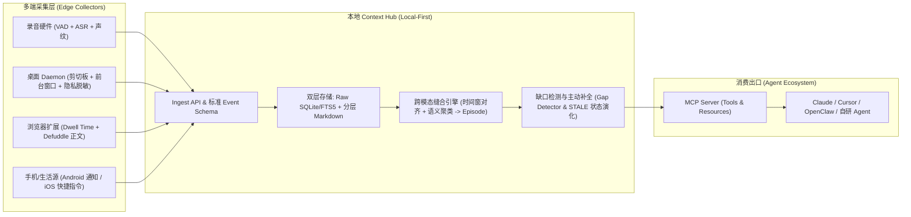

# 早期全景调研（初稿）

> 最早的一版调研，部分数据未核实（star 数等）。核实后的结论以 [channels.md](channels.md)、[integration-methods.md](integration-methods.md) 为准。

> **研究目标**：为构建“开源 Agent Context 补全计划”提供学术依据、开源竞品全景、端侧采集技术可行性边界（macOS / 浏览器 / 移动端 / 录音硬件）、隐私合规设计及差异化架构蓝图。

---

## 一、 核心问题定义：为什么 Agent 需要“Context 补全计划”？

当前主流 AI Agent（Cursor、Claude、OpenClaw 等）的交互范式本质上是**“输入框驱动的孤岛式协作”**——每次新任务开始，用户都必须手动搬运背景：
- 刚在线下用硬件录下的口头讨论；
- 刚刚在不同软件间复制粘贴的报错、单号或灵感片段；
- 花了 5 分钟精读并划重点的技术博客；
- 手机通知栏刚刚弹出的日程变更、物流或消息摘要。

这些对用户意图至关重要、但当前 Agent 默认完全看不见的数据，可以统称为 **Dark Context（隐式/盲区上下文）**。

本项目的核心价值不在于“再造一个聊天记忆库”，而在于：**打通被 OS 权限、应用孤岛与物理空间割裂的高信噪比信号，通过跨模态时间线缝合与缺口补全，成为所有 Agent 通用的外部“感知海马体”。**

---

## 二、 学术界与 Benchmark 前沿洞察（2025–2026）

近期顶级会议与 arXiv 的多篇最新研究，直接揭示了连续生活流（Lifelogging）和个人上下文（Personal Context）领域的关键瓶颈，对本项目的架构选型有决定性指导意义：

### 1. 过度有损压缩反而伤害性能（LifeDialBench, arXiv:2604.11182, 2026.04）
* **研究内容**：针对可穿戴设备与环境感知的连续日常对话评估（包含真实第一视角数据集 *EgoMem* 与模拟社区 *LifeMem*），引入严格的时间因果在线评测协议。
* **核心反直觉发现**：在连续环境流场景下，**许多复杂的“高级摘要压缩型”记忆系统反而跑不过保留原始粒度的简单 RAG 基线**。原因在于早期的有损摘要会丢掉当下看似无关、但几天后才显现关联的细节。
* **架构启示**：**原始证据链不可丢弃**。应采用“原始高精度事件层（Raw Event Store）+ 可演进摘要层（Episode / Semantic Layer）”的双层设计，而不是用摘要直接覆盖原始记录。

### 2. 隐式状态冲突是最大杀手（STALE, 2026.05）
* **研究内容**：测试“隐式冲突（Implicit Conflict）”——即生活中新的环境事件悄悄推翻了旧状态，而用户从未显式宣布“请忘记旧记忆”（例如：上周刚说在调研方案 A，这周录音里一直在改方案 B 的代码）。
* **核心数据**：即便最前沿的大模型，在用户个人状态自然随时间推移的场景下，状态更新与推理准确率也仅约 **55%**。
* **架构启示**：每条 Context 必须带**严格的时间戳、生命周期（TTL/Valid-From/Valid-To）与状态演进边**，不能把半年前的剪切板和今天的网页精读混在同一个扁平向量库里检索。

### 3. 瓶颈在于“注意力权重与利用”，而非“存不下”（MEMORYCD, 2026.10 & From Memory to Action, 2026.09）
* **研究发现**：跨领域长期记忆的主要失效原因不是检索不到，而是**低价值噪声淹没了高意图信号**，导致模型不知道该用哪条记忆。
* **架构启示**：采集端必须计算 **Attention Weight（注意力权重）**——在网页停留 3 秒误点关闭的权重接近 `0`，精读 4 分钟且伴随复制动作的权重为 `0.9`。

### 4. 前瞻性记忆（PM-Bench, 2026.07）
* **研究内容**：评估 Agent 在未来某个正确时间点或场景线索出现时，主动想起并触发未完成意图的能力（Prospective Memory）。
* **架构启示**：这正是**“补全计划”**高阶形态的理论支撑——不仅被动回答，还能在检测到“你打开了某项目但昨天录音里提到的风险还没解决”时主动提示。

---

## 三、 GitHub 开源生态全景与空白分析

我们对当前 GitHub 上最相关的四大类高质量开源项目做了横向拆解：

| 层次 | 代表开源项目 | GitHub 量级 | 核心强项 | 明显短板 / 留给我们的空间 |
| :--- | :--- | :--- | :--- | :--- |
| **感官采集层** | [screenpipe/screenpipe](https://github.com/screenpipe/screenpipe) | ~22k+ Stars | Rust 底座，24/7 本地桌面录屏 OCR + 音频 + MCP | 资源占用偏高；不抓浏览器精确停留与正文 DOM；无移动端/生活流融合 |
| | [BasedHardware/omi](https://github.com/BasedHardware/omi) | ~13k–14k+ Stars | 开源 AI 可穿戴硬件 + 环境对话转写与总结 | 偏重纯语音生态，与桌面剪切板、代码、浏览器阅读等工作流割裂 |
| | [ActivityWatch/activitywatch](https://github.com/ActivityWatch/activitywatch) | ~19.6k Stars | 隐私优先的跨平台窗口/网页 Dwell Time 统计 | 只记“标题和时长”，**不抓网页正文、不抓剪切板内容、不做 AI 语义缝合** |
| | [Freika/dawarich](https://github.com/Freika/dawarich) | ~10.9k+ Stars | 自托管位置历史（Google Timeline 替代） | 仅解决地理轨迹，未与日常语义事件关联 |
| **数据统一层** | [karlicoss/HPI](https://github.com/karlicoss/HPI) & [promnesia](https://github.com/karlicoss/promnesia) | ~1.6k / ~1.9k Stars | 极客级个人数据 Python 抽象层与浏览器历史侧边栏注入 | 偏脚本批处理和静态导出，缺少现代实时流、MCP 出口和语音硬件接入 |
| | [timelinize/timelinize](https://github.com/timelinize/timelinize) | ~3.7k Stars | 多账户数据拉取归档到本地统一时间线 | 侧重历史归档（Archival），而非实时的 Agent 上下文供给（Live Context） |
| **记忆基础设施** | [volcengine/OpenViking](https://github.com/volcengine/OpenViking) | ~42k+ Stars | 虚拟文件系统（`viking://`）分层加载与自我演进 | 定位是通用 Agent Context DB，**不包含端侧真实生活采集器** |
| | [mem0ai/mem0](https://github.com/mem0ai/mem0) / [getzep/graphiti](https://github.com/getzep/graphiti) / [topoteretes/cognee](https://github.com/topoteretes/cognee) / [letta-ai/letta](https://github.com/letta-ai/letta) | ~20k–68k Stars | 成熟记忆抽取、时序知识图谱（Graphiti）、有状态 Agent（Letta） | 全部假设“输入已经是干净对话文本”，**缺少从物理/OS 提取高噪暗数据的前端感知链** |
| **上层应用** | [khoj-ai/khoj](https://github.com/khoj-ai/khoj) / [volcengine/MineContext](https://github.com/volcengine/MineContext) | ~37k / ~5.5k Stars | 第二大脑 RAG 与主动式桌面洞察 | 跨端硬件（自研录音硬件）与自定义细粒度信号（剪切板+网页精读）扩展性受限 |

### 结论：明显的生态空白（Sweet Spot）
* **下游（Memory DB / MCP / Graph）已经非常成熟，但上游（High-Signal Multi-Modal Context Capture）极度碎片化且普遍缺失。**
* 几乎没有一个开源项目同时把 **“自研硬件录音 + 剪切板微意图 + 网页真实精读（Dwell Time + 正文） + 手机通知流”** 用一套统一的注意力权重协议缝合起来，并标准地通过 MCP 喂给任何 Agent。

---

## 四、 四大核心采集源：技术方案与关键避坑指南

### 1. 录音硬件（线下对话 Context）
* **推荐本地/边缘处理管线**：
  * **传输与切片**：硬件端或手机端尽量先做 **VAD（语音活动检测）**，只上传/保存有效人声片段，大幅减少无效静音和功耗。
  * **中文/中英混杂最佳开源 ASR**：**阿里 FunASR + `SenseVoiceSmall`**（非自回归架构，延迟极低，原生支持中/粤/英/日/韩及笑声/情绪标签），需要轻量级跨端无 Python 依赖时可用 **`sherpa-onnx`** 跑量化后的 SenseVoice ONNX 模型。
  * **说话人分离（Diarization）**：这是线下录音能否变成有效 Context 的分水岭。可用 FunASR 内置的 **CAM++** 声纹聚类，或 `sherpa-onnx` 移植的 **`pyannote-segmentation-3.0` + 3D-Speaker**，区分出“用户本人（Self）”与“他人（Speaker_X）”。

### 2. 用户剪切板 + 前台上下文（高意图微动作）
* **核心原则**：**没有来源上下文的剪切板记录是半残废的。**每次捕获必须打包：
  `{ content, content_type, source_app_name, source_bundle_id, window_title, timestamp }`。
* **macOS 工程实现与系统坑**：
  * 监听 `NSPasteboard.general.changeCount` 轮询（如 300–500ms 一次，几乎零 CPU 占用），结合 `NSWorkspace.shared.frontmostApplication` 与 Accessibility API (`AXUIElement`) 获取窗口标题。
  * **⚠️ macOS 15.4+ 新特性警示**：Apple 引入了 `NSPasteboard.AccessBehavior` 权限提示机制，后台静默读取剪切板可能会触发系统隐私弹窗提醒用户。开源项目需在文档和权限引导中明确告知用户授予“始终允许访问剪切板”，并配合透明的本地脱敏审计日志建立信任。
* **本地三层隐私防线（开源项目生死线）**：
  1. **来源黑名单（Zero-Touch Skip）**：检测到前台是 1Password、Bitwarden、KeePassXC、macOS 钥匙串或隐身浏览器窗口时，**直接内存跳过，绝不落盘**。
  2. **隐秘凭证正则拦截**：使用类似 `gitleaks` / `detect-secrets` 规则，过滤 `sk-...`、`ghp_...`、JWT、私钥块与 4–6 位短信验证码。
  3. **可选 PII 脱敏**：针对身份证号、手机号、银行卡号，支持通过本地正则或 **Microsoft Presidio** 替换为占位符（如 `<PHONE_1>`），或标记为 `privacy_tier: L2_LOCAL_ONLY` 禁止出本地。

### 3. 浏览记录 + 停留时间（Dwell Time）+ 浏览内容
* **为什么不直接读 Chrome SQLite `History` 文件？**
  * Chrome 的 History 只有访问时间点和标题，**没有“你在上面停留了多久”、没有“是否处于前台专注状态”、更没有网页正文**。
* **推荐 Chrome MV3 扩展方案**（参考 `aw-watcher-web` 的焦点追踪 + 现代正文抽取）：
  1. **精确计算 Effective Dwell Time**：
     * 监听 `chrome.tabs.onActivated`、`chrome.windows.onFocusChanged` 与 `chrome.idle.onStateChanged`（检测用户离开电脑无操作）。
     * 在 Content Script 中监听轻量交互（`scroll`、`visibilitychange`、文本选中 `selectionchange`），仅当页面处于**可见 + 窗口获焦 + 用户非 Idle** 时累加活跃阅读秒数。
  2. **触发式正文抽取（降噪核心）**：
     * **阈值过滤**：例如活跃停留 `>= 20 秒`，**或**用户在该页面触发了复制动作，才视为高价值阅读事件。
     * **正文清洗库**：强烈推荐用 **`kepano/defuddle`**（Obsidian Web Clipper 团队开源的现代网页抽取库，相比传统 `@mozilla/readability` 对现代前端框架和 Markdown 转换更友好）在浏览器本地直接转成干净 Markdown。
     * **域名黑名单**：默认跳过网银、内部管理后台、登录页等敏感 URL，支持用户自定义配置。

### 4. 手机端与生活高频外延信号（成本低、信息密度极高）
* **Android（开放度高，极具可玩性）**：
  * **通知总线监听（`NotificationListenerService`）**：官方合法权限，可实时获取外卖、快递、银行入账、微信/飞书消息摘要、日程提醒的 `packageName`、`title`、`text`，是性价比最高的手机 Context 来源。
  * **手机剪切板限制**：Android 10+ 严禁后台读取剪切板。开源替代路径：① 基于 **Shizuku** 调用系统服务绕过限制（参考 `Rian-yes/Clipboard-Manager`）；② 基于无障碍服务或自定义输入法扩展。
* **iOS（封闭度高，走轻量化协同）**：
  * iOS 无法后台常驻采集剪切板和通知。推荐提供 **Apple Shortcuts（快捷指令）模板**：一键将当前选中文本/网页/备忘录通过本地局域网 HTTP 或 Tailscale Webhook 推送到你的 Hub，作为主动补充入口。
* **零耗电物理场景标签**：
  * 不需要持续开 GPS 耗电，桌面端/手机端只需上报当前连接的 **Wi-Fi SSID（脱敏哈希映射为 `Home` / `Office` / `Cafe`）或蓝牙设备名（如车载蓝牙、耳机）**，即可为同一时间段的所有事件打上高质量环境标签。

---

## 五、 推荐系统总体架构：“Context 补全计划”参考蓝图



### 核心设计亮点（支撑研究与开源差异化）

#### 1. 统一标准事件协议（Unified Context Event Schema）
所有采集端向 Hub 上报同一套 JSON Schema，核心字段建议包含：
```json
{
  "event_id": "evt_01J...",
  "timestamp": "2026-11-14T10:15:30+08:00",
  "duration_sec": 145,
  "source": {
    "modality": "web_read | clipboard | audio_turn | app_focus | notification",
    "device": "macbook-pro",
    "app_or_domain": "arxiv.org"
  },
  "attention_score": 0.85,
  "privacy_tier": "L0_CLOUD_OK | L1_REDACTED | L2_LOCAL_ONLY",
  "content": "...",
  "metadata": {}
}
```

#### 2. “补全”的核心算法：跨模态缝合 + 缺口检测
* **Episode Stitching（事件缝合）**：
  * 以时间滑动窗口（如 10–15 分钟）+ 实体/关键词重叠度为依据，把孤立的事件串成一个 **Episode**。
  * *示例*：硬件录音提到“SenseVoice 量化”、10 分钟后浏览器精读了 `sherpa-onnx` 文档、随后 VS Code 和 Terminal 间复制了一段报错 —— 系统自动将这 3 条记录归档为同一个主题工作流，Agent 查询时直接拿到前因后果，而不是 3 条互不相干的碎片。
* **Gap Completion（主动缺口补全）**：
  * 当检测到**孤立高权重事件**（例如录音中多次提到一个未见过的专有名词、或者剪切板复制了一段无头无尾的报错但缺少项目上下文），标记为 `incomplete_episode`，允许用户每天花 30 秒通过极简卡片/CLI 补充一句话，或触发关联源回溯。

#### 3. 人机共读存储 + MCP 标准出口
* **存储双轨制**：SQLite（FTS5 全文索引 + 可选轻量向量如 `sqlite-vec`）负责毫秒级检索；同时按日期/主题生成干净的 **Markdown 文件树**（可直接在 Obsidian 中浏览和手动修改，彻底消除黑盒恐惧）。
* **MCP Server 接口设计（极简 4 工具）**：
  * `get_working_context(minutes=60, min_attention=0.3)`：获取当前正在做的事（已按 Episode 缝合，自动尊重 `privacy_tier`）。
  * `search_context(query, time_range, modalities)`：跨模态检索历史线索。
  * `get_recent_focus_and_clipboard(limit=10)`：专为编程/写作 Agent 设计的“刚刚复制与浏览的精读内容”。
  * `report_context_gap(episode_id, question)`：允许外部 Agent 在觉得信息不足时，向 Hub 登记待补全缺口。

---

## 六、 研究与开源破局建议

如果你想让这个项目不仅自己好用，还能在 GitHub 社区和研究圈产生影响力，建议采用以下组合拳：

1. **做“标准与生态”，不做封闭 App**：定位为 **“Open Agent Context Protocol & Local Hub”**，把 Event Schema 单独成规范文档，欢迎其他人写飞书、微信、Kindle、Apple Health 等各种 Collector 插件。
2. **隐私可见性是第一生产力**：在仓库首页直接提供一条龙的“隐私审计视图”与“脱敏规则测试集”，让开发者敢在工作电脑上 24 小时挂着运行。
3. **顺手产出一个可量化的评测集（Mini-Benchmark）**：基于你的真实脱敏脱壳场景（比如构造 30 个“需要结合线下录音 + 10 分钟前网页阅读 + 刚刚剪切板报错才能正确回答”的测试 Case），对比 **无 Context（0% 基线） vs 纯历史记录 vs 本项目的 Attention-Weighted + Stitched Context** 的任务一次通过率。这种实测数据无论是写进 GitHub README 还是发表技术报告/论文，说服力都极强。

---

## 七、 下一步：如何与即将开始的并行 MVP 开发衔接？

调研完成后，如果你准备用 `codex cli` 并行启动 **v1 MVP**，我建议在工作区中采用如下零冲突的 Monorepo 拆解方式：

* `schema/`（我先编写）：统一 Event Schema、SQLite DDL、OpenAPI / HTTP Ingest 接口契约（作为所有并行 Worker 的唯一真理来源）。
* `hub/`（Codex Worker 1）：Python FastAPI Ingest 服务 + SQLite FTS5 存储 + 基础时间窗 Episode 缝合 + 官方 `mcp` Python SDK Server。
* `collectors/mac-daemon/`（Codex Worker 2）：macOS 剪切板 + 前台 App/窗口采集 + 黑名单与正则脱敏过滤。
* `collectors/browser-ext/`（Codex Worker 3）：Chrome MV3 扩展（`idle`/Focus Dwell Time 计算 + `defuddle` 正文转 Markdown 上报）。
* `collectors/audio-bridge/`（Codex Worker 4）：对接你录音硬件输出的适配器（支持本地/API 转写或直接消费硬件文本流）。
