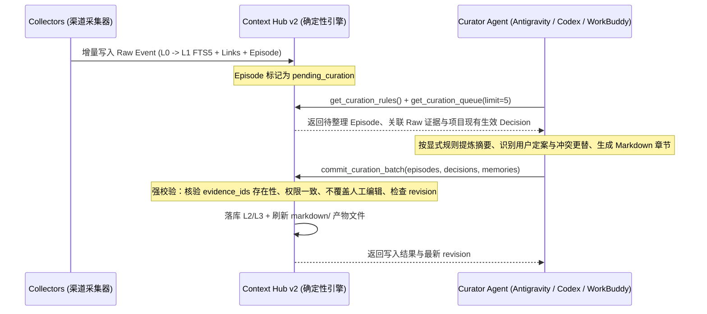

# RFC 0002：Context Hub v2 —— L0–L4 本地架构与 Agent-as-Curator 整理范式

- **状态**：Accepted（v2 实施基线）
- **前置参考**：[RFC-0001](0001-context-integration.md) · [Persom 0.1.200 剖析](../research/persom-0.1.200.md) · [整合方法调研](../research/integration-methods.md)

## 1. 背景与核心范式转变

早期原型将“记忆提取”写死在服务端 40 行关键词正则里，既缺乏真正语义理解，又试图把底层 CRUD 直接暴露给 Agent。v2 确立三条核心原则：

1. **Hub 保持确定性、零内置 LLM 密钥**：Hub 专注做好原档不可变落盘（L0）、高速全文/结构索引与确定性跨源链接（L1）、Episode 边界与可读 Markdown 生成（L2）、双时序决策验证存储（L3）以及权限与 MCP 出口（L4）。
2. **Agent-as-Curator（复用用户已有算力）**：语义整理、主题归并、决策抽取与冲突演进交给用户本地已拥有的高能力 Agent（**Antigravity / Codex / WorkBuddy / Claude Code**）。Hub 将**显式整理规则（Skill / MCP Prompt）**、**待整理批次队列**与**强校验回写接口**暴露给 Agent，支持交互式触发与定时后台自动整理（Sleep-time Curation）。
3. **证据门控与安全底线**：Agent 提交的任何摘要、Memory 或 Decision，必须引用真实存在且符合隐私级别的 `evidence_ids`；原始记录与外部内容始终被标记为不可信数据；私密凭证与证件留在独立加密的 **Context Vault v2**，绝不混入 Hub 明文库。

## 2. 五层存储与数据流

| 层级 | 物理载体 | 职责与不变式 |
| :--- | :--- | :--- |
| **L0 原始归档** | `raw/YYYY/MM/DD/<source>.jsonl` | 只追加、永不覆盖，保留采集原貌；任意时刻可全量重放重建下游索引。 |
| **L1 索引与链接** | `hub.sqlite`（WAL + FTS5 中文分词） | 毫秒级多维查询（关键词/时间/渠道/项目/隐私级别）；5 级确定性跨源链接（`same_anchor` / `copy_of` / `during` / `related`）。 |
| **L2 情景与产物** | `episodes` 表 + `markdown/` 目录 | 确定性边界聚合为 Episode；整理后生成带 YAML Frontmatter 的可读 `.md`（日报 / 情景档 / 项目页），与 Obsidian 无缝互通。 |
| **L3 决策与事实** | `decisions` + `memories` 表 | 双时序状态（`valid_at` / `superseded_by`），明确区分 `user_confirmed` / `assistant_suggested` / `observed`，永不静默抹除历史。 |
| **L4 双闭环出口** | FastAPI + Workbench UI + MCP Server | **消费侧**：`what_was_i_doing` / `search_context` / `get_project_state` / `related` / `expand`（带 Token 预算）；**整理侧**：`get_curation_rules` / `get_curation_queue` / `commit_curation_batch`。 |

## 3. Agent-as-Curator 整理闭环

## 4. 隐私分层与默认可用性

- **三层可见性**：`local_only`（仅所有者可见，Agent 不可见）、`redacted`（已脱敏，Agent 可见）、`shareable`（授权本机 Agent 可见）。
- **渠道级策略引擎**：允许用户按渠道/项目/联系人白名单配置默认级别（例如：过滤密码后的剪贴板与授权项目 AI 对话默认对本机 Agent 可见；私密微信对话、敏感域名默认 `local_only`），彻底消除逐条手动点授权的摩擦。
- **Context Vault v2 物理隔离**：API Key、证件扫描件、个人敏感信息单独存入逐条 AES-256-GCM 加密库；Agent 通过审批代理或 CLI 临时环境变量使用，仅在执行后向 Hub 写入**不含明文的脱敏操作回执**。
