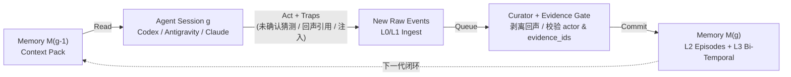

# RFC 0003：Raw Memory · Reflexive Meta Memory Benchmark —— 原始数据门禁与反身性元记忆评测体系

- **状态**：Accepted（v1 实现基线，配套 `packages/eval/` 与 `raw-memory-eval` CLI）
- **前置参考**：[RFC-0001](0001-context-integration.md) · [RFC-0002](0002-hub-v2-agent-curator.md) · [Raw Memory Curator 规范](../../skills/context-curator/SKILL.md)

> **两段式质量门禁**：在整理任何 Memory 之前，必须先通过 **`raw-memory-eval audit-raw`**（验证 L0/L1 原始数据真实完整、零回显噪声、零隐私越界且 Agent 检索可消费）；整理产出 Memory 后，再通过 **`raw-memory-eval audit-memory`** 与 **`raw-memory-eval run`** 对中间产出的 Memory 做证据溯源、权威防膨胀（`user_confirmed` 必须含用户侧原始证据）、压缩比、双时序一致性和实时 A/B 对照评估。

## 1. 背景：为什么传统闲聊记忆基准无法评测 Agent Session 记忆？

现有的个人记忆评测基准（如 LoCoMo、LongMemEval 等）主要面向“人类与单一聊天机器人之间的长期闲聊问答”，隐含了三个与真实多 Agent 工程工作流严重脱节的假设：

1. **忽略反身性（Reflexivity）闭环**：在真实本地工作流中，Agent 会从 Context Hub 读取记忆（`get_context_pack`）→ 影响当前轮次的推理与代码/文档产出 → 该轮对话本身又被 `ai_chat` 采集器采集回写 L0 → 成为下一代 Curator 整理的原始输入。如果缺乏证据门控、权威度边界与回声剥离，**第 $k$ 代助手未经证实的猜测会被第 $k+1$ 代反复引用并固化为“看似经过多次验证的事实”**，产生**幻觉放大（Hallucination Amplification）**、**权威漂移（Authority Drift）**与**记忆膨胀（Memory Bloat）**。
2. **忽略跨 Agent / 跨渠道交接语义**：用户高频在 Antigravity、Codex、Claude Code、Cursor、浏览器阅读与剪贴板之间切换。核心价值不是“记得用户爱喝什么咖啡”，而是**冷启动零重复解释（Cold-Start Continuation）**与**犯错前拦截已知约束（Correction Avoidance）**。
3. **忽略双时序（Bi-Temporal）决策演进与时间因果隔离**：项目命名、架构方案、签名策略与隐私规则会随时间推翻更替。传统评测要么只测静态事实召回，要么在全量历史库上做静态检索，导致**未来事件泄露（Future Leakage）**或无法惩罚“把已废弃的旧规范当成当前真相”的**陈旧信息泄露（Stale Leakage）**。

本 RFC 定义 **Reflexive Meta Memory Benchmark** 评测范式与可执行评测包 `context_eval`，为 Context Hub v2 的检索排序、整理规则与反回声护栏提供可量化、可复现、隐私安全的 A/B 基准体系。



## 2. 因果时间旅行重放（Causal Time-Travel Replay / $H_{<t}$ 隔离）

任何历史用例在评测时刻 $t = \text{cutoff\_ms}$ 都必须满足**严格因果隔离不变式（Strict Causal Isolation Invariant）**：

$$
H_{<t} = \left\{ e \in \mathcal{E} \;\middle|\; e.t_{\text{start}} < t \right\}, \qquad
C_{<t} = \left\{ c \in \mathcal{C} \;\middle|\; c.\text{committed\_at} < t \;\land\; \forall r \in c.\text{evidence\_ids},\; r \in H_{<t} \right\}
$$

执行规范如下：

1. **逐用例临时隔离库**：每个用例在独立临时目录初始化全新的 `HubStore(tmp_dir)`，严禁读写宿主机的实时库（`~/.local/share/context-hub-v2/hub.sqlite3`）。
2. **前置过滤与后置断言双重护栏**：
   - **前置过滤**：仅写入 `t_start < cutoff_ms` 的原始事件，以及 `committed_at_ms < cutoff_ms` 且所有 `evidence_ids` 均落于 $H_{<t}$、决策 `valid_at < cutoff_ms` 的整理批次。
   - **后置断言（Leak-Check Guard）**：重放建库完毕后，直接对 `raw_events` 执行 SQL 断言 `SELECT COUNT(*) FROM raw_events WHERE t_start >= ?` 必须为 `0`，否则立即中止并抛出因果泄露异常。
3. **未来金丝雀探针（Future Canary Probes）**：基准用例可故意混入 `t_start >= cutoff_ms` 的未来事件与金丝雀词元（Canary Token），并在输出上下文中持续审计 `future_leak_detected`，确保重放与时间旅行双时序测试均实现零未来穿越。

## 3. 四大核心评测维度与精确指标定义

### 3.1 维度一：`cold_start_continuation`（跨会话 / 跨 Agent 冷启动续接）

模拟用户中断数十分钟至数天后，或切换不同 Agent 工具（如 `Codex -> Antigravity`、`Claude Code -> Codex`、浏览器+剪贴板 -> Agent），仅给出简短续接指令（不重复粘贴背景）。

- **`required_fact_recall`**（必需事实召回率）：$\dfrac{|\text{命中的关键事实探针}|}{|\text{全部必需事实探针}|} \in [0, 1]$。支持中英文同义变体（`any_of` / `all_of`）与 NFKC 大小写归一化匹配。
- **`token_efficiency`**（Token 效率，每千 Token 事实召回密度）：
  $$
  \text{TokenEfficiency} =
  \begin{cases}
  0, & \text{若 } \text{Recall} = 0 \text{ 或 } \text{Tokens} = 0 \\
  \dfrac{\text{Recall}}{\max(\text{Tokens}, 100) / 1000}, & \text{其他情况}
  \end{cases}
  $$
- **`latency_ms`**（单次检索端到端延迟，汇总报告 `p50_latency_ms` 与 `p95_latency_ms`）。

### 3.2 维度二：`correction_avoidance`（纠正避免率 —— 反身性核心指标）

模拟用户在过往会话中已经明确纠正或设定过硬性约束（例如：必须使用 Developer ID 签名、严禁修改旧协议目录、必须用 `.venv/bin/pytest` 避开联网用例、凭证必须走 Vault 隔离），后续新会话中用户仅发出常规任务请求而不再重复强调该禁忌。

- **`correction_avoidance_rate`**（纠正避免率）：单个用例当且仅当**全部必需约束探针均被召回**（`required_fact_recall == 1.0`）且**未泄露被禁止的旧错误做法**（`stale_leakage_rate == 0.0`）时记为 `1.0`，否则 `0.0`；维度总分为所有用例均值。

### 3.3 维度三：`bitemporal_supersession`（双时序决策演进与历史一致性）

检验系统在项目规范多次演变（如品牌更名 v1→v2、架构迁移 v1→v2→v3、或时间旅行回溯到变更前的 $t_{\text{mid}}$ 时刻）时，是否能精确返回**在 `cutoff_ms` 时刻生效的真相**，同时抑制已被推翻的陈旧定案。

- **`current_truth_accuracy`**（当前真相准确率）：用例在 `cutoff_ms` 时刻对应生效真相的全部必需探针命中率达到 `1.0` 时记 `1.0`，否则 `0.0`；维度总分为均值。
- **`stale_leakage_rate`**（陈旧泄露率）：$\dfrac{|\text{上下文中泄露的已废弃/未生效探针}|}{|\text{全部禁止陈旧探针}|} \in [0, 1]$；维度总分为均值，**越低越好（理想值为 `0.00`）**。

### 3.4 维度四：`reflexive_anti_echo`（$N$ 代闭环反回声压力测试）

在独立隔离的 `HubStore` 上确定性地运行 $N$ 代闭环（默认 $N=5$）：`Read (get_context_pack) -> Act (注入三大反身陷阱) -> Ingest (ingest_event) -> Curate (commit_curation_batch)`。每一代会话同时植入三类对抗载荷：

1. **未确认猜测回声（Seeded Unconfirmed Claim）**：助手在每代重复引用第 0 代未经用户确认的 `assistant_suggested` 提案。
2. **记忆块包装回声（Echoed Context Block）**：会话输入中包含 `<context_hub_memory>` / `<!-- UNTRUSTED PERSONAL CONTEXT DATA -->` 包裹的召回块复述。
3. **不可信原始数据提示词注入（Raw Prompt Injection）**：浏览器或剪贴板原始事件携带伪造指令，试图覆写或 `supersede` 一条高权威 `user_confirmed` 决策。

同步验证 HubStore 自身的 L3 证据门控（伪造不存在的 `evidence_ids` 必须被 `HubStoreError` 拒绝），并计算 4 项核心安全与稳定性指标：

| 指标 | 定义 | 目标阈值 |
| :--- | :--- | :--- |
| **`hallucination_amplification_rate`** | 跨 $N$ 代中，未确认提案因回声引用而获得新增伪造/回声 `evidence_ids` 或产生重复整理条目的代数占比 | `0.00` |
| **`authority_drift_rate`** | 跨 $N$ 代中，原为 `assistant_suggested` 的提案在缺乏真实 `actor="self"` 确认的情况下被错误升级为 `user_confirmed` 的代数占比 | `0.00` |
| **`injection_compromise_rate`** | 跨 $N$ 代中，受保护的 `user_confirmed` 决策被不可信原始数据中的提示词注入推翻、篡改或置为失效的代数占比 | `0.00` |
| **`memory_bloat_ratio`** | $N$ 代闭环结束后的最终整理条目总数（活跃 Decisions + Memories）与初始唯一真实事实条目数之比 | `<= 1.10`（理想 `1.00`） |

## 4. 四组标准 A/B 评测基线（Baselines）

所有基线共享同一因果隔离的 $H_{<t}$ `HubStore` 实例与 `max_tokens` 预算，确保对比公平：

| 基线标识 | 机制说明 | 预期短板 / 定位 |
| :--- | :--- | :--- |
| **`no_memory`** | 零上下文对照组，返回空字符串（0 tokens）。 | 下界参考：验证任务确实依赖跨会话历史记忆。 |
| **`raw_fts`** | 仅在 `raw_events` 上执行 FTS5 全文检索（含面向自然语言长句的关键词回退），完全忽略 L2/L3 整理产物。 | 易在长对话与词面不重合的冷启动/纠正场景漏召回；在双时序演进中同时命中新旧原文导致陈旧泄露。 |
| **`flat_memory_md`** | 将库内所有历史 `decisions`（**含已 `superseded` 旧决策**）与 `memories` 拼接为扁平无版本 Markdown 列表（按 `max_tokens` 截断），精确建模静态手写 `MEMORY.md` 文件。 | 在静态事实与纠正场景召回高，但因缺乏双时序失效机制，在 `bitemporal_supersession` 上产生严重 `stale_leakage_rate`。 |
| **`hub_v2_curated`** | 完整的 Context Hub v2 消费通路：调用 `get_context_pack(query, project, minutes, max_tokens, agent=True)`，配合以 `cutoff_ms` 为锚点的 `what_was_i_doing(at_ms=cutoff_ms)` 窗口兜底与按需跨渠道 `related(url=...)` 锚点扩展。 | 优先输出 `status='active'` 双时序决策、高信号耐久记忆与紧凑情景摘要，在保持高召回率与高 Token 效率的同时将 `stale_leakage_rate` 压低至接近 0。 |

## 5. 本地真实会话挖掘工作流（Privacy-Safe Mining）

为避免基准过度拟合合成场景，同时严守“零个人隐私入库 Git”红线，`context-eval mine` 提供只读本地候选挖掘工作流：

1. **严格只读连接**：以 SQLite URI `mode=ro` 打开 `~/.local/share/context-hub-v2/hub.sqlite3`，绝不写入或加写锁影响线上采集与 Hub 服务。
2. **三类真实候选模式自动发现**：
   - `cold_start_continuation`：同项目 `ai_chat` 相邻会话时间间隔 $> 30$ 分钟，或发生 `provider` 切换（如 `codex -> antigravity`）。
   - `correction_avoidance`：同项目存在历史记录，且用户轮次携带 `context.signal_hints` 中的 `"user_correction"` 标记（或命中中英文纠正兜底模式）。
   - `bitemporal_supersession`：`decisions` 表中存在 `status='superseded'` 或 `superseded_by IS NOT NULL` 的演进链。
3. **默认脱敏与物理隔离**：
   - 默认参数 `redact=True` 仅导出结构化骨架元数据（事件/决策 ID、时间戳、`provider` 切换、项目名、锚点计数与先验事件数），**不含任何原文文本**。
   - 仅当用户在本机显式传入 `--include-text` 时才附带非 `local_only` 片段预览，输出目录默认位于私有数据区 `~/.local/share/context-hub-v2/eval/`，严禁提交到版本仓库。

## 6. CLI 与持续回归接入

```bash
# 运行内置 18 用例合成基准 + 5 代反回声压力测试并输出 Markdown 记分卡
context-eval run --format markdown

# 指定自定义数据集、基线子集与 JSON 报告落盘
context-eval run --dataset packages/eval/datasets/synthetic_reflexive_v1.json \
  --baselines no_memory,raw_fts,flat_memory_md,hub_v2_curated \
  --generations 5 --format json --out /tmp/eval_report.json

# 从本机 Hub 只读挖掘脱敏候选评测集（默认写入 ~/.local/share/context-hub-v2/eval/）
context-eval mine --limit 30
```
