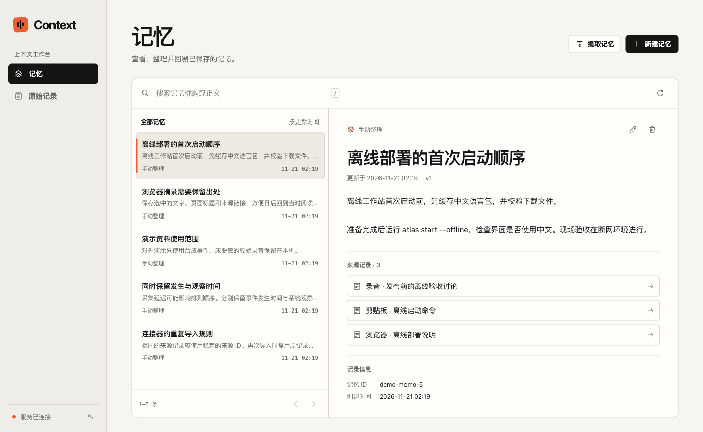

# Context Hub

Context Hub 将录音、剪贴板和其他来源的原始记录存进一个个人数据库，定期生成带出处的 Memory。用户在浏览器里管理两层数据，Codex 等 MCP 客户端通过同一个服务读取和修正记录。数据库可以放在自己的电脑或一台云主机。



## 在这台电脑上试用

需要 Python 3.10 或更高版本，以下命令从仓库根目录执行。

```sh
python3 -m venv .venv
.venv/bin/python -m pip install '.[agent]'
.venv/bin/context-hub serve
```

服务默认监听 `127.0.0.1:8741`，启动时和之后每隔 60 秒处理新增或变更的记录。保持这个终端运行，在另一个终端打开有管理权限的页面。

```sh
.venv/bin/context-hub open
```

第一次打开时资料库为空。可以从「原始记录」手工新建，也可以导入仓库自带的合成会议记录。

```sh
export HUB_OWNER_TOKEN="$(.venv/bin/context-hub token owner)"
.venv/bin/context-hub-import context-event hub/examples/recorder-decision.json
unset HUB_OWNER_TOKEN
```

在页面点击提取按钮或等待下次提取。「记忆」中会出现银杏收音笔的首版决定。点开「来源记录」中的条目可以看到原句、时间与来源定位。正确答案是第一版加入日期筛选，客户分组留到第二版。修改原文后，旧证据立即失效，再运行提取即可查看新结果。

## 接入 Codex 或其他 Agent

在仓库根目录执行以下命令，将这个 Hub 注册为 Codex 的 stdio MCP 服务，然后打开一个新会话。本机桥接进程会读取本机的 Agent 凭据。其他支持 MCP 的客户端也可把同一个可执行文件配置为 command，参数填 `mcp`。

```sh
codex mcp add context_hub -- "$PWD/.venv/bin/context-hub" mcp
```

可以用上面的合成数据连续问两件事，观察工具调用。

| 问法 | 预期读取 |
| --- | --- |
| 银杏收音笔第一版定了什么？ | `search_memory`。结果正文足以回答，保留证据 ID |
| 给我校正标签那句逐字原文和出处。 | 从 Memory 的 `evidence_ids` 选取证据，用 `get_raw` 查原文和定位符 |

MCP 提供十个工具。Raw 和 Memory 各有搜索、按 ID 读取、新建、修改与删除。服务说明引导 Agent 在缺失、矛盾、需要精确引文或用户要求核验时才读 Raw。标题、正文和来源定位符都按外部数据处理。Agent 写入同样需要相应记录的访问权限，更改或删除时还须带上读到的版本号。

## 导入自己的来源

导入器只读取明确选择的文件。复用上例的 `HUB_OWNER_TOKEN` 环境设置。下表中的路径均需替换为自己的导出路径。

| 来源 | 导入命令 | Hub 保存的内容 |
| --- | --- | --- |
| ClipContext | `context-hub-import clipcontext /path/to/clipboard.json` 或选 `Raw/manifest.json` | 单项文本、可用应用与设备上下文、来源身份和二进制表示的指纹。分块归档会校验清单 |
| Record for Agent | `context-hub-import record-for-agent /path/to/selected.zip` 或选 `export.json` | 录音段元数据、已有转写与分段、音频指纹。ZIP 可验证所附音频，独立清单只能验证元数据绑定 |
| 浏览器或其他来源 | `context-hub-import context-event /path/to/events.json` | 单个合法的 ContextEvent 或数组。支持 browser 等内建来源，以及 mail.message 等带命名空间的新来源 |

原生导出默认标为 `local_only`。如果要让 Agent 使用已选材料，先在本机界面审阅并更改可见范围，或在导入命令中明确加 `--privacy shareable`。通用 JSON 保留逐条标注。Hub 存储源文本与结构化字段，原始音频和剪贴板图片仍由生产端保存。导入是一次性快照，源应用内后续删除不会自动传播，Hub 的修改也不会写回源应用。相同内容重复导入会跳过，修改过的内容需要 `--update-existing`。浏览器目前可通过通用导入接入，扩展采集端属于后续工作。

### 自动接入 Mac 的录音投递回执

设置了 Mac 自动接收器后，可在本机 Hub 安装目录运行 `context-hub-recordings`。用接收器 LaunchAgent 中的 `--state`、`--library` 和 `--receiver-id` 填入下列参数。`--since-ms` 使用启用时的 Unix 毫秒时间；如需对过去指定的片段回补，`--selection` 接收一个包含 UUID 字符串的 JSON 数组。任选一种范围，也可组合。

```sh
context-hub-recordings --receiver-state "$receiver_state" --library "$recording_library" \
  --receiver-id "$receiver_id" --since-ms "$activation_ms" --selection "$selection_file"
```

在同一命令末尾加 `--launchd-plist` 输出 LaunchAgent。保存到 `~/Library/LaunchAgents/dev.context-hub.recording-receipts.plist` 后可用 `launchctl bootstrap "gui/$(id -u)" "$HOME/Library/LaunchAgents/dev.context-hub.recording-receipts.plist"` 启用。任务在登录后及每 60 秒运行一次，接收器路径、身份和时间界限写入作业，可恢复停机期间的收据。

每条 Raw 都需要匹配接收器提交的成功回执、Mac 录音库和已提交的导入成员。按时间接入时，录音还须在界限后首次进入该 Mac 库；重投已有的旧录音只在明确选中时回补。接收器账本标识的是接收端，无法按发送手机身份筛选。Hub 仅保存私有片段元数据及源端有无转写，不复制音频、位置或转写正文，也不由此生成内容 Memory。使用原有 Raw 身份，保留用户修改、授权范围及删除记录。

## 存储、提取与人工修订

* 每条 Raw 保留时间、来源、生产者身份、权限和原始载荷。相同的来源、connector、source_id 标识同一条证据。
* 每条 Memory 含标题、正文、来源方式、版本和一组 Raw ID。第一版提取器从材料中选取至多三句，优先决策、时间和否定等线索，并保留已知说话人。缺少转写时只使用已有元数据。规则在本机或自托管服务执行，无需模型密钥。
* 同一权限等级下，完全一致且归属兼容的材料可共享一条 Memory 并保留多个出处。用户或 Agent 也可手工把多条证据编成一条结论。语义相似但措辞不同的记录目前需要人工判断。
* 修改 Raw 会立即移除失效证据。依赖该证据的人工结论会标为待复核并对 Agent 隐藏。删除 Raw 会移除受影响的人工结论；删除 Memory 保留 Raw，并阻止下一次提取把已删内容重新生成。两个写入者同时修改时，后提交者会收到 HTTP 409。
* 删除会清除本数据库的正文、搜索文本和失效的证据关系，保留防止重新导入的身份标记。源文件、数据库备份及已被客户端下载的副本有各自的生命周期。

记录格式与 HTTP 接口见[数据契约](../schema/memory.md)和[事件 Schema](../schema/context-event.schema.json)。

## 自托管在云上

下一组命令在云主机的仓库根目录执行。一个容器和一个挂载卷对应一个用户的资料库。暴露到公网的入口应在前面终止 HTTPS，也可以只通过 SSH 隧道访问回环端口。

```sh
docker build -f hub/Dockerfile -t context-hub:local .
docker volume create context-hub-data
docker run -d --name context-hub --restart unless-stopped \
  -p 127.0.0.1:8741:8741 -v context-hub-data:/var/lib/context-hub context-hub:local
```

容器首次启动会在卷中生成独立的 owner 和 agent 凭据。用可信终端上的 `docker exec context-hub context-hub token owner` 取回管理凭据，Agent 使用 `token agent`。不要把它们写进仓库、共享链接或聊天记录。在自己的电脑执行 `ssh -L 8742:127.0.0.1:8741 your-host`，打开 `http://127.0.0.1:8742/` 并在连接面板输入云端管理凭据。直连域名时请使用 HTTPS。

对远程 MCP 桥接进程设置 `HUB_URL` 和 `HUB_AGENT_TOKEN`。导入器使用相同 URL 及 `HUB_OWNER_TOKEN`。通过隧道时可额外设置 `HUB_MODE=cloud`。云模式只接收 `shareable` 和由来源方完成脱敏的 `redacted` 资料。本机和云主机各自保存数据，应用没有双向同步或多租户功能。

本机 macOS 默认目录为 `~/Library/Application Support/Context Hub`，Linux 默认 `$XDG_DATA_HOME/context-hub` 或 `~/.local/share/context-hub`。可以用 `HUB_DATA_DIR` 覆盖。SQLite 数据库、凭据和运行卷都应留在用户选择的存储位置，备份时使用 SQLite 在线备份或先停止进程。

## 开发验证

```sh
.venv/bin/python -m pip install '.[agent,test]'
.venv/bin/python -m pytest tests -q
```

GitHub Actions 在 Linux 上运行测试、验证安装包可独立加载资源，并新建云模式容器，写入合成证据，更换容器后用 Agent 凭据从原卷读回 Memory。[验收记录](VERIFICATION.md)列出了实际操作与观察结果。

### iPhone iCloud Drive 录音进入本机 Hub

在 Mac 上选择 iPhone 已授权的同一个 iCloud 录音子库并固定库 UUID。首次启用时保存当时的片段目录名。此后可随时重跑第二条命令，它会回补明确选中的 UUID，同时核验基线之后出现且首次提交时间足够新的片段。旧目录中仅新增转写不会触发整库历史回补。

```sh
context-hub-icloud-recordings --library-root "$selected_icloud_root" --library-id "$expected_library_id" \
  --baseline "$private_baseline" --initialize-baseline
context-hub-icloud-recordings --library-root "$selected_icloud_root" --library-id "$expected_library_id" \
  --baseline "$private_baseline" --selection "$selected_ids" --request-metadata
```

在第二条命令后加 `--launchd-plist` 可生成每 60 秒执行的 macOS LaunchAgent。默认只读本机已有元数据。`--request-metadata` 允许 Foundation 仅取回库标记、当前范围内的 commit 和由 commit 指定的 manifest JSON，单次最多 64 个文件，每个最大 1 MiB。源目录存在但提交未完成、manifest 尚未可读或音频目录项缺失时，下一轮重试。已逐出的 CAF 可以由与提交字节数一致的云盘文件目录项确认，全流程读取音频与转写正文的字节数均为零。

Hub 使用 `record-for-agent.icloud` 保存 `cloud_audio_commit` 事件，包含原段 UUID、采集起止时间、音频和 manifest 摘要、转写提交标志，默认 `local_only`。其证据是该库中可验证的 commit、manifest 和音频文件目录项。iPhone 的上传确认、音频内容重验、Mac 自动接收、Agent 正文可读性均有各自独立的证据来源。已修改过或删除的事件沿用所有者的决定。


#### 让 Agent 读取选定片段的目录元数据

录音原始记录默认保留在本地。使用者可按库 UUID 和片段原始 UUID 列表授权 Agent 读取目录元数据。首次授权会核对已经入库的片段。之后运行同步时，尚未抵达的选定片段通过原库 commit、清单与音频目录项的核验后，会自动出现在 Agent 的 `search_raw` 和 `get_raw` 中。其他片段沿用原隐私设置。

```sh
context-hub-icloud-recordings --library-root "$selected_icloud_root" --library-id "$expected_library_id" \
  --selection "$selected_ids" --grant-agent-metadata --request-metadata
context-hub-icloud-recordings --library-id "$expected_library_id" \
  --selection "$selected_ids" --revoke-agent-metadata
```

Agent 视图标为 `redacted`，提供 UTC 时间、原始片段和会话 ID、顺序、采样与大小、库 ID、音频和清单的 SHA-256 及证据状态。正文固定为空。原始记录的修订和隐私等级保持由所有者管理。手动编辑或删除使该修订的目录视图立即失效。撤销仅需访问 Hub 的本地数据库。
