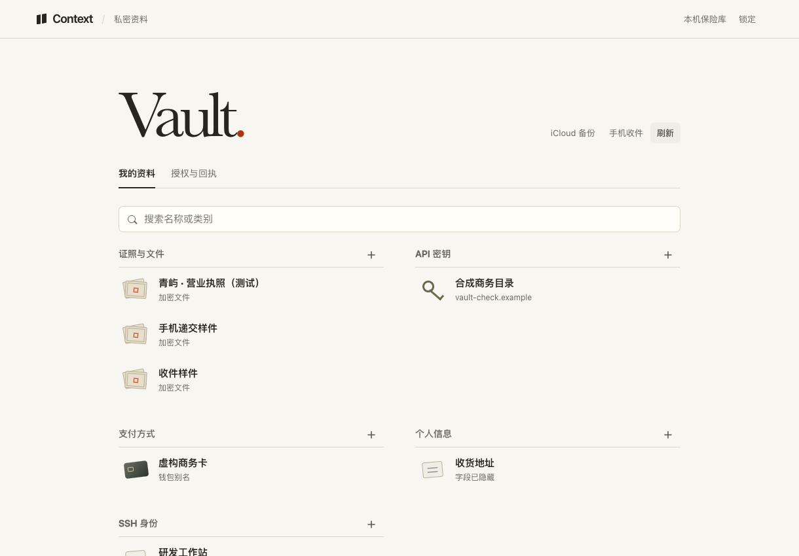

# Context Vault

这是你的私密资料库。比如要交一份学位证明，可以在 iPhone 上扫描纸本，也可以让 Codex 帮你在 Gmail 里找当年的 PDF。选中的文件进入加密收件箱。在 Mac 上确认一次，今后要交给某个接收方时，只需要核对用途、资料版本、网址并批准。Vault 可以单独使用，也可以和 Context Hub 共用。



## 在 Mac 上打开

已安装 uv 的 Mac 可以在仓库根目录运行：

```sh
vault/macos/install.command
open "$HOME/Applications/Context Vault.app"
```

第一次打开时，在本机管理页设置至少 12 个字符的主口令并妥善保存。默认数据库在 `~/Library/Application Support/Context Vault/`。应用内提供资料管理、手机收件、iCloud 设置和 Agent 授权。五分钟没有主动操作会锁定，并清空本次会话的授权与待处理请求。锁定后可再次从 Mac 启动器进入。想用命令行，独立环境在 `~/.local/share/context-vault/runtime/bin/`。

在其他安装了 Python 3.10+ 的 macOS 或 Linux 机器上，从仓库根目录运行：

```sh
python3 -m venv .venv
.venv/bin/pip install './vault[agent]'
.venv/bin/context-vault launch
```

`serve` 可以在前台运行，`open` 打开已运行服务的管理页。管理令牌通过本机页面的 URL 片段传入，页面读取后即清除。再次刷新页面时可以从启动器重新打开。同一用户的操作系统账户、浏览器与运行服务的机器处在信任边界内。

## 资料怎么进来

| 手头的资料 | 入口 | 留在 Vault 的内容 |
| --- | --- | --- |
| 纸质身份证、执照、学位证、工资证明 | iPhone 选择类别，连续拍多页，核对后导出到 iCloud 收件夹 | 加密包确认入库后得到一份 PDF |
| 手机或电脑中已有的电子版 | iPhone 从“文件”选择，Mac 可以直接上传，也可以让发现 Skill 帮忙列候选 | 选中的原文件、名称与类型 |
| Gmail、单封导出的邮件 | 限定检索范围，从候选附件中选一份 | 确认选择的附件。同一类型、同一内容重复导入复用原记录 |
| API Key | Skill 找出选定项目中的凭据变量名，在管理页手输密钥，或自行选择本地 .env 文件，再选要保存的一项 | 加密保存的值、自己取的别名、可选的固定 HTTPS 接收地址 |
| SSH 登录方式 | 为 Skill 指定 OpenSSH 配置并选择 Host 别名，也可在管理页登记公钥指纹 | Host 别名或公钥指纹；实际认证沿用原来的 SSH 密钥与配置 |
| 手机号、地址、证件号、支付方式 | 在管理页创建个人信息或钱包引用 | 个人信息字段，或钱包提供方及自定义别名。支付项只接受钱包引用，当前没有付款操作 |

**手机配对。** Mac 上点「手机收件」，将公开配对码填入 iPhone App，核对两端相同的指纹。手机以收件公钥封装文档，资料标题和字节一起加密，文件名随机。选择系统「文件」里的 iCloud Drive → Context Vault → Inbox；Mac 端启用 iCloud 后会显示待确认项。也可直接把加密包传到 Mac，再手动导入。手机端目前负责拍摄和投递，资料管理与授权在 Mac 上完成。真机安装需自己的 Apple 开发签名。[iPhone 工程、操作与验证](ios/README.md)

**邮箱与本地发现。** 将本项目的发现 Skill 安装到 Codex 项目，并让它使用本地 CLI。可以对 Codex 说「在我选的文件夹和过去一年的 Gmail PDF 附件里找学位证、工资证明，给我候选清单」。候选项含名称、来源、引用 ID。确认选项后，CLI 直接加密投递。项目的 Gmail Desktop OAuth 配对步骤、Keychain 凭据和权限见 Skill。Google 的只读权限覆盖邮箱，工具按输入的查询范围工作，API 在枚举时只返回附件元数据。当前还支持本机选择的 .eml。[发现 Skill](skills/context-vault-discovery/SKILL.md) · [Google Gmail scopes](https://developers.google.com/workspace/gmail/api/auth/scopes)

```sh
context-vault-discover gmail-connect --client "/path/to/desktop-client.json"
context-vault-discover gmail --query 'has:attachment filename:pdf newer_than:1y' --limit 20
context-vault-discover files --root "/path/to/selected/folder" --match "学位"
context-vault-discover ssh --config "$HOME/.ssh/config"
```

独立安装器把配套 Skill 安装进 Python 环境下的 `share/context-vault/skills/context-vault-discovery`。为当前 Codex 项目在 `.agents/skills/` 链接该目录，并让 `context-vault-discover` 位于 PATH。首次连接真实邮箱时，由用户在 Google 的浏览器授权页选择账户。

## iCloud、自托管和恢复

「iCloud 备份」内的自动开关会把每台 Mac 的最新加密副本写到用户自己的 `iCloud Drive/Context Vault/Devices/<device>/latest.cvault`，并启用手机收件。页面显示最近一次**本机写入**时间，macOS 文件提供方另行报告正在上传、上传成功、网络不可用或空间不足。手动快照使用独立的时间戳文件名，适合在大批修改资料之前保存。各台设备分别写自己的文件，当前支持换机恢复，多台 Mac 同时编辑后的合并尚待实现。Apple 的标准数据保护与高级数据保护有不同的服务端密钥策略；两种设置下，Vault 都在写入文件前自行加密。[Apple iCloud 数据安全说明](https://support.apple.com/en-us/102651)

```sh
context-vault backup --folder "/path/to/private-backups"
context-vault --data-dir "/path/to/new/empty-vault" restore "/path/to/snapshot.cvault"
```

恢复时输入原主口令，手机收件私钥随保险库恢复。丢失主口令且无可用已解锁设备时，当前没有找回机制。删除本机条目后，旧备份、iCloud 收件源文件与原始电子邮件仍需在各自位置管理。当前上限为单附件 8 MiB、整个密文库 64 MiB、2,000 条资料。

私有服务器可运行独立容器。挂载持久卷，把端口仅发布到服务器回环地址。在自己的电脑上用 SSH 端口转发访问；主口令会在运行 Vault 的那台受信主机上解锁数据库。

```sh
docker build -t context-vault vault
docker run -d --name context-vault --restart unless-stopped \
  -p 127.0.0.1:8743:8743 -v context-vault-data:/vault context-vault
```

## Agent 使用、授权与 Context Hub

Codex 项目的 `.codex/config.toml` 示例，路径改成自己的安装路径：

```toml
[mcp_servers.context_vault]
command = "/absolute/path/to/runtime/bin/context-vault"
args = ["mcp"]
```

只有配置了接收地址的密钥、文件和个人信息会出现在 Agent 可见的别名列表中。每次使用都要发起请求，所有者界面显示资料版本、用途、操作和接收地址。批准仅能使用一次，整个请求窗口为五分钟。修改资料会使旧版本授权失效。当前支持向预设地址做 Bearer GET、原文件 POST 或纯文本字段 POST。目的地址锁定为公开 HTTPS 端点，服务校验证书，忽略重定向。返回给 Agent 的是操作状态；业务响应正文、资料原件和凭据均留在这条直接交付通道之外。接口调用失败可能已触达接收方，由用户决定是否重新申请。

Hub 是可选的。需要留痕时，在管理页主动分享已执行的回执。进入 Hub 的事件只有操作类别、结果、时间和随机关联 ID。资料名、原文、密钥、目的地址、用途均留在 Vault。可用 `CONTEXT_VAULT_HUB_URL` 和 `CONTEXT_VAULT_HUB_AGENT_TOKEN` 指向自建 Hub。默认支持这台电脑上的 Context Hub。

## 加密、测试与订阅方向

磁盘格式使用 Scrypt 派生密钥（N=131072、r=8、p=1）和 AES-256-GCM。每次改写使用新 nonce，原子替换密文；名称和内容一起加密。手机使用 CryptoKit 的 RFC 9180 HPKE，P-256/HKDF-SHA256/AES-256-GCM。接收公钥可用于投递，开库和确认入库均由所有者完成。[Swift 发送端](ios/ContextVaultCapture/Transfer.swift) · [Python 收件端](context_vault/intake.py) · [RFC 9180](https://www.rfc-editor.org/rfc/rfc9180.html)

在仓库根安装两个包的 test/agent 扩展以及 Vault 的 gmail 扩展，运行 `python -m pytest tests vault/tests -q`。macOS 还可以运行 `python vault/ios/Tests/verify_transfer.py` 校验真实 Swift 与 Python 实现互通。测试使用合成文件和本地服务。适配层支持 Gmail 的只读搜索、令牌刷新和附件请求，日常开发不需要授权真实邮箱。[持续集成](../.github/workflows/context-vault.yml)

**订阅可以卖什么。** 本地版与自有 iCloud 已能覆盖个人采集和备份。托管版值得验证的付费需求是跨平台密文同步、按时间找回误删版本，以及设备丢失后的撤权。承诺面向公众保管高敏资料前，需要实现客户端持钥的多设备协议、可信新设备加入、恢复流程和独立安全审计。现有私有服务器部署需要信任服务器管理员。托管订阅、计费和公众云服务尚未上线。
