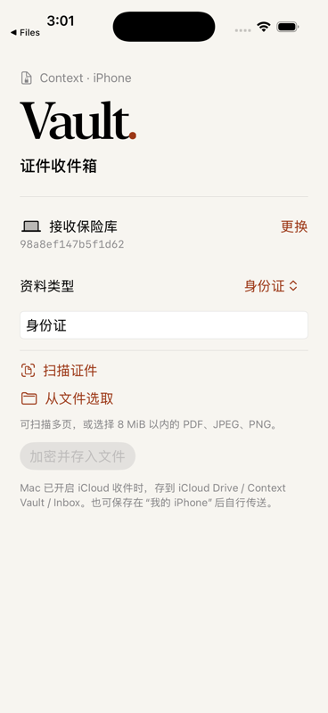

# Context Vault for iPhone

iPhone 将扫描件或选中的 PDF、JPEG、PNG 加密给一台已配对的 Vault。可以用“文件”里的 iCloud Drive 传输，或选“我的 iPhone”后自己传送。发送端只持有接收方公钥。



## 配对与收件

1. 在 Mac 上打开已解锁的 Context Vault，获取手机配对码。
2. 在 iPhone 的 Context Vault 粘贴 `CV1.` 开头的码，和 Mac 核对显示的 16 位十六进制指纹，点“保存配对”。换保险库时同样核对指纹。
3. 选择资料类型，需要时修改名称。点“扫描证件”可连续扫最多 16 页并生成 PDF。也可以从“文件”中选择 PDF、JPEG 或 PNG。每件上限 8 MiB。
4. 点“加密并存入文件”。在系统文件窗口保存 `.cvdrop`，若 Mac 已启用 iCloud 收件，选 iCloud Drive / Context Vault / Inbox。其他目录中的文件也可手动选择导入。文件名使用随机标识，资料名称和内容都在加密包内。取消导出可继续使用当前选择。
5. 在接收 Mac 上等待文件下载，然后通过 Vault 的手机收件功能导入。相同资料内容重复导入会复用已有记录。

手机本地的应用设置只保存接收公钥。证件原始字节仅在本应用的当前进程中处理，成功导出后清除内存中的选件。系统文件提供方原有的文档仍由其管理。手机不持有用于解密历史资料的保险库私钥。配对公钥标识收件方。任何持有公钥的人都能生成加密包，接收方需核对收到的包。

## 构建及验证

用 Xcode 打开 `ContextVaultCapture.xcodeproj`，选择共享方案 `ContextVaultCapture`。支持 iOS 17 及以上。真机运行需选择自己的开发团队并允许摄像头。选择 iCloud Drive 使用系统文档选择器，无需本项目的专属 CloudKit 容器。

本机安装 Vault 的 Python 包后，可在 macOS 14 及以上、装有 Swift 工具链的电脑上运行下面的验证。它编译 App 使用的 Swift 加密代码，以临时合成 PDF 生成两个独立加密包，用真实 Python Vault 接收，并检查重复、篡改和错误接收方。

```sh
python ios/Tests/verify_transfer.py
```

在 iPhone 模拟器上，Xcode 的 Test 动作还会验证配对、资料类型切换与重启后公钥保留。如需验证系统“文件”选择器，在已启动的专用英文 iPhone 模拟器上运行以下命令。该测试会替换模拟器中保存的配对公钥，通过系统文件窗口选中一张临时合成 PNG、取消后重新导出，再在 Mac 上解密并核对原始字节。

```sh
python ios/Tests/verify_files.py <模拟器-UDID>
```

硬件扫描和两台设备之间的 Apple ID 同步需两端真机分别验收。
